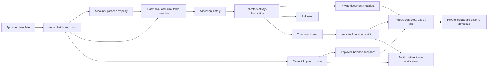

# DebtOps — PostgreSQL and Laravel Data Architecture Blueprint

**Confirmed scope update — 16 October 2026.** The user's confirmed DebtOps requirements take precedence over the earlier DRMS parity baseline. **C** means confirmed DebtOps capability; **P** denotes an implementation choice within that scope; **O/U** continue to describe only observed/unverified DRMS behaviour. Missing DRMS evidence does not defer Customer Management, automated column mapping, Rider workflows, attendance, Call Centre, email or WhatsApp. Provider selection, template wording and business policy values remain configuration/implementation decisions, not omitted features. See the Feature Coverage Matrix in Plan.md.

Terminology: **Customer** is the UI/business term for the existing party record in **debtors** (Eloquent **Debtor**); **Rider** is collection staff in **staff**, linked one-to-one to **users**. **Client** remains the commissioning company. Retain these existing physical names and models: do not add parallel customers/customer_contacts/customer_addresses/rider_profiles/task_assignments/attachments/task_verifications tables for the same facts.

InteXcode (IXC) · 16 October 2026 · Proposed normalized schema derived from observed DRMS fields and workflows.

## Evidence, readiness and naming

This is the expanded confirmed DebtOps design, not a reverse-engineered DRMS schema. E01–E24 and G01–G08 remain reference evidence/follow-ups. C defines required product behaviour; table/constraint choices are P. Legacy template/data semantics need fixtures, while attendance policy values, template wording and provider enablement are release configuration gates. The absence of a DRMS feature does not block implementing confirmed attendance, mapping, Customer Management or communications.

PostgreSQL database with UTF-8; snake_case plural tables, singular snake_case foreign keys, PascalCase Eloquent models. Avoid naming SQL tables simply assignments because batch and collector allocation have distinct lifecycles. Recommended baseline is one IXC operating organization with multiple client namespaces. Full SaaS tenancy/branch security requires a separate design; a client_id by itself is not a complete authorization model.

### Universal column contract

Every business table below includes these columns unless its section explicitly says otherwise. A per-table column declaration overrides the common declaration, never duplicates it. This convention supplies column type/null/default/PK details for every table without repeating boilerplate.

| Column | PostgreSQL type | Required | Default | Key / index | Meaning |
|---|---|---|---|---|---|
| id | bigint GENERATED BY DEFAULT AS IDENTITY | Yes | identity | PK | Efficient internal joins; use Laravel bigIncrements/identity migration consistently. |
| public_id | uuid | Yes | application UUID v7 | UNIQUE | Unpredictable route/export reference; still require authorization. |
| created_at | timestamptz | Yes | now() | Per-query index only | Creation instant. |
| updated_at | timestamptz | Yes | now() | Per-query index only | Eloquent updates explicitly; default alone does not auto-update. |

Spatie pivots: no id/public_id/timestamps; composite PK as documented. Spatie roles/permissions: package id and timestamps, **no public_id** unless extending published migration intentionally. notifications: UUID id generated by Laravel, no public_id, Laravel timestamps. audit_logs: bigint id/public_id/created_at only; no mutable updated_at. Immutable snapshots/reviews may retain created_at/updated_at for Laravel conventions but reject business updates. Existing records are corrected by append/supersede.

### Architecture conventions

- Foreign keys are signed PostgreSQL bigint matching PKs; indexed explicitly. RESTRICT deletion of financial/history parents; cascade only disposable pivots/staging children under approved retention; SET NULL only for optional provenance when retaining the parent is not possible. Default here is RESTRICT, so no hidden cascade data loss.
- Optional means SQL NULL, default NULL. Em dash means no default: caller must supply a value. All lengths shown are maxima; text is unbounded at DB level but application validators impose approved field limits. A display field is never trusted as an identifier.
- Use UTC timestamptz instants, local date for assignment/balance dates, ISO 8601 in interchange; display Asia/Kuala_Lumpur by default. Exact numeric(18,2) amounts, char(3) ISO currency. Source identifiers/postcodes/phones are strings. No binary floats for money.
- Use bigint for internal keys plus UUID v7 public keys. This keeps Spatie and Laravel conventional joins simple. UUID-only keys are possible but require consistent package pivot/morph changes; do not mix without deliberate migration.
- Only documents have generic soft-delete by default. Staff/accounts disable; batches archive; tasks cancel with history. Ordinary soft deletion must not make accounts available for duplicate reuse. Use partial uniqueness only where explicitly intended.
- JSONB is for configuration, redacted audit and non-PII extensions. Sensitive source payloads are encrypted text because Laravel encrypted casts are not queryable JSONB. Searchable PII uses approved HMAC blind indexes; equality only. Never use a plain unsalted hash for guessable identifiers.
- Reference codes use lookup rows. Work/queue/review states are bounded varchar with CHECK and PHP backed enums for stable application state machines, not PostgreSQL ENUMs that complicate deployments. See lookup plan below.
- Each cross-client relationship is checked by a transaction service and a DB constraint trigger, or use composite unique(id,client_id) + composite FKs where client_id is carried. Do not rely on the browser to select matching clients. Trigger specifications are mandatory migration work, not optional application convention.

## Entity and model catalogue

Debtors represent parties; owner, tenant, billing customer and occupier are account roles rather than separate duplicated people. A debt account can recur in multiple batches. An assignment batch has tasks; each task has allocation history, source snapshot, activities, observations, reviews and evidence. Financial updates append snapshots and do not imply cash received. No debt_cases table is needed merely to rename tasks; a future legal-case lifecycle would justify one. Customer uses debtors, Rider uses staff + users; manual tasks now have nullable source IWK ID and explicit customer/origin/priority/planned/due fields. No payment_transactions/payment_methods or full promises_to_pay repayment tables are introduced: the confirmed Promise to Pay call outcome and follow-up use existing activity/communication history.

| Table | Eloquent model | Module | Evidence basis |
|---|---|---|---|
| users | User | M01/M12 | E01/E03/E21; authentication structure P |
| staff | Staff | M10 | E17/E18 |
| roles | Role (Spatie) | M12 | P; observed position labels are not roles |
| permissions | Permission (Spatie) | M12 | P |
| role_has_permissions | package pivot | M12 | P |
| model_has_roles | package polymorphic pivot | M12 | P |
| model_has_permissions | package polymorphic pivot | M12 | P |
| reference_values | ReferenceValue | M03/M06/M10/M12 | E09/E14/E18; lookup structure P |
| clients | Client | M03/M06 | E14 client company; management UI P |
| assignment_batches | AssignmentBatch | M03 | E09 |
| properties | Property | M06 | E14 property fields |
| debtors | Debtor | M06 | E14 owners/tenant/contact fields; normalized party P |
| contacts | Contact | M06 | E14 customer/owner/tenant phone/email/fax |
| addresses | Address | M06 | E14 mailing names/address lines |
| debt_accounts | DebtAccount | M06/M08 | E14 SAN/sewacc, client, property and billing |
| account_parties | AccountParty | M06 | E14 owner1/owner2/tenant/occupier; relation P |
| import_templates | ImportTemplate | M04/M11/M12 | E11/E20 template instruction; version structure P |
| import_batches | ImportBatch | M04/M08/M11 | E11/E20; staging P |
| import_rows | ImportRow | M04/M08/M11 | P supporting observed import capability |
| tasks | Task | M03/M05/M06/M07 | E10/E14 |
| task_allocations | TaskAllocation | M05 | E12/E14; historical structure P |
| collection_activities | CollectionActivity | M06 | E14 visit/agent/counts and E16 TPS; event history P |
| property_inspections | PropertyInspection | M06 | E14 Vacant and recovery outcome fields |
| task_observations | TaskObservation | M06 | E14 field groups; structured versioning P |
| follow_ups | FollowUp | M06 | E14 upDateReminder/count; scheduling P |
| task_reviews | TaskReview | M07 | E15 populated listing/E14 controls; independent decisions P |
| financial_updates | FinancialUpdate | M08 | E11 Payment Update; review P |
| financial_snapshots | FinancialSnapshot | M08 | E14 monetary fields |
| documents | Document | M04/M06/M09/M01 | E14 photos/E16 categories/E21 avatar; metadata P |
| export_jobs | ExportJob | M09 | E16 export controls; async structure P |
| bulk_operations | BulkOperation | M05 | E12/E13 controls; durable job P |
| bulk_operation_items | BulkOperationItem | M05 | P |
| databank_sources | DatabankSource | M11 | E20; source contract U/P |
| databank_records | DatabankRecord | M11 | E20 empty result only; schema provisional |
| databank_search_tokens | DatabankSearchToken | M11 | P pending G05 search keys |
| notifications | DatabaseNotification (Laravel) | M12 | E23 bell shell; centre P |
| audit_logs | AuditLog | M01–M12 | P; no audit UI observed |
| system_settings | SystemSetting | M12 | P |
| outbox_events | OutboxEvent | M04/M05/M09/M12 | P |
| processed_events | ProcessedEvent | M12 | P |
| user_client_scopes | UserClientScope | M01/M12 | P implementing record-level authorization |
| customer_categories | CustomerCategory | M13 | C; P implementation |
| customer_category_assignments | CustomerCategoryAssignment | M13 | C; P implementation |
| import_fields | ImportField | M04 | C; P implementation |
| column_aliases | ColumnAlias | M04 | C; P implementation |
| import_mapping_profiles | ImportMappingProfile | M04 | C; P implementation |
| import_column_mappings | ImportColumnMapping | M04 | C; P implementation |
| task_status_histories | TaskStatusHistory | M05/M06/M07 | C; P implementation |
| task_submissions | TaskSubmission | M06/M07 | C; P implementation |
| task_submission_documents | TaskSubmissionDocument | M06/M07 | C; P implementation |
| attendance_policies | AttendancePolicy | M10 | C; P implementation |
| attendance_schedules | AttendanceSchedule | M10 | C; P implementation |
| attendances | Attendance | M10 | C; P implementation |
| attendance_adjustments | AttendanceAdjustment | M10 | C; P implementation |
| integration_accounts | IntegrationAccount | M14/M12 | C; P implementation |
| communication_templates | CommunicationTemplate | M14 | C; P implementation |
| communication_batches | CommunicationBatch | M14 | C; P implementation |
| conversations | Conversation | M14 | C; P implementation |
| communications | Communication | M14/M11/M13 | C; P implementation |
| communication_attempts | CommunicationAttempt | M14 | C; P implementation |
| integration_events | IntegrationEvent | M14 | C; P implementation |
| communication_events | CommunicationEvent | M14 | C; P implementation |
| communication_preferences | CommunicationPreference | M14/M13 | C; P implementation |
| communication_quota_reservations | CommunicationQuotaReservation | M14 | C; P implementation |
| call_permissions | CallPermission | M14 | C; P implementation |
| voice_sessions | VoiceSession | M14 | C; P implementation |

## Complete proposed business ERD

The ERD covers all original and confirmed-scope business tables. Logical morph links lack conventional target FKs; code references use category+code composite FKs. All table definitions remain the authoritative column/constraint specification.

```mermaid
erDiagram
    USERS {
        bigint id PK
    }
    STAFF {
        bigint id PK
    }
    ROLES {
        bigint id PK
    }
    PERMISSIONS {
        bigint id PK
    }
    ROLE_HAS_PERMISSIONS {
        string composite_key PK
    }
    MODEL_HAS_ROLES {
        string composite_key PK
    }
    MODEL_HAS_PERMISSIONS {
        string composite_key PK
    }
    REFERENCE_VALUES {
        bigint id PK
    }
    CLIENTS {
        bigint id PK
    }
    ASSIGNMENT_BATCHES {
        bigint id PK
    }
    PROPERTIES {
        bigint id PK
    }
    DEBTORS {
        bigint id PK
    }
    CONTACTS {
        bigint id PK
    }
    ADDRESSES {
        bigint id PK
    }
    DEBT_ACCOUNTS {
        bigint id PK
    }
    ACCOUNT_PARTIES {
        bigint id PK
    }
    IMPORT_TEMPLATES {
        bigint id PK
    }
    IMPORT_BATCHES {
        bigint id PK
    }
    IMPORT_ROWS {
        bigint id PK
    }
    TASKS {
        bigint id PK
    }
    TASK_ALLOCATIONS {
        bigint id PK
    }
    COLLECTION_ACTIVITIES {
        bigint id PK
    }
    PROPERTY_INSPECTIONS {
        bigint id PK
    }
    TASK_OBSERVATIONS {
        bigint id PK
    }
    FOLLOW_UPS {
        bigint id PK
    }
    TASK_REVIEWS {
        bigint id PK
    }
    FINANCIAL_UPDATES {
        bigint id PK
    }
    FINANCIAL_SNAPSHOTS {
        bigint id PK
    }
    DOCUMENTS {
        bigint id PK
    }
    EXPORT_JOBS {
        bigint id PK
    }
    BULK_OPERATIONS {
        bigint id PK
    }
    BULK_OPERATION_ITEMS {
        bigint id PK
    }
    DATABANK_SOURCES {
        bigint id PK
    }
    DATABANK_RECORDS {
        bigint id PK
    }
    DATABANK_SEARCH_TOKENS {
        bigint id PK
    }
    NOTIFICATIONS {
        uuid id PK
    }
    AUDIT_LOGS {
        bigint id PK
    }
    SYSTEM_SETTINGS {
        bigint id PK
    }
    OUTBOX_EVENTS {
        bigint id PK
    }
    PROCESSED_EVENTS {
        bigint id PK
    }
    USER_CLIENT_SCOPES {
        bigint id PK
    }
    CUSTOMER_CATEGORIES {
        bigint id PK
    }
    CUSTOMER_CATEGORY_ASSIGNMENTS {
        bigint id PK
    }
    IMPORT_FIELDS {
        bigint id PK
    }
    COLUMN_ALIASES {
        bigint id PK
    }
    IMPORT_MAPPING_PROFILES {
        bigint id PK
    }
    IMPORT_COLUMN_MAPPINGS {
        bigint id PK
    }
    TASK_STATUS_HISTORIES {
        bigint id PK
    }
    TASK_SUBMISSIONS {
        bigint id PK
    }
    TASK_SUBMISSION_DOCUMENTS {
        bigint id PK
    }
    ATTENDANCE_POLICIES {
        bigint id PK
    }
    ATTENDANCE_SCHEDULES {
        bigint id PK
    }
    ATTENDANCES {
        bigint id PK
    }
    ATTENDANCE_ADJUSTMENTS {
        bigint id PK
    }
    INTEGRATION_ACCOUNTS {
        bigint id PK
    }
    COMMUNICATION_TEMPLATES {
        bigint id PK
    }
    COMMUNICATION_BATCHES {
        bigint id PK
    }
    CONVERSATIONS {
        bigint id PK
    }
    COMMUNICATIONS {
        bigint id PK
    }
    COMMUNICATION_ATTEMPTS {
        bigint id PK
    }
    INTEGRATION_EVENTS {
        bigint id PK
    }
    COMMUNICATION_EVENTS {
        bigint id PK
    }
    COMMUNICATION_PREFERENCES {
        bigint id PK
    }
    COMMUNICATION_QUOTA_RESERVATIONS {
        bigint id PK
    }
    CALL_PERMISSIONS {
        bigint id PK
    }
    VOICE_SESSIONS {
        bigint id PK
    }
    USERS ||--o{ MODEL_HAS_ROLES : "logical morph"
    USERS ||--o{ MODEL_HAS_PERMISSIONS : "logical morph"
    USERS ||--o{ NOTIFICATIONS : "recipient morph"
    TASKS ||--o{ DOCUMENTS : "logical owner morph"
    COLLECTION_ACTIVITIES ||--o{ DOCUMENTS : "logical owner morph"
    IMPORT_BATCHES ||--o{ DOCUMENTS : "logical owner morph"
    EXPORT_JOBS ||--o{ DOCUMENTS : "logical owner morph"
    USERS ||--o{ DOCUMENTS : "logical owner morph"
    COMMUNICATIONS ||--o{ DOCUMENTS : "logical owner morph"
```

## Table: users

- **Purpose / description:** Login principal, distinct from staff and debtor.
- **Module / evidence:** M01/M12; E01/E03/E21; authentication structure P. Physical design P.
- **Model:** User.
- **Primary key / common columns:** Universal bigint id, public UUID and timestamps above.

| Column | PostgreSQL type / length | Required | Default | Key / relationship | Description / validation meaning |
|---|---|---|---|---|---|
| staff_id | bigint | No | NULL | FK → staff.id; indexed | Optional unique staff link |
| name | varchar(160) | Yes | — | See constraints below | Login display name |
| email | varchar(254) | Yes | — | See constraints below | Canonical case-normalized login email |
| email_verified_at | timestamptz | No | NULL | See constraints below | Verified email time |
| password | varchar(255) | Yes | — | See constraints below | Framework password hash only |
| remember_token | varchar(100) | No | NULL | See constraints below | Framework remember token |
| status | varchar(24) | Yes | 'invited' | See constraints below | invited/active/disabled/locked |
| last_login_at | timestamptz | No | NULL | See constraints below | Last successful sign-in |

**Constraints, indexes, validation, relationships and remarks:** Unique lower(email) and staff_id when non-null. Eloquent User belongsTo Staff; Staff hasOne User. Block sign-in for disabled staff/account. Never serialize password/remember_token. Users may be provisioned after staff; bootstrap admin may have null staff.

## Table: staff

- **Purpose / description:** Employment identity and allocation eligibility.
- **Module / evidence:** M10; E17/E18. Physical design P.
- **Model:** Staff.
- **Primary key / common columns:** Universal bigint id, public UUID and timestamps above.

| Column | PostgreSQL type / length | Required | Default | Key / relationship | Description / validation meaning |
|---|---|---|---|---|---|
| staff_no | varchar(50) | Yes | — | See constraints below | IWK staff number, stored as text |
| first_name | varchar(100) | Yes | — | See constraints below | Given/display first name |
| last_name | varchar(100) | No | NULL | See constraints below | Family name |
| email | varchar(254) | No | NULL | See constraints below | Employment contact email |
| gender_category | varchar(50) | Yes | 'gender' | See constraints below | Fixed lookup category; CHECK gender_category='gender' |
| gender_code | varchar(24) | No | NULL | Composite FK (gender_category,gender_code) → reference_values(category,code); indexed | Approved gender code, original options Male/Female |
| position_category | varchar(50) | Yes | 'position' | See constraints below | Fixed lookup category; CHECK position_category='position' |
| position_code | varchar(32) | Yes | — | Composite FK (position_category,position_code) → reference_values(category,code); indexed | Observed position code; not permission role |
| appointment_date | date | No | NULL | See constraints below | Employment appointment date |
| phone_ciphertext | text | No | NULL | See constraints below | Encrypted work/mobile telephone |
| home_phone_ciphertext | text | No | NULL | See constraints below | Encrypted home telephone |
| address_ciphertext | text | No | NULL | See constraints below | Encrypted staff address |
| is_active | boolean | Yes | true | See constraints below | Active/Unactive normalization |
| is_rider | boolean | Yes | false | Index with is_active | Collection staff eligibility; independent from Spatie role grants |

**Constraints, indexes, validation, relationships and remarks:** Unique staff_no. Index (is_active,position_code). Position/gender FK to reference_values by composite (category,code) using explicit category columns added with references. Deactivate, never delete referenced collectors. Email format and position required at application layer.

**Confirmed-scope constraints / relationships:** Rider Profile is this staff row linked to users.staff_id, not a separate rider_profiles table. Existing employment/contact fields retained. Eligible active Rider required for new allocation.

## Table: roles

- **Purpose / description:** Permission role definitions.
- **Module / evidence:** M12; P; observed position labels are not roles. Physical design P.
- **Model:** Role (Spatie).
- **Primary key / common columns:** Package bigint id, created_at, updated_at; no public_id.

| Column | PostgreSQL type / length | Required | Default | Key / relationship | Description / validation meaning |
|---|---|---|---|---|---|
| name | varchar(125) | Yes | — | See constraints below | Role name |
| guard_name | varchar(125) | Yes | 'web' | See constraints below | Laravel guard |

**Constraints, indexes, validation, relationships and remarks:** Use published Spatie migrations/models as authoritative after version lock; unique(name,guard_name). Role belongsToMany Permission via role_has_permissions.

## Table: permissions

- **Purpose / description:** Named action permissions.
- **Module / evidence:** M12; P. Physical design P.
- **Model:** Permission (Spatie).
- **Primary key / common columns:** Package bigint id, created_at, updated_at; no public_id.

| Column | PostgreSQL type / length | Required | Default | Key / relationship | Description / validation meaning |
|---|---|---|---|---|---|
| name | varchar(125) | Yes | — | See constraints below | Action permission |
| guard_name | varchar(125) | Yes | 'web' | See constraints below | Laravel guard |

**Constraints, indexes, validation, relationships and remarks:** Unique(name,guard_name). Permission belongsToMany Role. Reference policies for record scope.

## Table: role_has_permissions

- **Purpose / description:** Role-to-permission grants.
- **Module / evidence:** M12; P. Physical design P.
- **Model:** package pivot.
- **Primary key / common columns:** Composite key specified below; no universal columns.

| Column | PostgreSQL type / length | Required | Default | Key / relationship | Description / validation meaning |
|---|---|---|---|---|---|
| role_id | bigint | Yes | — | FK → roles.id; indexed | Role |
| permission_id | bigint | Yes | — | FK → permissions.id; indexed | Permission |

**Constraints, indexes, validation, relationships and remarks:** Composite PK(permission_id,role_id); no synthetic id/timestamps. Cascade pivot rows only on authorized role/permission removal.

## Table: model_has_roles

- **Purpose / description:** Role grants to users.
- **Module / evidence:** M12; P. Physical design P.
- **Model:** package polymorphic pivot.
- **Primary key / common columns:** Composite key specified below; no universal columns.

| Column | PostgreSQL type / length | Required | Default | Key / relationship | Description / validation meaning |
|---|---|---|---|---|---|
| role_id | bigint | Yes | — | FK → roles.id; indexed | Role |
| model_type | varchar(125) | Yes | 'user' | See constraints below | Explicit morph alias |
| model_id | bigint | Yes | — | See constraints below | User primary key when model_type=user |

**Constraints, indexes, validation, relationships and remarks:** Composite PK(role_id,model_id,model_type); index(model_id,model_type). Package model morph mapping configured; application restricts to User. Polymorphic target has no normal FK; transactional grant service validates User existence.

## Table: model_has_permissions

- **Purpose / description:** Exceptional direct user grants.
- **Module / evidence:** M12; P. Physical design P.
- **Model:** package polymorphic pivot.
- **Primary key / common columns:** Composite key specified below; no universal columns.

| Column | PostgreSQL type / length | Required | Default | Key / relationship | Description / validation meaning |
|---|---|---|---|---|---|
| permission_id | bigint | Yes | — | FK → permissions.id; indexed | Permission |
| model_type | varchar(125) | Yes | 'user' | See constraints below | Explicit morph alias |
| model_id | bigint | Yes | — | See constraints below | User target |

**Constraints, indexes, validation, relationships and remarks:** Composite PK(permission_id,model_id,model_type); index(model_id,model_type). Prefer role grants; direct grants require reason/audit. Package pivots have no timestamps.

## Table: reference_values

- **Purpose / description:** Versionable configurable codes and labels.
- **Module / evidence:** M03/M06/M10/M12; E09/E14/E18; lookup structure P. Physical design P.
- **Model:** ReferenceValue.
- **Primary key / common columns:** Universal bigint id, public UUID and timestamps above.

| Column | PostgreSQL type / length | Required | Default | Key / relationship | Description / validation meaning |
|---|---|---|---|---|---|
| category | varchar(50) | Yes | — | See constraints below | assignment_type/state/position/activity_type/etc |
| code | varchar(64) | Yes | — | See constraints below | Stable code within category |
| label | varchar(160) | Yes | — | See constraints below | Displayed label |
| is_active | boolean | Yes | true | See constraints below | Selectable for new work |
| sort_order | integer | Yes | 0 | See constraints below | Display order |
| metadata | jsonb | Yes | '{}' | See constraints below | Versioned supporting metadata, no secrets |

**Constraints, indexes, validation, relationships and remarks:** Unique(category,code). Referencing tables use explicit category column with fixed CHECK plus code composite FK, or a validated category-specific relation. Do not use unconstrained arbitrary code values. Deactivate referenced values; labels may change without changing code.

## Table: clients

- **Purpose / description:** Commissioning company/account namespace.
- **Module / evidence:** M03/M06; E14 client company; management UI P. Physical design P.
- **Model:** Client.
- **Primary key / common columns:** Universal bigint id, public UUID and timestamps above.

| Column | PostgreSQL type / length | Required | Default | Key / relationship | Description / validation meaning |
|---|---|---|---|---|---|
| code | varchar(50) | Yes | — | See constraints below | Stable client key |
| name | varchar(200) | Yes | — | See constraints below | Client organization name |
| is_active | boolean | Yes | true | See constraints below | Availability for new work |
| default_currency | char(3) | Yes | 'MYR' | See constraints below | Default reporting currency |

**Constraints, indexes, validation, relationships and remarks:** Unique code; index is_active. Client hasMany assignments/debtAccounts. One observed company does not establish multi-client management in DRMS; normalization P supports future client separation.

## Table: assignment_batches

- **Purpose / description:** Work package metadata and scheduling.
- **Module / evidence:** M03; E09. Physical design P.
- **Model:** AssignmentBatch.
- **Primary key / common columns:** Universal bigint id, public UUID and timestamps above.

| Column | PostgreSQL type / length | Required | Default | Key / relationship | Description / validation meaning |
|---|---|---|---|---|---|
| client_id | bigint | Yes | — | FK → clients.id; indexed | Commissioning client |
| external_reference | varchar(100) | No | NULL | See constraints below | Client-supplied batch identifier |
| name | varchar(200) | Yes | — | See constraints below | Assignment name |
| type_category | varchar(50) | Yes | 'assignment_type' | See constraints below | Fixed lookup category; CHECK type_category='assignment_type' |
| type_code | varchar(64) | Yes | — | Composite FK (type_category,type_code) → reference_values(category,code); indexed | Seven approved assignment types |
| start_date | date | Yes | — | See constraints below | Assignment date |
| due_date | date | Yes | — | See constraints below | Assignment due date |
| description | text | No | NULL | See constraints below | Description |
| dca_code | varchar(50) | No | NULL | See constraints below | DCA routing code |
| dca_name | varchar(200) | No | NULL | See constraints below | DCA display name snapshot |
| la_name | varchar(200) | No | NULL | See constraints below | Local authority metadata |
| state_category | varchar(50) | Yes | 'state' | See constraints below | Fixed lookup category; CHECK state_category='state' |
| state_code | varchar(64) | No | NULL | Composite FK (state_category,state_code) → reference_values(category,code); indexed | State reference |
| status | varchar(24) | Yes | 'active' | See constraints below | active/archived |
| created_by | bigint | Yes | — | FK → users.id; indexed | Creating principal |
| archived_at | timestamptz | No | NULL | See constraints below | Archive transition time |
| lock_version | integer | Yes | 0 | See constraints below | Optimistic concurrency counter |

**Constraints, indexes, validation, relationships and remarks:** Unique(client_id,external_reference) WHERE external_reference IS NOT NULL. CHECK due_date>=start_date; status active/archived. Index(client_id,status,due_date). Reference type/state composite FKs per lookup convention. Batch belongsTo Client and hasMany Tasks/ImportBatches.

## Table: properties

- **Purpose / description:** Reusable service property, not the billing address.
- **Module / evidence:** M06; E14 property fields. Physical design P.
- **Model:** Property.
- **Primary key / common columns:** Universal bigint id, public UUID and timestamps above.

| Column | PostgreSQL type / length | Required | Default | Key / relationship | Description / validation meaning |
|---|---|---|---|---|---|
| client_id | bigint | Yes | — | FK → clients.id; indexed | Namespace |
| external_key | varchar(100) | No | NULL | See constraints below | Stable property reference if source defines one |
| address_lines_ciphertext | text | No | NULL | See constraints below | Encrypted property address lines 1–5 or single propAddr |
| building | varchar(200) | No | NULL | See constraints below | Building label |
| building_external_id | varchar(100) | No | NULL | See constraints below | Source buildingId |
| road_name | varchar(200) | No | NULL | See constraints below | Road name |
| taman | varchar(200) | No | NULL | See constraints below | Area / taman |
| postcode | varchar(20) | No | NULL | See constraints below | Postal code as text |
| suburb | varchar(160) | No | NULL | See constraints below | Suburb |
| state_category | varchar(50) | Yes | 'state' | See constraints below | Fixed lookup category; CHECK state_category='state' |
| state_code | varchar(64) | No | NULL | Composite FK (state_category,state_code) → reference_values(category,code); indexed | State lookup |

**Constraints, indexes, validation, relationships and remarks:** Unique(client_id,external_key) when present. Do not deduplicate solely on address/building ID; a building can contain many properties. Index(client_id,postcode). Property hasMany DebtAccounts and PropertyInspections.

## Table: debtors

- **Purpose / description:** Individual or company party, not necessarily the liable owner.
- **Module / evidence:** M06; E14 owners/tenant/contact fields; normalized party P. Physical design P.
- **Model:** Debtor.
- **Primary key / common columns:** Universal bigint id, public UUID and timestamps above.

| Column | PostgreSQL type / length | Required | Default | Key / relationship | Description / validation meaning |
|---|---|---|---|---|---|
| client_id | bigint | Yes | — | FK → clients.id; indexed | Data namespace |
| party_type | varchar(24) | Yes | — | See constraints below | person/company |
| display_name_ciphertext | text | Yes | — | See constraints below | Encrypted party name |
| identity_ciphertext | text | No | NULL | See constraints below | Encrypted NRIC or company identifier |
| identity_fingerprint | char(64) | No | NULL | See constraints below | Keyed HMAC for controlled exact matching |
| nationality_category | varchar(50) | Yes | 'nationality' | See constraints below | Fixed lookup category; CHECK nationality_category='nationality' |
| nationality_code | varchar(64) | No | NULL | Composite FK (nationality_category,nationality_code) → reference_values(category,code); indexed | Reported nationality when available |
| verification_status | varchar(24) | Yes | 'unverified' | See constraints below | unverified/verified/disputed |
| customer_reference | varchar(80) | Yes | — | Unique(client_id,customer_reference) | Business customer reference; not NRIC |
| status | varchar(24) | Yes | 'active' | CHECK active/inactive | Customer lifecycle; do not physically remove referenced party |
| search_tokens | jsonb | Yes | '[]' | GIN after query validation | Keyed approved normalized name tokens/prefixes; no plaintext name index |

**Constraints, indexes, validation, relationships and remarks:** Index(client_id,identity_fingerprint); not automatically unique because source identities may be incomplete/incorrect and need review. No fuzzy automatic party merge. Party hasMany contacts/addresses and belongsToMany accounts through account_parties.

**Confirmed-scope constraints / relationships:** UI Customer / Eloquent Debtor uses existing debtors, contacts and addresses. Customer hasMany categoryAssignments/tasks/activities/communications. Client+reference uniqueness; optional identity fingerprints remain reviewed, not automatically unique. Search service derives keyed approved name tokens (minimum prefix length 3 by configurable policy), scoped by client; full identifiers/phones use exact HMAC lookup. Prefix indexing leaks equality patterns and must follow data classification; do not decrypt-scan all customers. New customer creation may have no debt account.

## Table: contacts

- **Purpose / description:** Party contact points with source and validity.
- **Module / evidence:** M06; E14 customer/owner/tenant phone/email/fax. Physical design P.
- **Model:** Contact.
- **Primary key / common columns:** Universal bigint id, public UUID and timestamps above.

| Column | PostgreSQL type / length | Required | Default | Key / relationship | Description / validation meaning |
|---|---|---|---|---|---|
| debtor_id | bigint | Yes | — | FK → debtors.id; indexed | Party |
| kind_category | varchar(50) | Yes | 'contact_type' | See constraints below | Fixed lookup category; CHECK kind_category='contact_type' |
| kind_code | varchar(32) | Yes | — | Composite FK (kind_category,kind_code) → reference_values(category,code); indexed | telephone/mobile/fax/email |
| value_ciphertext | text | Yes | — | See constraints below | Encrypted contact value |
| value_fingerprint | char(64) | No | NULL | See constraints below | Keyed canonical exact-match token |
| source | varchar(100) | Yes | — | See constraints below | import/collector/TPS source identifier |
| is_primary | boolean | Yes | false | See constraints below | Preferred current contact |
| verified_at | timestamptz | No | NULL | See constraints below | Verification time |
| valid_from | timestamptz | Yes | now() | See constraints below | Start of contact observation |
| valid_to | timestamptz | No | NULL | See constraints below | End / supersession |

**Constraints, indexes, validation, relationships and remarks:** Index(debtor_id,kind_code), (kind_code,value_fingerprint). CHECK valid_to IS NULL OR valid_to>=valid_from. Phone as string; validate email without assuming ownership. Contact belongsTo Debtor. Do not overwrite imported contact history.

## Table: addresses

- **Purpose / description:** Party mailing/contact address, distinct from property.
- **Module / evidence:** M06; E14 mailing names/address lines. Physical design P.
- **Model:** Address.
- **Primary key / common columns:** Universal bigint id, public UUID and timestamps above.

| Column | PostgreSQL type / length | Required | Default | Key / relationship | Description / validation meaning |
|---|---|---|---|---|---|
| debtor_id | bigint | Yes | — | FK → debtors.id; indexed | Party |
| kind_category | varchar(50) | Yes | 'address_type' | See constraints below | Fixed lookup category; CHECK kind_category='address_type' |
| kind_code | varchar(32) | Yes | 'billing' | Composite FK (kind_category,kind_code) → reference_values(category,code); indexed | billing/contact |
| recipient_name_ciphertext | text | No | NULL | See constraints below | Mail name 1/2 if associated with party |
| lines_ciphertext | text | Yes | — | See constraints below | Encrypted original address lines |
| postcode | varchar(20) | No | NULL | See constraints below | Postal code |
| state_category | varchar(50) | Yes | 'state' | See constraints below | Fixed lookup category; CHECK state_category='state' |
| state_code | varchar(64) | No | NULL | Composite FK (state_category,state_code) → reference_values(category,code); indexed | State reference |
| source | varchar(100) | Yes | — | See constraints below | Provenance |
| valid_from | timestamptz | Yes | now() | See constraints below | Observed validity start |
| valid_to | timestamptz | No | NULL | See constraints below | Supersession time |

**Constraints, indexes, validation, relationships and remarks:** Index(debtor_id,kind_code); valid date ordering CHECK. Where billing recipient identity cannot be resolved, preserve raw source snapshot until reviewed rather than create a fictional debtor.

## Table: debt_accounts

- **Purpose / description:** Stable service account across repeated assignment batches.
- **Module / evidence:** M06/M08; E14 SAN/sewacc, client, property and billing. Physical design P.
- **Model:** DebtAccount.
- **Primary key / common columns:** Universal bigint id, public UUID and timestamps above.

| Column | PostgreSQL type / length | Required | Default | Key / relationship | Description / validation meaning |
|---|---|---|---|---|---|
| client_id | bigint | Yes | — | FK → clients.id; indexed | Account namespace |
| property_id | bigint | No | NULL | FK → properties.id; indexed | Service property |
| account_number | varchar(100) | Yes | — | See constraints below | SAN/sewacc as text, preserving leading zeros |
| billing_reference | varchar(160) | No | NULL | See constraints below | Current billing identifier, source snapshots remain authoritative |
| currency | char(3) | Yes | 'MYR' | See constraints below | Account currency |
| status | varchar(24) | Yes | 'active' | See constraints below | active/closed/disputed P |

**Constraints, indexes, validation, relationships and remarks:** Unique(client_id,account_number). Index(property_id),(client_id,status). Account hasMany Tasks/AccountParties/FinancialSnapshots; belongsTo Client/Property. Do not store IWK row number here; its scope is task/batch. No derived current cash balance until finance rules approved.

## Table: account_parties

- **Purpose / description:** Time-bound party role on an account.
- **Module / evidence:** M06; E14 owner1/owner2/tenant/occupier; relation P. Physical design P.
- **Model:** AccountParty.
- **Primary key / common columns:** Universal bigint id, public UUID and timestamps above.

| Column | PostgreSQL type / length | Required | Default | Key / relationship | Description / validation meaning |
|---|---|---|---|---|---|
| debt_account_id | bigint | Yes | — | FK → debt_accounts.id; indexed | Service account |
| debtor_id | bigint | Yes | — | FK → debtors.id; indexed | Party |
| role_category | varchar(50) | Yes | 'party_role' | See constraints below | Fixed lookup category; CHECK role_category='party_role' |
| role_code | varchar(32) | Yes | — | Composite FK (role_category,role_code) → reference_values(category,code); indexed | owner/tenant/occupier/billing_customer |
| source_slot | varchar(32) | No | NULL | See constraints below | owner1/owner2/imported/verified |
| valid_from | timestamptz | Yes | now() | See constraints below | Observed role start |
| valid_to | timestamptz | No | NULL | See constraints below | Role end |
| source_task_id | bigint | No | NULL | FK → tasks.id; indexed | Supporting task observation |

**Constraints, indexes, validation, relationships and remarks:** Index(debt_account_id,role_code,valid_to). CHECK valid_to ordering. Unique(account,party,role,source_slot) for current row using null-safe normalized slot; two owners allowed. Ownership/occupancy does not automatically establish legal liability. FK source_task_id added after tasks migration.

## Table: import_templates

- **Purpose / description:** Pinned field mapping and validation contracts.
- **Module / evidence:** M04/M11/M12; E11/E20 template instruction; version structure P. Physical design P.
- **Model:** ImportTemplate.
- **Primary key / common columns:** Universal bigint id, public UUID and timestamps above.

| Column | PostgreSQL type / length | Required | Default | Key / relationship | Description / validation meaning |
|---|---|---|---|---|---|
| code | varchar(80) | Yes | — | See constraints below | Template identity |
| version | integer | Yes | — | See constraints below | Immutable positive version |
| kind | varchar(32) | Yes | — | CHECK allowed kinds | customer/debt_account/assignment_batch/assignment/payment_update/databank |
| assignment_type_category | varchar(50) | Yes | 'assignment_type' | See constraints below | Fixed lookup category; CHECK assignment_type_category='assignment_type' |
| assignment_type_code | varchar(64) | No | NULL | Composite FK (assignment_type_category,assignment_type_code) → reference_values(category,code); indexed | Type-specific template |
| schema_definition | jsonb | Yes | — | See constraints below | Headers, source keys, validation and transformation version |
| is_active | boolean | Yes | false | See constraints below | Published for new imports |
| created_by | bigint | Yes | — | FK → users.id; indexed | Author |

**Constraints, indexes, validation, relationships and remarks:** Unique(code,version); CHECK version>0. Published schema immutable; new version for changes. JSON schema itself validated and field mapping allowlisted.

**Confirmed-scope constraints / relationships:** schema_definition remains immutable versioned template validation/transform specification; import_fields provides canonical registry. Templates may accept aliased/reordered source columns only through reviewed mapping.

## Table: import_batches

- **Purpose / description:** Persisted workbook processing state and counters.
- **Module / evidence:** M04/M08/M11; E11/E20; staging P. Physical design P.
- **Model:** ImportBatch.
- **Primary key / common columns:** Universal bigint id, public UUID and timestamps above.

| Column | PostgreSQL type / length | Required | Default | Key / relationship | Description / validation meaning |
|---|---|---|---|---|---|
| assignment_batch_id | bigint | No | NULL | FK → assignment_batches.id; indexed | Required for assignment/payment import, null for databank |
| client_id | bigint | Yes | — | FK → clients.id; indexed | Source data namespace |
| template_id | bigint | Yes | — | FK → import_templates.id; indexed | Pinned schema |
| uploaded_by | bigint | Yes | — | FK → users.id; indexed | Importer |
| kind | varchar(32) | Yes | — | CHECK allowed kinds | customer/debt_account/assignment_batch/assignment/payment_update/databank |
| source_document_id | bigint | No | NULL | FK → documents.id; indexed | Quarantined workbook metadata, linked after upload |
| content_sha256 | char(64) | Yes | — | See constraints below | Workbook digest |
| idempotency_key | varchar(200) | Yes | — | See constraints below | Namespace + source + kind + version digest |
| status | varchar(32) | Yes | 'uploaded' | See constraints below | Workflow state from M04 |
| input_count | integer | Yes | 0 | See constraints below | All parsed data rows |
| accepted_count | integer | Yes | 0 | See constraints below | Rows eligible for commit |
| rejected_count | integer | Yes | 0 | See constraints below | Validation rejects |
| duplicate_count | integer | Yes | 0 | See constraints below | Duplicate rows excluded |
| processed_count | integer | Yes | 0 | See constraints below | Committed accepted rows |
| started_at | timestamptz | No | NULL | See constraints below | Processing start |
| completed_at | timestamptz | No | NULL | See constraints below | Terminal completion |
| error_summary | text | No | NULL | See constraints below | Sanitized job error |
| mapping_profile_id | bigint | No | NULL | FK → import_mapping_profiles.id; indexed | Pinned reusable profile version if used |
| selected_sheet | varchar(100) | No | NULL | Required by mapping-ready state | Selected source worksheet |
| header_row_number | integer | No | NULL | CHECK > 0 when set | Detected/confirmed header row |
| mapping_digest | char(64) | No | NULL | Required for ready/processing/completed | Frozen mapping and version hash |
| mapping_confirmed_by | bigint | No | NULL | FK → users.id; indexed | Human mapping reviewer |
| mapping_confirmed_at | timestamptz | No | NULL | — | Mapping acceptance instant |
| confirmed_by | bigint | No | NULL | FK → users.id; indexed | Import commit actor |
| confirmed_at | timestamptz | No | NULL | — | Confirmed preview/row selection instant |
| failed_count | integer | Yes | 0 | CHECK >= 0 | Accepted rows that terminally failed processing; distinct from rejected validation |
| error_document_id | bigint | No | NULL | FK → documents.id; indexed | Redacted downloadable error report |

**Constraints, indexes, validation, relationships and remarks:** Unique idempotency_key; indexes(assignment_batch_id,created_at),(status,created_at). Counts>=0; input=accepted+rejected+duplicate after validation, processed<=accepted. On completely successful completion processed=accepted; a terminal partial result has processed+failed=accepted and explicit failed rows. Different source kinds require explicit assignment/null check. Source document FK deferred until documents exists; insert batch then document then link in transaction.

**Confirmed-scope constraints / relationships:** C: assignment/payment imports require batch; other kinds may have null batch. States add mapping between scanning and validating. No commit before reviewed complete mapping + row preview. Idempotency key includes client/kind/target namespace/source digest/template+profile versions/mapping digest; same committed source row cannot duplicate target effect. input=accepted+rejected+duplicate after validation; accepted=processed+failed+outstanding during processing, terminal completion outstanding=0. Successful row count=processed; failed total in UI=rejected+failed, itemized. Late partial failure explicitly reconciles rather than requiring processed=accepted. Mapping revisions invalidate prior preview/confirmation.

## Table: import_rows

- **Purpose / description:** Row-level staging, errors and deterministic retry.
- **Module / evidence:** M04/M08/M11; P supporting observed import capability. Physical design P.
- **Model:** ImportRow.
- **Primary key / common columns:** Universal bigint id, public UUID and timestamps above.

| Column | PostgreSQL type / length | Required | Default | Key / relationship | Description / validation meaning |
|---|---|---|---|---|---|
| import_batch_id | bigint | Yes | — | FK → import_batches.id; indexed | Workbook job |
| sheet_name | varchar(100) | Yes | — | See constraints below | Source sheet |
| row_number | integer | Yes | — | See constraints below | Original row position |
| source_key | varchar(160) | No | NULL | See constraints below | Candidate task/account/source identifier |
| raw_payload_ciphertext | text | Yes | — | See constraints below | Encrypted original row with column names |
| normalized_payload_ciphertext | text | No | NULL | See constraints below | Encrypted validated transform |
| validation_errors | jsonb | Yes | '[]' | See constraints below | Field/error code only, no PII values |
| state | varchar(24) | Yes | 'staged' | See constraints below | staged/accepted/rejected/duplicate/processed/failed |
| target_task_id | bigint | No | NULL | FK → tasks.id; indexed | Created/matched task when applicable |
| processed_at | timestamptz | No | NULL | See constraints below | Successful row commit |
| target_customer_id | bigint | No | NULL | FK → debtors.id; indexed | Customer created/matched |
| target_account_id | bigint | No | NULL | FK → debt_accounts.id; indexed | Account created/matched |
| target_assignment_batch_id | bigint | No | NULL | FK → assignment_batches.id; indexed | Batch created/matched |

**Constraints, indexes, validation, relationships and remarks:** Unique(import_batch_id,sheet_name,row_number); index(import_batch_id,state). CHECK row_number>0. Target task FK added after tasks. Row state and created target committed atomically. Staging retention shorter than approved source record retention.

**Confirmed-scope constraints / relationships:** validation_errors already stores field/error code arrays, so no duplicate import_errors table. Add normalized target links by kind; exactly appropriate targets populated after successful commit. Raw/normalized sensitive rows stay encrypted. Mapping row identity uses sheet+column ordinal and pinned mapping, independent of column order.

## Table: tasks

- **Purpose / description:** Assignment-specific work item and snapshot identity.
- **Module / evidence:** M03/M05/M06/M07; E10/E14. Physical design P.
- **Model:** Task.
- **Primary key / common columns:** Universal bigint id, public UUID and timestamps above.

| Column | PostgreSQL type / length | Required | Default | Key / relationship | Description / validation meaning |
|---|---|---|---|---|---|
| assignment_batch_id | bigint | Yes | — | FK → assignment_batches.id; indexed | Parent batch |
| debt_account_id | bigint | Yes | — | FK → debt_accounts.id; indexed | Stable account |
| source_import_row_id | bigint | No | NULL | FK → import_rows.id; indexed | Source row provenance |
| source_iwk_id | varchar(100) | No | NULL | Partial unique with assignment_batch_id | Required for imported source-keyed task; null for manual task |
| type_category | varchar(50) | Yes | 'assignment_type' | See constraints below | Fixed lookup category; CHECK type_category='assignment_type' |
| type_code | varchar(64) | Yes | — | Composite FK (type_category,type_code) → reference_values(category,code); indexed | Pinned task type from batch at intake |
| work_status | varchar(24) | Yes | 'unstarted' | See constraints below | unstarted/in_progress/submitted/completed/cancelled |
| payment_update_flag | boolean | Yes | false | See constraints below | Separate observed Payment Update marker |
| source_snapshot_ciphertext | text | Yes | — | See constraints below | Immutable full source-field dictionary |
| snapshot_schema_version | integer | Yes | 1 | See constraints below | Source field dictionary version |
| excluded | boolean | Yes | false | See constraints below | Normalized exclude indicator |
| special_instruction_ciphertext | text | No | NULL | See constraints below | IWK special instructions |
| range_due_code | varchar(100) | No | NULL | See constraints below | Original arrears range text, meaning template-defined |
| cost_state | varchar(80) | No | NULL | See constraints below | Source costState |
| uo | varchar(50) | No | NULL | See constraints below | Source operating unit code |
| bill_number | varchar(160) | No | NULL | See constraints below | Per-task source bilNo |
| task_remarks_ciphertext | text | No | NULL | See constraints below | Collector task remarks |
| admin_remarks_ciphertext | text | No | NULL | See constraints below | Administrative remarks |
| uncomplete_reason | text | No | NULL | See constraints below | Required on configured return/incomplete action |
| last_updated_by | bigint | No | NULL | FK → users.id; indexed | Most recent business editor |
| submitted_at | timestamptz | No | NULL | See constraints below | Latest review submission |
| completed_at | timestamptz | No | NULL | See constraints below | Verified completion |
| cancelled_at | timestamptz | No | NULL | See constraints below | Recoverable cancellation time |
| lock_version | integer | Yes | 0 | See constraints below | Optimistic concurrency |
| customer_id | bigint | Yes | — | FK → debtors.id; indexed | Explicit primary customer for task; distinct from all account parties |
| created_by | bigint | Yes | — | FK → users.id; indexed | Manual creator or authorized importer |
| origin_code | varchar(24) | Yes | 'manual' | CHECK manual/import | Initial manual intake; future import adapters must explicitly set import and source provenance |
| priority_category | varchar(50) | Yes | 'priority' | CHECK constant | Lookup namespace |
| priority_code | varchar(64) | Yes | 'normal' | Composite FK (priority_category,priority_code) → reference_values(category,code); indexed | low/normal/high/urgent configurable references |
| scheduled_visit_at | timestamptz | No | NULL | Index | Planned visit time |
| due_at | timestamptz | No | NULL | Index with work_status | Task-specific due time; batch due date is fallback rule |
| review_status | varchar(24) | Yes | 'none' | CHECK none/pending/approved/returned | Transactionally maintained current review projection |

**Constraints, indexes, validation, relationships and remarks:** Partial UNIQUE(assignment_batch_id,source_iwk_id) WHERE source_iwk_id IS NOT NULL; source contracts still require G02 duplicate-key fixtures. Unique source_import_row_id when non-null. Index(assignment_batch_id,work_status,id),(debt_account_id,created_at). Cross-client batch/account consistency checked in transaction/DB trigger. IWK numeric range uses validated numeric projection or cast only after template assures numeric IDs; never lexical range. Source snapshot immutable. M05 initial manual-task editing keeps batch/account/customer/type/source identity fixed; correcting that context requires recoverable cancellation and a new task. Priority, timing and instructions remain editable before submitted/completed/cancelled states.

**Confirmed-scope constraints / relationships:** C: required customer belongs to account/client, verified transaction/constraint trigger; preserve account_parties history. Manual task supplies encrypted origin snapshot and no fake IWK key; source_import_row nullable. Canonical work_status retained; work_status=submitted iff current review pending; completed requires approved review. Returned review has in_progress work; starting correction clears projection to none. Index(customer_id,work_status,due_at), (assignment_batch_id,review_status), (priority_code,due_at); audit + task_status_histories on each action. Existing source-key uniqueness is now partial WHERE source_iwk_id IS NOT NULL. Imported tasks require nonnull valid source key, unless an approved template supplies another deterministic occurrence key.

## Table: task_allocations

- **Purpose / description:** Collector allocation history.
- **Module / evidence:** M05; E12/E14; historical structure P. Physical design P.
- **Model:** TaskAllocation.
- **Primary key / common columns:** Universal bigint id, public UUID and timestamps above.

| Column | PostgreSQL type / length | Required | Default | Key / relationship | Description / validation meaning |
|---|---|---|---|---|---|
| task_id | bigint | Yes | — | FK → tasks.id; indexed | Allocated work |
| collector_id | bigint | Yes | — | FK → staff.id; indexed | Receiving staff |
| assigned_by | bigint | Yes | — | FK → users.id; indexed | Authorized allocator |
| operation_code | varchar(32) | Yes | — | See constraints below | new/replace/reassign |
| assigned_at | timestamptz | Yes | now() | See constraints below | Allocation start |
| released_at | timestamptz | No | NULL | See constraints below | Allocation end; null means current |
| release_reason | text | No | NULL | See constraints below | Why ended/unassigned |
| bulk_operation_id | bigint | No | NULL | FK → bulk_operations.id; indexed | Range operation provenance |

**Constraints, indexes, validation, relationships and remarks:** Partial UNIQUE(task_id) WHERE released_at IS NULL. Index(collector_id,released_at,task_id). CHECK released_at>=assigned_at when present. Close prior and open next under task row lock; active staff validation. Task hasMany Allocations; currentAllocation hasOne filtered released_at null; belongsTo Staff/User.

## Table: collection_activities

**M11 physical extension (18 October 2026):** nullable `call_details_ciphertext` TEXT with encrypted:array cast and hidden serialization stores versioned outgoing/manual direction, selected phone snapshot, outcome label, Other detail and optional PTP narrative/date/decimal-string amount/currency. Existing person_contacted/notes/backdating_reason and created_at preserve typed narrative, approved historical justification and server entry time. Calls remain immutable, use existing customer/contact/task context guards and UUID idempotency; no duplicate call table. Index(customer_id,occurred_at,id) supports scoped chronological history. One-day MYT backdating with reason follows owner approval in Module.md M11. Outcome reference metadata.activity_types separates call-only values from site visits; Promise to Pay supports both. Legacy visit outcomes without that metadata retain their visit meaning.

- **Purpose / description:** Append-oriented call, visit or TPS outcome.
- **Module / evidence:** M06; E14 visit/agent/counts and E16 TPS; event history P. Physical design P.
- **Model:** CollectionActivity.
- **Primary key / common columns:** Universal bigint id, public UUID and timestamps above.

| Column | PostgreSQL type / length | Required | Default | Key / relationship | Description / validation meaning |
|---|---|---|---|---|---|
| task_id | bigint | No | NULL | FK → tasks.id; indexed | Required for Rider visit, optional for customer-level Call Centre call |
| performed_by | bigint | Yes | — | FK → users.id; indexed | Actor |
| activity_type_category | varchar(50) | Yes | 'activity_type' | See constraints below | Fixed lookup category; CHECK activity_type_category='activity_type' |
| activity_type_code | varchar(64) | Yes | — | Composite FK (activity_type_category,activity_type_code) → reference_values(category,code); indexed | visit/call/TPS/other approved code |
| occurred_at | timestamptz | Yes | — | See constraints below | Actual event time |
| outcome_category | varchar(50) | Yes | 'activity_outcome' | See constraints below | Fixed lookup category; CHECK outcome_category='activity_outcome' |
| outcome_code | varchar(64) | No | NULL | Composite FK (outcome_category,outcome_code) → reference_values(category,code); indexed | Approved collection outcome / DR code |
| notes_ciphertext | text | No | NULL | See constraints below | Sensitive narrative |
| tps_source | varchar(160) | No | NULL | See constraints below | Third-party search provenance |
| tps_contact_ciphertext | text | No | NULL | See constraints below | TPS outcome contact value |
| source_agent_name | varchar(160) | No | NULL | See constraints below | Original agentsName when importing history |
| idempotency_key | uuid | Yes | application UUID v7 | See constraints below | Prevent duplicate collector submission |
| customer_id | bigint | Yes | — | FK → debtors.id; indexed | Customer context for visit/call/TPS |
| contact_id | bigint | No | NULL | FK → contacts.id; indexed | Chosen customer contact; address frozen in communication if sent |
| communication_id | bigint | No | NULL | FK → communications.id; indexed | Associated outgoing/manual/WhatsApp voice communication |
| ended_at | timestamptz | No | NULL | CHECK >= occurred_at | Visit/call end time |
| availability_category | varchar(50) | Yes | 'availability' | CHECK constant | Fixed lookup category |
| availability_code | varchar(64) | No | NULL | Composite FK (availability_category,availability_code) → reference_values(category,code); indexed | Customer availability during visit |
| visit_status_category | varchar(50) | Yes | 'visit_status' | CHECK constant | Fixed lookup category |
| visit_status_code | varchar(64) | No | NULL | Composite FK (visit_status_category,visit_status_code) → reference_values(category,code); indexed | Site visit state |
| contact_result_category | varchar(50) | Yes | 'contact_result' | CHECK constant | Fixed lookup category |
| contact_result_code | varchar(64) | No | NULL | Composite FK (contact_result_category,contact_result_code) → reference_values(category,code); indexed | Reached person/result |
| person_contacted_ciphertext | text | No | NULL | — | Name/role of person contacted |
| site_address_ciphertext | text | No | NULL | — | Visit address snapshot |
| visit_remarks_ciphertext | text | No | NULL | — | Typed visit remarks |
| collection_remarks_ciphertext | text | No | NULL | — | Collection discussion; not a cash posting |
| customer_remarks_ciphertext | text | No | NULL | — | Customer response remarks |

**Constraints, indexes, validation, relationships and remarks:** Unique idempotency_key. Index(task_id,occurred_at),(performed_by,occurred_at),(activity_type_code,occurred_at). Occurred time validation with approved backdating policy. Activity belongsTo Task/User; hasMany FollowUps and morphMany Documents. Counters derive from event types, not arbitrary increments.

**Confirmed-scope constraints / relationships:** Visit records are existing collection_activities with activity_type_code=visit; call logs use call and approved outcome references. No duplicate site_visits/call_logs/visit_remarks. Enforce visit task/current Rider, customer/task/account consistency, contact ownership; task-less Call Centre call requires customer and permission. Existing notes_ciphertext is general/TPS narrative, not duplicate typed remarks. Index(customer_id,occurred_at). Lookup category columns for new codes follow the global fixed-category convention.

## Table: property_inspections

- **Purpose / description:** Versioned property/occupancy observation per task/activity.
- **Module / evidence:** M06; E14 Vacant and recovery outcome fields. Physical design P.
- **Model:** PropertyInspection.
- **Primary key / common columns:** Universal bigint id, public UUID and timestamps above.

| Column | PostgreSQL type / length | Required | Default | Key / relationship | Description / validation meaning |
|---|---|---|---|---|---|
| task_id | bigint | Yes | — | FK → tasks.id; indexed | Observation task |
| activity_id | bigint | No | NULL | FK → collection_activities.id; indexed | Supporting visit |
| property_id | bigint | No | NULL | FK → properties.id; indexed | Property reference |
| observed_at | timestamptz | Yes | — | See constraints below | Observation time |
| current_class | varchar(64) | No | NULL | See constraints below | Source currentClass |
| occupancy_category | varchar(50) | Yes | 'occupancy' | See constraints below | Fixed lookup category; CHECK occupancy_category='occupancy' |
| occupancy_code | varchar(64) | No | NULL | Composite FK (occupancy_category,occupancy_code) → reference_values(category,code); indexed | Normalized occupied/vacant/other after G06 |
| occupancy_other | text | No | NULL | See constraints below | othersADesc |
| usage_category | varchar(50) | Yes | 'property_usage' | See constraints below | Fixed lookup category; CHECK usage_category='property_usage' |
| usage_code | varchar(64) | No | NULL | Composite FK (usage_category,usage_code) → reference_values(category,code); indexed | Commercial/domestic/other usage |
| usage_other | text | No | NULL | See constraints below | othersBDesc |
| property_type_category | varchar(50) | Yes | 'property_type' | See constraints below | Fixed lookup category; CHECK property_type_category='property_type' |
| property_type_code | varchar(64) | No | NULL | Composite FK (property_type_category,property_type_code) → reference_values(category,code); indexed | Source propertyType |
| meter_connected | boolean | No | NULL | See constraints below | MeterConnectedInd after mapping |
| meter_number | varchar(100) | No | NULL | See constraints below | Meter number as text |
| shop_company_ciphertext | text | No | NULL | See constraints below | nameOfShopCompany |
| nature_of_business | varchar(200) | No | NULL | See constraints below | Business nature |
| black_area_category | varchar(50) | Yes | 'black_area' | See constraints below | Fixed lookup category; CHECK black_area_category='black_area' |
| black_area_code | varchar(64) | No | NULL | Composite FK (black_area_category,black_area_code) → reference_values(category,code); indexed | Source blackArea, exact semantics U |
| customer_reason_ciphertext | text | No | NULL | See constraints below | reasonCustomer |
| business_closed | boolean | No | NULL | See constraints below | BusinessClosedDown mapping |
| source_values | jsonb | Yes | '{}' | See constraints below | Only non-PII original flags/labels |
| business_type_category | varchar(50) | Yes | 'business_type' | CHECK constant | Fixed lookup category |
| business_type_code | varchar(64) | No | NULL | Composite FK (business_type_category,business_type_code) → reference_values(category,code); indexed | Predefined type plus other |
| business_nature_category | varchar(50) | Yes | 'business_nature' | CHECK constant | Fixed lookup category |
| business_nature_code | varchar(64) | No | NULL | Composite FK (business_nature_category,business_nature_code) → reference_values(category,code); indexed | Approved nature selection |
| business_status_category | varchar(50) | Yes | 'business_status' | CHECK constant | Fixed lookup category |
| business_status_code | varchar(64) | No | NULL | Composite FK (business_status_category,business_status_code) → reference_values(category,code); indexed | Operating/closed/other configurable choice |
| business_other_ciphertext | text | No | NULL | — | Required explanation when any selected business code is other |

**Constraints, indexes, validation, relationships and remarks:** Index(task_id,observed_at),(property_id,observed_at). Nullable booleans preserve unknown vs false. CHECK other explanations when normalized code=other once vocabulary approved. Mismatched task/activity/property rejected by service/trigger. Do not impose mutual exclusivity on raw source flags without approved mapping.

**Confirmed-scope constraints / relationships:** Retain nature_of_business as source/legacy free text; new Rider selects coded type/nature/status with Other explanation. Lookup references replace a duplicate business_natures table. Each inspection links visit activity and task; completion snapshots retain exact submitted version.

## Table: task_observations

- **Purpose / description:** Task-specific verified contact, LOD and CTOS outcomes.
- **Module / evidence:** M06; E14 field groups; structured versioning P. Physical design P.
- **Model:** TaskObservation.
- **Primary key / common columns:** Universal bigint id, public UUID and timestamps above.

| Column | PostgreSQL type / length | Required | Default | Key / relationship | Description / validation meaning |
|---|---|---|---|---|---|
| task_id | bigint | Yes | — | FK → tasks.id; indexed | Observed task |
| recorded_by | bigint | Yes | — | FK → users.id; indexed | Actor |
| recorded_at | timestamptz | Yes | now() | See constraints below | Observation time |
| occupier_category | varchar(50) | Yes | 'occupier' | See constraints below | Fixed lookup category; CHECK occupier_category='occupier' |
| occupier_code | varchar(64) | No | NULL | Composite FK (occupier_category,occupier_code) → reference_values(category,code); indexed | Source occupier classification |
| correct_owner_name | boolean | No | NULL | See constraints below | Source correctOwnerName after approved mapping |
| lod_template_category | varchar(50) | Yes | 'lod_template' | See constraints below | Fixed lookup category; CHECK lod_template_category='lod_template' |
| lod_template_code | varchar(100) | No | NULL | Composite FK (lod_template_category,lod_template_code) → reference_values(category,code); indexed | LODTemplate label/reference |
| lod_acknowledgement_category | varchar(50) | Yes | 'lod_acknowledgement' | See constraints below | Fixed lookup category; CHECK lod_acknowledgement_category='lod_acknowledgement' |
| lod_acknowledgement_code | varchar(64) | No | NULL | Composite FK (lod_acknowledgement_category,lod_acknowledgement_code) → reference_values(category,code); indexed | CustomerLODAcknowledgement |
| lod_acknowledgement_remark_ciphertext | text | No | NULL | See constraints below | Acknowledgement remark |
| proof_of_visitation_category | varchar(50) | Yes | 'visitation_proof' | See constraints below | Fixed lookup category; CHECK proof_of_visitation_category='visitation_proof' |
| proof_of_visitation_code | varchar(64) | No | NULL | Composite FK (proof_of_visitation_category,proof_of_visitation_code) → reference_values(category,code); indexed | Original proof category; document links separate |
| ctos_classification_category | varchar(50) | Yes | 'ctos_classification' | See constraints below | Fixed lookup category; CHECK ctos_classification_category='ctos_classification' |
| ctos_classification_code | varchar(64) | No | NULL | Composite FK (ctos_classification_category,ctos_classification_code) → reference_values(category,code); indexed | ctosOrNonctos, no external API effect |
| imported_visit_count | integer | No | NULL | See constraints below | Legacy numberOfVisitation baseline |
| imported_follow_up_count | integer | No | NULL | See constraints below | Legacy NumberOfFollowUp baseline |

**Constraints, indexes, validation, relationships and remarks:** Index(task_id,recorded_at). Imported counters>=0 and immutable provenance; new event counts displayed separately to avoid double-counting. Owner/tenant name and contact edits stored through account_parties/contacts, with observation audit linking task. Unknown boolean mappings remain null and raw value preserved.

## Table: follow_ups

**M11 physical extension:** add nonnegative `lock_version` integer default 0, nullable `resolved_by` FK users (indexed), nullable `resolved_at` timestamptz and encrypted hidden `resolution_ciphertext` TEXT. Existing pending records keep null decision fields. An assigned agent resolves a pending call reminder once to done/cancelled, preserving customer/task/activity/assignee/due/type/original notes; decision fields and lock_version advance atomically with redacted audit. `completed_at` is set only for done. PostgreSQL rejects mutation/deletion of resolved history and request-context changes. Preserve existing M06 data; no speculative communications/voice FKs before M14 parents exist.

- **Purpose / description:** Actionable reminder linked to task/activity.
- **Module / evidence:** M06; E14 upDateReminder/count; scheduling P. Physical design P.
- **Model:** FollowUp.
- **Primary key / common columns:** Universal bigint id, public UUID and timestamps above.

| Column | PostgreSQL type / length | Required | Default | Key / relationship | Description / validation meaning |
|---|---|---|---|---|---|
| task_id | bigint | No | NULL | FK → tasks.id; indexed | Optional for customer-only communication follow-up |
| activity_id | bigint | No | NULL | FK → collection_activities.id; indexed | Originating activity |
| assigned_to | bigint | Yes | — | FK → users.id; indexed | Reminder recipient |
| due_at | timestamptz | Yes | — | See constraints below | Due time; source date uses agreed local-time policy |
| type_category | varchar(50) | Yes | 'follow_up_type' | See constraints below | Fixed lookup category; CHECK type_category='follow_up_type' |
| type_code | varchar(64) | Yes | 'reminder' | Composite FK (type_category,type_code) → reference_values(category,code); indexed | Approved reminder category |
| status | varchar(24) | Yes | 'pending' | See constraints below | pending/done/cancelled |
| notes_ciphertext | text | No | NULL | See constraints below | Follow-up detail |
| completed_at | timestamptz | No | NULL | See constraints below | Completion time |
| customer_id | bigint | Yes | — | FK → debtors.id; indexed | Customer context even without task |
| communication_id | bigint | No | NULL | FK → communications.id; indexed | Originating message/call context |

**Constraints, indexes, validation, relationships and remarks:** Index(assigned_to,status,due_at),(task_id,due_at). Deduplicate generated notices by reminder ID/due revision. Imported date-only reminder is not silently UTC midnight. belongsTo Task/Activity/User.

**Confirmed-scope constraints / relationships:** Call Back Requested requires due time; Promise to Pay is outcome/notes with follow-up, not receipt. Index(customer_id,status,due_at). notes_ciphertext stores follow-up remarks. Contact/task/customer consistency enforced.

## Table: task_reviews

- **Purpose / description:** Immutable verification decisions and submission version.
- **Module / evidence:** M07; E15 populated listing/E14 controls; independent decisions P. Physical design P.
- **Model:** TaskReview.
- **Primary key / common columns:** Universal bigint id, public UUID and timestamps above.

| Column | PostgreSQL type / length | Required | Default | Key / relationship | Description / validation meaning |
|---|---|---|---|---|---|
| task_id | bigint | Yes | — | FK → tasks.id; indexed | Reviewed work |
| reviewer_id | bigint | Yes | — | FK → users.id; indexed | Authorized reviewer |
| submission_version | integer | Yes | — | Unique with task_id | Completion cycle version; equals task_submissions.submission_version |
| decision | varchar(24) | Yes | — | See constraints below | approved/returned |
| reason | text | No | NULL | See constraints below | Encrypted verification remarks via model cast; nonblank plaintext required when returned |
| reviewed_at | timestamptz | Yes | now() | See constraints below | Decision time |
| supersedes_review_id | bigint | No | NULL | FK → task_reviews.id; indexed | Previous decision if corrected |
| submission_id | bigint | Yes | — | FK → task_submissions.id; indexed | Exactly one immutable completion submission being reviewed |

**Constraints, indexes, validation, relationships and remarks:** Unique(task_id,submission_version). CHECK returned requires nonblank reason. Reviewer != submitter enforced in locked transaction. Historical decision updates prohibited; corrections append new submission/decision with provenance. Index(reviewer_id,reviewed_at).

**Confirmed-scope constraints / relationships:** UNIQUE(submission_id), plus existing task+submission_version consistency. Submission supplies submitted_by and submitted_at; reviewer_id is reviewed_by, reviewed_at review time, decision approved/returned, reason verification remarks. Returned displays Rejected / Returned to Rider and requires nonblank remarks. Approver != submitter; lock task/submission; transaction changes current review/work projection and audit/history. No decision for unsubmitted draft.

## Table: financial_updates

- **Purpose / description:** Staged/approved external financial update, not a payment receipt.
- **Module / evidence:** M08; E11 Payment Update; review P. Physical design P.
- **Model:** FinancialUpdate.
- **Primary key / common columns:** Universal bigint id, public UUID and timestamps above.

| Column | PostgreSQL type / length | Required | Default | Key / relationship | Description / validation meaning |
|---|---|---|---|---|---|
| import_row_id | bigint | Yes | — | FK → import_rows.id; indexed | Source row |
| debt_account_id | bigint | No | NULL | FK → debt_accounts.id; indexed | Resolved match; null until reviewed |
| task_id | bigint | No | NULL | FK → tasks.id; indexed | Optional assignment-specific context |
| source_reference | varchar(160) | Yes | — | See constraints below | External update identifier |
| source_as_of_date | date | Yes | — | See constraints below | Client reporting date |
| status | varchar(24) | Yes | 'pending' | See constraints below | pending/approved/rejected |
| reviewed_by | bigint | No | NULL | FK → users.id; indexed | Reviewer |
| reviewed_at | timestamptz | No | NULL | See constraints below | Decision time |
| reason | text | No | NULL | See constraints below | Exception/rejection explanation |

**Constraints, indexes, validation, relationships and remarks:** Unique import_row_id. Unique external source identity requires client/feed scoping after G04; do not assume source_reference global. Approved update requires account and reviewer. Source row payload contains proposed amounts; approval appends FinancialSnapshot. Index(status,source_as_of_date),(debt_account_id,source_as_of_date).

## Table: financial_snapshots

- **Purpose / description:** Immutable client-reported amounts with date and source.
- **Module / evidence:** M08; E14 monetary fields. Physical design P.
- **Model:** FinancialSnapshot.
- **Primary key / common columns:** Universal bigint id, public UUID and timestamps above.

| Column | PostgreSQL type / length | Required | Default | Key / relationship | Description / validation meaning |
|---|---|---|---|---|---|
| debt_account_id | bigint | Yes | — | FK → debt_accounts.id; indexed | Stable account |
| task_id | bigint | No | NULL | FK → tasks.id; indexed | Source assignment context |
| financial_update_id | bigint | No | NULL | FK → financial_updates.id; indexed | Approved update provenance |
| import_row_id | bigint | No | NULL | FK → import_rows.id; indexed | Original assignment snapshot provenance |
| as_of_date | date | No | NULL | See constraints below | Source balance date; null when absent |
| currency | char(3) | Yes | 'MYR' | See constraints below | Amount denomination |
| lod_overdue_amount | numeric(18,2) | No | NULL | See constraints below | LODOverdueAmount |
| sewerage_service_charge | numeric(18,2) | No | NULL | See constraints below | CajPerkhidmatanPembentungan |
| ctos_cancellation_charge | numeric(18,2) | No | NULL | See constraints below | Source 3pctg label; do not recalculate automatically |
| demand_letter_charge | numeric(18,2) | No | NULL | See constraints below | CajUntukSuratTuntutan |
| total_charge_payable | numeric(18,2) | No | NULL | See constraints below | JumlahCajYangPerluDibayar |
| balance_at_date | numeric(18,2) | No | NULL | See constraints below | balanceAmountAtDate |
| balance_copy_bill | numeric(18,2) | No | NULL | See constraints below | balanceAmountAsCopyBill |
| balance_difference_flag | varchar(32) | No | NULL | See constraints below | Source Y/other marker, not decimal delta |

**Constraints, indexes, validation, relationships and remarks:** Unique financial_update_id when non-null; index(debt_account_id,as_of_date,created_at),(task_id). Require import_row_id or financial_update_id, with source kind validated. Null means unknown, not zero. Permit signed source amounts until G04 confirms credit handling. Current projection chooses approved latest dated snapshot under explicit null-date rule; never sum snapshots.

## Table: documents

- **Purpose / description:** Private S3 metadata for evidence, workbooks and artifacts.
- **Module / evidence:** M04/M06/M09/M01; E14 photos/E16 categories/E21 avatar; metadata P. Physical design P.
- **Model:** Document.
- **Primary key / common columns:** Universal bigint id, public UUID and timestamps above.

| Column | PostgreSQL type / length | Required | Default | Key / relationship | Description / validation meaning |
|---|---|---|---|---|---|
| owner_type | varchar(40) | Yes | — | Allowlisted morph | task/activity/import/export/user/communication; submission links use pivot |
| owner_id | bigint | Yes | — | See constraints below | Target entity ID |
| uploaded_by | bigint | Yes | — | FK → users.id; indexed | Uploader or job owner |
| disk | varchar(32) | Yes | 's3' | See constraints below | Laravel disk |
| bucket | varchar(160) | Yes | — | See constraints below | Private bucket |
| object_key | varchar(1024) | Yes | — | See constraints below | Immutable random S3 key |
| version_id | varchar(200) | No | NULL | See constraints below | S3 version if enabled |
| original_filename | varchar(255) | Yes | — | See constraints below | Sanitized original name |
| mime_type | varchar(160) | Yes | — | See constraints below | Detected MIME type |
| size_bytes | bigint | Yes | — | See constraints below | Object byte length |
| sha256 | char(64) | Yes | — | See constraints below | Content digest |
| document_type_category | varchar(50) | Yes | 'document_type' | See constraints below | Fixed lookup category; CHECK document_type_category='document_type' |
| document_type_code | varchar(64) | Yes | — | Composite FK (document_type_category,document_type_code) → reference_values(category,code); indexed | workbook/photo/avatar/report/image_bundle/other approved type |
| image_category_category | varchar(50) | Yes | 'image_category' | See constraints below | Fixed lookup category; CHECK image_category_category='image_category' |
| image_category_code | varchar(64) | No | NULL | Composite FK (image_category_category,image_category_code) → reference_values(category,code); indexed | street_sign/premise_1/premise_2/meter |
| scan_status | varchar(24) | Yes | 'pending' | See constraints below | pending/clean/rejected/error |
| caption_ciphertext | text | No | NULL | See constraints below | Optional sensitive caption |
| captured_at | timestamptz | No | NULL | See constraints below | Verified/claimed capture time, provenance documented |
| retained_until | timestamptz | No | NULL | See constraints below | Policy-controlled retention deadline |
| deleted_at | timestamptz | No | NULL | See constraints below | Soft deletion without destroying history |

**Constraints, indexes, validation, relationships and remarks:** Unique(bucket,object_key); index(owner_type,owner_id),(scan_status,created_at). CHECK size_bytes>=0. Document morphTo owner with enforced morph map and application/trigger validation; no conventional owner FK. S3 object existence reconciled by scheduled job. Signed URLs computed on demand, never stored. Versioned replacements append rows.

**Confirmed-scope constraints / relationships:** Proof uses existing Document metadata/S3; submitted evidence membership through task_submission_documents freezes reviewed versions. Allow owner communication for letter PDF or WhatsApp media; media stays quarantined until clean. 10 MiB/image and 10/submission default limits live in typed settings/type policy, not fixed DB constraints.

## Table: export_jobs

- **Purpose / description:** Authorized report/image snapshot request and artifact state.
- **Module / evidence:** M09; E16 export controls; async structure P. Physical design P.
- **Model:** ExportJob.
- **Primary key / common columns:** Universal bigint id, public UUID and timestamps above.

| Column | PostgreSQL type / length | Required | Default | Key / relationship | Description / validation meaning |
|---|---|---|---|---|---|
| requested_by | bigint | Yes | — | FK → users.id; indexed | Requester |
| assignment_batch_id | bigint | No | NULL | FK → assignment_batches.id; indexed | Primary scope |
| kind | varchar(32) | Yes | — | See constraints below | csv/pdf/image_bundle |
| criteria | jsonb | Yes | — | See constraints below | Allowlisted filters/column set/category without raw search PII |
| snapshot_at | timestamptz | Yes | — | See constraints below | Consistent report cutoff |
| status | varchar(24) | Yes | 'queued' | See constraints below | queued/running/completed/failed/expired/cancelled |
| row_count | bigint | Yes | 0 | See constraints below | Actual exported rows |
| missing_image_count | integer | Yes | 0 | See constraints below | Manifest evidence gaps |
| artifact_document_id | bigint | No | NULL | FK → documents.id; indexed | Private completed artifact |
| expires_at | timestamptz | No | NULL | See constraints below | Artifact availability deadline |
| error_summary | text | No | NULL | See constraints below | Sanitized error |
| report_family | varchar(40) | Yes | 'task' | CHECK report family | customer/task/rider_assignment/rider_performance/completed_task/verification/attendance/collection_visit/communication/import |

**Constraints, indexes, validation, relationships and remarks:** Unique artifact_document_id when non-null. Index(requested_by,created_at),(status,created_at). Export consistent via PostgreSQL snapshot/staged task IDs, not timestamp cutoff alone for mutable rows. Reauthorize before download. CHECK counts>=0. Document/export circular reference linked after create.

**Confirmed-scope constraints / relationships:** Use existing export_jobs for every scoped CSV/PDF family and image bundle; family+criteria select a permitted schema/projection. No separate per-report tables. Snapshot recipient/body PII only when permitted; history and download audited.

## Table: bulk_operations

- **Purpose / description:** Preview and execution provenance for range operations.
- **Module / evidence:** M05; E12/E13 controls; durable job P. Physical design P.
- **Model:** BulkOperation.
- **Primary key / common columns:** Universal bigint id, public UUID and timestamps above.

| Column | PostgreSQL type / length | Required | Default | Key / relationship | Description / validation meaning |
|---|---|---|---|---|---|
| requested_by | bigint | Yes | — | FK → users.id; indexed | Operator |
| assignment_batch_id | bigint | Yes | — | FK → assignment_batches.id; indexed | Scope |
| operation_code | varchar(32) | Yes | — | See constraints below | new/replace/reassign/unassign/cancel |
| target_collector_id | bigint | No | NULL | FK → staff.id; indexed | Required except unassign/cancel |
| selection_mode | varchar(24) | Yes | — | CHECK single/selected/range | Explicit selection contract; no invented source keys |
| from_iwk_id | varchar(100) | Range only | NULL | Required only for range mode | Source range start |
| to_iwk_id | varchar(100) | Range only | NULL | Required only for range mode | Source range end |
| reason | text | Yes | — | See constraints below | Operation rationale |
| preview_digest | char(64) | Yes | — | See constraints below | Selected task/version digest |
| idempotency_key | uuid | Yes | application UUID v7 | See constraints below | Repeat protection |
| status | varchar(24) | Yes | 'previewed' | See constraints below | previewed/queued/running/completed/failed/cancelled |
| result_counts | jsonb | Yes | '{}' | See constraints below | Selected/applied/excluded/failed counts |

**Constraints, indexes, validation, relationships and remarks:** Unique idempotency_key; indexes(assignment_batch_id,created_at),(status,created_at). Revalidate exact selected versions; no hidden range expansion. Current selection persisted in bulk_operation_items. Range bounds must be null for single/selected modes. Confirm recomputes the digest of exact task IDs, versions and current allocations; queued selections cannot expand and applied results cannot be rewritten.

## Table: bulk_operation_items

- **Purpose / description:** Exact task selections and row outcomes.
- **Module / evidence:** M05; P. Physical design P.
- **Model:** BulkOperationItem.
- **Primary key / common columns:** Universal bigint id, public UUID and timestamps above.

| Column | PostgreSQL type / length | Required | Default | Key / relationship | Description / validation meaning |
|---|---|---|---|---|---|
| bulk_operation_id | bigint | Yes | — | FK → bulk_operations.id; indexed | Operation |
| task_id | bigint | Yes | — | FK → tasks.id; indexed | Selected task |
| expected_version | integer | Yes | — | See constraints below | Version at preview |
| state | varchar(24) | Yes | 'pending' | See constraints below | pending/applied/excluded/failed |
| result_code | varchar(80) | No | NULL | See constraints below | Sanitized outcome code |

**Constraints, indexes, validation, relationships and remarks:** Unique(bulk_operation_id,task_id); index(bulk_operation_id,state). Preserve per-row result and reconcile counts; applied state and business mutation in same transaction.

## Table: databank_sources

- **Purpose / description:** Governed dataset identity pending positive sample.
- **Module / evidence:** M11; E20; source contract U/P. Physical design P.
- **Model:** DatabankSource.
- **Primary key / common columns:** Universal bigint id, public UUID and timestamps above.

| Column | PostgreSQL type / length | Required | Default | Key / relationship | Description / validation meaning |
|---|---|---|---|---|---|
| client_id | bigint | Yes | — | FK → clients.id; indexed | Data namespace |
| name | varchar(160) | Yes | — | See constraints below | Dataset name |
| template_id | bigint | Yes | — | FK → import_templates.id; indexed | Approved source mapping |
| is_active | boolean | Yes | true | See constraints below | Search availability |
| retention_days | integer | No | NULL | See constraints below | Approved retention policy, not guessed legal duration |

**Constraints, indexes, validation, relationships and remarks:** Unique(client_id,name). Scope search by entitled source/client. This table is proposed infrastructure; actual DRMS databank schema not determined.

## Table: databank_records

- **Purpose / description:** Encrypted source rows and minimal search index pending G05.
- **Module / evidence:** M11; E20 empty result only; schema provisional. Physical design P.
- **Model:** DatabankRecord.
- **Primary key / common columns:** Universal bigint id, public UUID and timestamps above.

| Column | PostgreSQL type / length | Required | Default | Key / relationship | Description / validation meaning |
|---|---|---|---|---|---|
| databank_source_id | bigint | Yes | — | FK → databank_sources.id; indexed | Governed source |
| import_row_id | bigint | Yes | — | FK → import_rows.id; indexed | Row provenance |
| external_key | varchar(160) | No | NULL | See constraints below | Defined source key after G05 |
| payload_ciphertext | text | Yes | — | See constraints below | Encrypted full record; never arbitrary public JSON |
| schema_version | integer | Yes | — | See constraints below | Pinned positive-sample schema |
| expires_at | timestamptz | No | NULL | See constraints below | Retention expiry |

**Constraints, indexes, validation, relationships and remarks:** Unique import_row_id; index(databank_source_id,external_key),(expires_at). No invented phone/name columns. Phase 0 must replace/extend with typed fields for approved search keys; baseline is not final databank migration.

## Table: databank_search_tokens

- **Purpose / description:** Keyed exact lookup tokens without plaintext PII indexing.
- **Module / evidence:** M11; P pending G05 search keys. Physical design P.
- **Model:** DatabankSearchToken.
- **Primary key / common columns:** Universal bigint id, public UUID and timestamps above.

| Column | PostgreSQL type / length | Required | Default | Key / relationship | Description / validation meaning |
|---|---|---|---|---|---|
| databank_record_id | bigint | Yes | — | FK → databank_records.id; indexed | Source row |
| key_kind | varchar(50) | Yes | — | See constraints below | Approved identifier/contact key |
| token_version | integer | Yes | 1 | See constraints below | HMAC key/normalization version |
| token | char(64) | Yes | — | See constraints below | Keyed canonical exact-match digest |

**Constraints, indexes, validation, relationships and remarks:** Unique(databank_record_id,key_kind,token_version,token); index(key_kind,token_version,token). No substring search on ciphertext; approved partial text search requires a separately assessed protected index.

## Table: notifications

- **Purpose / description:** Own-recipient persisted event notices.
- **Module / evidence:** M12; E23 bell shell; centre P. Physical design P.
- **Model:** DatabaseNotification (Laravel).
- **Primary key / common columns:** UUID id, created_at, updated_at; no public_id.

| Column | PostgreSQL type / length | Required | Default | Key / relationship | Description / validation meaning |
|---|---|---|---|---|---|
| type | varchar(255) | Yes | — | See constraints below | Laravel notification class |
| notifiable_type | varchar(40) | Yes | 'user' | See constraints below | Recipient morph alias |
| notifiable_id | bigint | Yes | — | See constraints below | Recipient user ID |
| data | jsonb | Yes | — | See constraints below | Allowlisted title/message/module/entity alias/id; no secrets |
| read_at | timestamptz | No | NULL | See constraints below | Null means unread |

**Constraints, indexes, validation, relationships and remarks:** UUID PK overriding common bigint. Index(notifiable_type,notifiable_id,read_at,created_at); recipient enforced by delivery service. Laravel notifiable morphTo; User morphMany notifications. Title/message/record data stored in validated data, read boolean derived from read_at.

## Table: audit_logs

- **Purpose / description:** Immutable security/business access and change trail.
- **Module / evidence:** M01–M12; P; no audit UI observed. Physical design P.
- **Model:** AuditLog.
- **Primary key / common columns:** Universal id/public_id/created_at; no updated_at.

| Column | PostgreSQL type / length | Required | Default | Key / relationship | Description / validation meaning |
|---|---|---|---|---|---|
| actor_id | bigint | No | NULL | FK → users.id; indexed | Human principal or null for system/pre-auth event |
| module | varchar(40) | Yes | — | See constraints below | Module identifier |
| action | varchar(64) | Yes | — | See constraints below | create/update/delete/assign/reassign/payment_update/status_change/login/logout/export/upload/etc |
| entity_type | varchar(80) | Yes | — | See constraints below | Allowlisted model alias or auth/session subject |
| entity_id | varchar(100) | No | NULL | See constraints below | Target public/internal identifier, supports UUID/system |
| previous_values_redacted | jsonb | No | NULL | See constraints below | Redacted prior field values |
| new_values_redacted | jsonb | No | NULL | See constraints below | Redacted resulting values |
| ip_address | inet | No | NULL | See constraints below | Trusted request IP with retention policy |
| user_agent | varchar(1024) | No | NULL | See constraints below | Bounded user agent |
| occurred_at | timestamptz | Yes | now() | See constraints below | Event time |
| correlation_id | uuid | Yes | application UUID v7 | See constraints below | Cross-job/request reference |
| reason | text | No | NULL | See constraints below | Business justification, sanitized |

**Constraints, indexes, validation, relationships and remarks:** Append-only: application DB role cannot update/delete audit. Index(entity_type,entity_id,occurred_at),(actor_id,occurred_at),(module,action,occurred_at), correlation_id. Large installations partition by occurred_at after measured need. Actor retained/disabled; do not cascade. Redaction prevents raw credentials/NRIC in JSON.

## Table: system_settings

- **Purpose / description:** Typed nonsecret application configuration.
- **Module / evidence:** M12; P. Physical design P.
- **Model:** SystemSetting.
- **Primary key / common columns:** Universal bigint id, public UUID and timestamps above.

| Column | PostgreSQL type / length | Required | Default | Key / relationship | Description / validation meaning |
|---|---|---|---|---|---|
| key | varchar(160) | Yes | — | See constraints below | Stable setting path |
| value | jsonb | Yes | — | See constraints below | Typed validated nonsecret value |
| value_type | varchar(32) | Yes | — | See constraints below | boolean/integer/string/object/list |
| version | integer | Yes | 1 | See constraints below | Configuration revision |
| updated_by | bigint | Yes | — | FK → users.id; indexed | Authorized editor |

**Constraints, indexes, validation, relationships and remarks:** Unique key; validate schema per key, version>0. Never put AWS keys/passwords in settings. Secrets Manager stores secrets; audit changes. Cache invalidation after commit.

## Table: outbox_events

- **Purpose / description:** Durable post-commit dispatch for critical jobs.
- **Module / evidence:** M04/M05/M09/M12; P. Physical design P.
- **Model:** OutboxEvent.
- **Primary key / common columns:** Universal bigint id, public UUID and timestamps above.

| Column | PostgreSQL type / length | Required | Default | Key / relationship | Description / validation meaning |
|---|---|---|---|---|---|
| event_key | uuid | Yes | application UUID v7 | See constraints below | Globally unique event identity |
| event_type | varchar(100) | Yes | — | See constraints below | Allowlisted handler/event type |
| aggregate_type | varchar(60) | Yes | — | See constraints below | Target model alias |
| aggregate_id | bigint | Yes | — | See constraints below | Target job/task identifier |
| payload | jsonb | Yes | '{}' | See constraints below | Minimal IDs/version only |
| available_at | timestamptz | Yes | now() | See constraints below | Earliest dispatch |
| dispatched_at | timestamptz | No | NULL | See constraints below | Dispatch acknowledged |
| attempts | integer | Yes | 0 | See constraints below | Dispatch retry count |
| last_error | text | No | NULL | See constraints below | Sanitized dispatch failure |

**Constraints, indexes, validation, relationships and remarks:** Unique event_key; partial index(available_at,id) WHERE dispatched_at IS NULL. Publisher uses SKIP LOCKED and at-least-once delivery; consumers deduplicate event_key/business idempotency key. Redis queue loss repaired from durable job state/reconciliation.

## Table: processed_events

- **Purpose / description:** Consumer deduplication checkpoint.
- **Module / evidence:** M12; P. Physical design P.
- **Model:** ProcessedEvent.
- **Primary key / common columns:** Universal bigint id, public UUID and timestamps above.

| Column | PostgreSQL type / length | Required | Default | Key / relationship | Description / validation meaning |
|---|---|---|---|---|---|
| event_key | uuid | Yes | — | See constraints below | Outbox event identity |
| consumer | varchar(100) | Yes | — | See constraints below | Handler identity |
| processed_at | timestamptz | Yes | now() | See constraints below | Business effect committed |

**Constraints, indexes, validation, relationships and remarks:** Unique(event_key,consumer); atomically insert checkpoint with effect. Retention exceeds maximum job replay horizon. Do not prune while matching outbox events/jobs remain replayable.

## Table: user_client_scopes

- **Purpose / description:** Explicit client portfolio access, independent of global action permissions.
- **Module / evidence:** M01/M12; P implementing record-level authorization. Physical design P.
- **Model:** UserClientScope.
- **Primary key / common columns:** Universal bigint id, public UUID and timestamps above.

| Column | PostgreSQL type / length | Required | Default | Key / relationship | Description / validation meaning |
|---|---|---|---|---|---|
| user_id | bigint | Yes | — | FK → users.id; indexed | Scoped principal |
| client_id | bigint | Yes | — | FK → clients.id; indexed | Allowed client namespace |
| granted_by | bigint | Yes | — | FK → users.id; indexed | Authorized grantor |
| valid_from | timestamptz | Yes | now() | See constraints below | Grant effective time |
| valid_to | timestamptz | No | NULL | See constraints below | Revocation/expiry; null current |
| reason | text | Yes | — | See constraints below | Access justification |

**Constraints, indexes, validation, relationships and remarks:** Partial UNIQUE(user_id,client_id) WHERE valid_to IS NULL. CHECK valid_to ordering. Index(client_id,valid_to,user_id). User belongsToMany Client through time-bound scope model; effective scope requires date validity AND permitted action. Collectors additionally require current task allocation; reviewers require scoped client and review permission. No implicit team hierarchy or tenant boundary invented. Scope grant/revoke audited; recheck before export/download.

## Table: customer_categories

- **Purpose / description:** Customer classification reference, scoped to commissioning client.
- **Module / evidence:** M13; C confirmed scope, P relational implementation.
- **Model:** CustomerCategory.
- **Primary key / common columns:** Universal bigint id, public UUID and timestamps above. All explicit foreign keys default RESTRICT; indexed unless a leading composite index covers them.

| Column | PostgreSQL type / length | Required | Default | Key / relationship | Description / validation meaning |
|---|---|---|---|---|---|
| client_id | bigint | Yes | — | FK → clients.id; indexed | Namespace |
| code | varchar(64) | Yes | — | See constraints below | Stable category code |
| name | varchar(160) | Yes | — | See constraints below | Display label |
| description | text | No | NULL | See constraints below | Category meaning |
| is_active | boolean | Yes | true | See constraints below | Selectable for new assignments |

**Constraints, indexes, validation, relationships and remarks:** Unique(client_id,code); index(client_id,is_active,name). Activate/deactivate with audit; no deleting referenced category. CustomerCategory hasMany categoryAssignments.

## Table: customer_category_assignments

- **Purpose / description:** Time-bound membership without duplicating customer identity.
- **Module / evidence:** M13; C confirmed scope, P relational implementation.
- **Model:** CustomerCategoryAssignment.
- **Primary key / common columns:** Universal bigint id, public UUID and timestamps above. All explicit foreign keys default RESTRICT; indexed unless a leading composite index covers them.

| Column | PostgreSQL type / length | Required | Default | Key / relationship | Description / validation meaning |
|---|---|---|---|---|---|
| customer_id | bigint | Yes | — | FK → debtors.id; indexed | Existing Customer/Debtor |
| category_id | bigint | Yes | — | FK → customer_categories.id; indexed | Category |
| assigned_by | bigint | Yes | — | FK → users.id; indexed | Assigning Admin |
| assigned_at | timestamptz | Yes | now() | See constraints below | Effective membership start |
| revoked_at | timestamptz | No | NULL | See constraints below | Membership end |

**Constraints, indexes, validation, relationships and remarks:** Partial UNIQUE(customer_id,category_id) WHERE revoked_at IS NULL; index(category_id,revoked_at,customer_id). Same-client trigger and revoked_at>=assigned_at; inactive category cannot receive new membership. Debtor belongsToMany CustomerCategory using this history model; revoke, never overwrite history.

## Table: import_fields

- **Purpose / description:** Versioned canonical target field registry for mappings.
- **Module / evidence:** M04; C confirmed scope, P relational implementation.
- **Model:** ImportField.
- **Primary key / common columns:** Universal bigint id, public UUID and timestamps above. All explicit foreign keys default RESTRICT; indexed unless a leading composite index covers them.

| Column | PostgreSQL type / length | Required | Default | Key / relationship | Description / validation meaning |
|---|---|---|---|---|---|
| module | varchar(40) | Yes | — | See constraints below | Target module/kind namespace |
| canonical_field | varchar(100) | Yes | — | See constraints below | customer_name/identification_no/phone_number/outstanding_amount/assigned_rider etc |
| version | integer | Yes | 1 | See constraints below | Immutable definition version |
| data_type | varchar(40) | Yes | — | See constraints below | string/date/datetime/decimal/reference |
| validation_schema | jsonb | Yes | '{}' | See constraints below | Bounded allowlisted validation and target binding |
| is_active | boolean | Yes | true | See constraints below | Available for new mappings |

**Constraints, indexes, validation, relationships and remarks:** Unique(module,canonical_field,version); version>0. Match only approved field/version within target kind; template defines required subset. Registry target bindings are allowlisted code descriptors, never executable uploaded PHP/SQL. Template schema validates referenced registry IDs.

## Table: column_aliases

- **Purpose / description:** Configurable multilingual header variants, not hardcoded Excel positions.
- **Module / evidence:** M04; C confirmed scope, P relational implementation.
- **Model:** ColumnAlias.
- **Primary key / common columns:** Universal bigint id, public UUID and timestamps above. All explicit foreign keys default RESTRICT; indexed unless a leading composite index covers them.

| Column | PostgreSQL type / length | Required | Default | Key / relationship | Description / validation meaning |
|---|---|---|---|---|---|
| field_id | bigint | Yes | — | FK → import_fields.id; indexed | Canonical field/version |
| client_id | bigint | No | NULL | FK → clients.id; indexed | Optional client-specific alias scope |
| module | varchar(40) | Yes | — | See constraints below | Must match field module |
| alias | varchar(160) | Yes | — | See constraints below | Original label e.g. Cust Name or Nama Pelanggan |
| normalized_alias | varchar(160) | Yes | — | See constraints below | Deterministic case/space/punctuation normalization |
| locale | varchar(20) | No | NULL | See constraints below | Optional source-language hint |
| is_active | boolean | Yes | true | See constraints below | Eligible matching rule |

**Constraints, indexes, validation, relationships and remarks:** Unique active normalized alias per module/client scope (two partial unique indexes for global client_id null and specific nonnull). Conflict across approved scope candidates is surfaced rather than silently guessed. Client-specific exact rule precedence is documented and reviewable; alias must reference same module. Updates audited; per-job mapping retains the chosen alias/version provenance, so later alias edits cannot alter a prior import.

## Table: import_mapping_profiles

- **Purpose / description:** Reusable reviewed mapping configuration with immutable versions.
- **Module / evidence:** M04; C confirmed scope, P relational implementation.
- **Model:** ImportMappingProfile.
- **Primary key / common columns:** Universal bigint id, public UUID and timestamps above. All explicit foreign keys default RESTRICT; indexed unless a leading composite index covers them.

| Column | PostgreSQL type / length | Required | Default | Key / relationship | Description / validation meaning |
|---|---|---|---|---|---|
| client_id | bigint | Yes | — | FK → clients.id; indexed | Source namespace |
| template_id | bigint | Yes | — | FK → import_templates.id; indexed | Pinned target contract |
| code | varchar(100) | Yes | — | See constraints below | Reusable profile identity |
| version | integer | Yes | 1 | See constraints below | Immutable profile revision |
| name | varchar(160) | Yes | — | See constraints below | User-facing name |
| mapping_definition | jsonb | Yes | — | See constraints below | Source patterns to canonical field IDs/versions and allowlisted transforms |
| is_active | boolean | Yes | true | See constraints below | Selectable version |
| created_by | bigint | Yes | — | FK → users.id; indexed | Author/reviewer |

**Constraints, indexes, validation, relationships and remarks:** Unique(client_id,code,version); version>0; JSON schema validates field/template/module compatibility. New correction creates new profile version; map exact source columns separately per job. Saving profile requires permission, does not publish a global alias automatically.

## Table: import_column_mappings

- **Purpose / description:** Actual reviewed source-column mapping for one workbook import.
- **Module / evidence:** M04; C confirmed scope, P relational implementation.
- **Model:** ImportColumnMapping.
- **Primary key / common columns:** Universal bigint id, public UUID and timestamps above. All explicit foreign keys default RESTRICT; indexed unless a leading composite index covers them.

| Column | PostgreSQL type / length | Required | Default | Key / relationship | Description / validation meaning |
|---|---|---|---|---|---|
| import_batch_id | bigint | Yes | — | FK → import_batches.id; indexed | Job |
| source_sheet | varchar(100) | Yes | — | See constraints below | Worksheet |
| source_column_index | integer | Yes | — | See constraints below | 1-based original column identity |
| original_header | varchar(255) | No | NULL | See constraints below | Preserved source label |
| normalized_header | varchar(255) | No | NULL | See constraints below | Deterministic matching label |
| field_id | bigint | No | NULL | FK → import_fields.id; indexed | Selected target/version; null only if explicitly ignored/unresolved |
| alias_id | bigint | No | NULL | FK → column_aliases.id; indexed | Rule proposed from alias |
| match_method | varchar(24) | Yes | — | See constraints below | canonical/alias/profile/manual/unmatched |
| confidence | numeric(5,4) | No | NULL | See constraints below | Optional proposal confidence, never proof of correctness |
| transform_code | varchar(64) | No | NULL | See constraints below | Allowlisted normalization transform |
| matched_rule_snapshot | jsonb | Yes | '{}' | See constraints below | Frozen alias/profile/field version and proposal rationale, no sample PII |
| is_ignored | boolean | Yes | false | See constraints below | Explicit ignored column |
| confirmed_by | bigint | No | NULL | FK → users.id; indexed | Human reviewer |
| confirmed_at | timestamptz | No | NULL | See constraints below | Mapping confirmation |

**Constraints, indexes, validation, relationships and remarks:** Unique(import_batch_id,source_sheet,source_column_index); positive source index, confidence 0..1. Unique active target field per import/sheet unless approved combine transform grouping is explicitly supported; baseline rejects duplicate targets. Ready state requires all required targets mapped and every source resolved/ignored; immutable after commit. Alias rule details/hash included in job mapping digest.

## Table: task_status_histories

- **Purpose / description:** Structured append-only lifecycle and allocation event history.
- **Module / evidence:** M05/M06/M07; C confirmed scope, P relational implementation.
- **Model:** TaskStatusHistory.
- **Primary key / common columns:** Universal bigint id, public UUID and timestamps above. All explicit foreign keys default RESTRICT; indexed unless a leading composite index covers them.

| Column | PostgreSQL type / length | Required | Default | Key / relationship | Description / validation meaning |
|---|---|---|---|---|---|
| task_id | bigint | Yes | — | FK → tasks.id; indexed | Task |
| actor_id | bigint | Yes | — | FK → users.id; indexed | Authorized human/service principal |
| event_code | varchar(40) | Yes | — | See constraints below | created/started/visited/submitted/approved/returned/reassigned/cancelled/reopened |
| from_work_status | varchar(24) | No | NULL | See constraints below | Prior work state, null on create |
| to_work_status | varchar(24) | Yes | — | See constraints below | Resulting canonical state |
| from_review_status | varchar(24) | No | NULL | See constraints below | Previous projection |
| to_review_status | varchar(24) | Yes | — | See constraints below | Resulting projection |
| submission_id | bigint | No | NULL | FK → task_submissions.id; indexed | Completion cycle context |
| allocation_id | bigint | No | NULL | FK → task_allocations.id; indexed | Allocation context |
| reason | text | No | NULL | See constraints below | Required for return/cancel/reassign/reopen |
| occurred_at | timestamptz | Yes | now() | See constraints below | Event instant |

**Constraints, indexes, validation, relationships and remarks:** Index(task_id,occurred_at,id); CHECK canonical vocabularies. Append with same transaction as action/audit; no duplicate event on retry. Audit remains cross-module security/change trail; history is task-specific queryable workflow data, not replacement for audit.

## Table: task_submissions

- **Purpose / description:** Immutable Rider completion snapshot and actor/time.
- **Module / evidence:** M06/M07; C confirmed scope, P relational implementation.
- **Model:** TaskSubmission.
- **Primary key / common columns:** Universal bigint id, public UUID and timestamps above. All explicit foreign keys default RESTRICT; indexed unless a leading composite index covers them.

| Column | PostgreSQL type / length | Required | Default | Key / relationship | Description / validation meaning |
|---|---|---|---|---|---|
| task_id | bigint | Yes | — | FK → tasks.id; indexed | Submitted task |
| submitted_by | bigint | Yes | — | FK → users.id; indexed | Rider principal; user.staff_id identifies Rider |
| submitted_at | timestamptz | Yes | now() | See constraints below | Server completion submission time |
| submission_version | integer | Yes | — | See constraints below | Positive cycle version |
| task_version | integer | Yes | — | See constraints below | Resulting locked task version after submit transition; compare before review |
| completion_snapshot_ciphertext | text | Yes | — | See constraints below | Frozen customer/visit/business/typed remarks/mandatory checklist/supporting data |
| idempotency_key | uuid | Yes | application UUID v7 | See constraints below | Duplicate tap/retry protection |

**Constraints, indexes, validation, relationships and remarks:** Unique(task_id,submission_version), unique idempotency_key; index(submitted_by,submitted_at); index(submitted_at,id) supports the M07 date-ordered queue and date filters. No update of accepted snapshot. Submission hasMany submissionDocuments and hasOne TaskReview; only clean owned task evidence at submit. Reviewer != submitted_by; history access remains scoped. Pending status derived from task projection and lack of decision.

## Table: task_submission_documents

- **Purpose / description:** Freeze exact Document versions in each reviewed submission.
- **Module / evidence:** M06/M07; C confirmed scope, P relational implementation.
- **Model:** TaskSubmissionDocument.
- **Primary key / common columns:** Universal bigint id, public UUID and timestamps above. All explicit foreign keys default RESTRICT; indexed unless a leading composite index covers them.

| Column | PostgreSQL type / length | Required | Default | Key / relationship | Description / validation meaning |
|---|---|---|---|---|---|
| submission_id | bigint | Yes | — | FK → task_submissions.id; indexed | Completion snapshot |
| document_id | bigint | Yes | — | FK → documents.id; indexed | Immutable private S3 object/version metadata |
| category_code | varchar(64) | No | NULL | See constraints below | Frozen image category |

**Constraints, indexes, validation, relationships and remarks:** Unique(submission_id,document_id); category is frozen snapshot of existing document metadata, not mutable owner classification. Validate document belongs to task/activity context, clean scan, uploader permissions and retained object version. RESTRICT delete while referenced; later evidence uses new document/submission.

## Table: attendance_policies

**M10 approved physical contract — 18 October 2026:** Module.md#m10-approved-policy supersedes the earlier illustrative attendance status/rule vocabulary. `rules` is a typed versioned object: `workdays` (ISO weekdays), `shift_start`, `shift_end`, `break_minutes`, `grace_minutes`, `present_minutes`, `half_day_minutes`, `overnight_allowed`. The initial approved version is Mon–Fri/09:00–18:00/60/15/420/240/true; standard shifts do not cross midnight. No default Rider assignment is seeded. Policy revisions are immutable.

- **Purpose / description:** Versioned business timezone and attendance computation rules.
- **Module / evidence:** M10; C confirmed scope, P relational implementation.
- **Model:** AttendancePolicy.
- **Primary key / common columns:** Universal bigint id, public UUID and timestamps above. All explicit foreign keys default RESTRICT; indexed unless a leading composite index covers them.

| Column | PostgreSQL type / length | Required | Default | Key / relationship | Description / validation meaning |
|---|---|---|---|---|---|
| code | varchar(64) | Yes | — | See constraints below | Policy identity |
| version | integer | Yes | 1 | See constraints below | Immutable revision |
| timezone | varchar(64) | Yes | 'Asia/Kuala_Lumpur' | See constraints below | IANA business timezone |
| rules | jsonb | Yes | — | See constraints below | Approved workdays/start/end/unpaid break/grace/Present/Half Day/overnight rules |
| is_active | boolean | Yes | false | See constraints below | Configured and approved for schedules |
| approved_by | bigint | No | NULL | FK → users.id; indexed | Policy authority |
| approved_at | timestamptz | No | NULL | See constraints below | Approval time |

**Constraints, indexes, validation, relationships and remarks:** Unique(code,version); validated typed rules, positive version; activate only after grace/half-day/work-calendar rules supplied and approved. Existing schedules pin version. No default guessed workweek or absence penalty.

## Table: attendance_schedules

Daily rows are explicit schedule assignments and work calendar entries, reusing staff and policies. Extend `day_type` to `scheduled/leave/day_off/public_holiday/cancelled`, add nonnegative `lock_version` for schedule-only correction comparison. `day_off` displays Rest Day; cancelled means deactivated with retained history. No overlapping scheduled intervals per Rider. Calendar changes require immutable independent correction decisions; do not delete history. Original values remain in the adjustment snapshot.

- **Purpose / description:** Expected Rider service date/shift and leave/day-off exceptions.
- **Module / evidence:** M10; C confirmed scope, P relational implementation.
- **Model:** AttendanceSchedule.
- **Primary key / common columns:** Universal bigint id, public UUID and timestamps above. All explicit foreign keys default RESTRICT; indexed unless a leading composite index covers them.

| Column | PostgreSQL type / length | Required | Default | Key / relationship | Description / validation meaning |
|---|---|---|---|---|---|
| rider_id | bigint | Yes | — | FK → staff.id; indexed | Rider |
| policy_id | bigint | Yes | — | FK → attendance_policies.id; indexed | Pinned rule version |
| service_date | date | Yes | — | See constraints below | Local scheduled start date |
| day_type | varchar(24) | Yes | — | See constraints below | scheduled/leave/day_off/public_holiday/cancelled |
| scheduled_start_at | timestamptz | No | NULL | See constraints below | Required for scheduled day |
| scheduled_end_at | timestamptz | No | NULL | See constraints below | Can be next local date |
| authorized_by | bigint | Yes | — | FK → users.id; indexed | Schedule/leave authority |
| remarks | text | No | NULL | See constraints below | Schedule exception reason |
| lock_version | integer | Yes | 0 | CHECK >=0 | Schedule-only optimistic correction version |

**Constraints, indexes, validation, relationships and remarks:** Unique(rider_id,service_date) for initial single-shift/day scope; index(service_date,day_type). Scheduled days require ordered start/end; leave/day_off not treated as missing punches. Absence report derives only after end of expected scheduled shift with no attendance. Missing schedule=unscheduled/needs review. Split-shift expansion is a future policy, not fabricated rows.

## Table: attendances

Add `worked_minutes` nullable nonnegative integer, `is_late` boolean default false and `late_minutes` nonnegative integer default 0. Stored main statuses: present/half_day/incomplete/needs_review (retain late as a compatible historical code); Late is an independent flag. Open/Pending Correction are report overlays, Absent/Leave/Rest Day/Public Holiday derive from schedule. Unique nonnull schedule and unique unscheduled (rider_id,service_date) prevent repeat shifts. Operational-open partial uniqueness uses `effective_clock_out_at IS NULL` so an approved missed-clock-out correction can close work without altering the null raw event. Punch operations additionally block unresolved raw-open records until effective close. Raw in/out and request keys never change after their initial write; all effective corrections reference independently approved immutable adjustments.

- **Purpose / description:** Raw clock events and current effective attendance projection.
- **Module / evidence:** M10; C confirmed scope, P relational implementation.
- **Model:** Attendance.
- **Primary key / common columns:** Universal bigint id, public UUID and timestamps above. All explicit foreign keys default RESTRICT; indexed unless a leading composite index covers them.

| Column | PostgreSQL type / length | Required | Default | Key / relationship | Description / validation meaning |
|---|---|---|---|---|---|
| rider_id | bigint | Yes | — | FK → staff.id; indexed | Rider |
| schedule_id | bigint | No | NULL | FK → attendance_schedules.id; indexed | Expected shift; null unscheduled event pending review |
| service_date | date | Yes | — | See constraints below | Policy local service date |
| raw_clock_in_at | timestamptz | Yes | now() | See constraints below | Server time, immutable |
| raw_clock_out_at | timestamptz | No | NULL | See constraints below | Server time, written only once |
| effective_clock_in_at | timestamptz | Yes | — | See constraints below | Raw or approved adjusted projection |
| effective_clock_out_at | timestamptz | No | NULL | See constraints below | Raw or approved adjusted projection |
| status | varchar(24) | Yes | 'needs_review' | See constraints below | present/half_day/incomplete/needs_review; legacy late accepted; Late now independent; calendar statuses projected |
| worked_minutes | integer | No | NULL | CHECK >=0 | Effective duration less pinned fixed unpaid break, floored at zero |
| is_late | boolean | Yes | false | See constraints below | Arrival after scheduled start plus inclusive grace |
| late_minutes | integer | Yes | 0 | CHECK >=0 | Minutes after scheduled start when Late is true |
| remarks | text | No | NULL | See constraints below | Own shift remarks |
| clock_in_request_id | uuid | Yes | application UUID v7 | See constraints below | Idempotent clock-in |
| clock_out_request_id | uuid | No | NULL | See constraints below | Idempotent clock-out |
| lock_version | integer | Yes | 0 | See constraints below | Concurrent action/correction protection |

**Constraints, indexes, validation, relationships and remarks:** Unique clock_in_request_id; unique nonnull clock_out_request_id; unique nonnull schedule_id; unique unscheduled(rider_id,service_date); partial UNIQUE(rider_id) WHERE effective_clock_out_at IS NULL. Index(rider_id,service_date),(service_date,status). Ordered raw/effective times; own active staff account only. First raw clock-out is immutable thereafter; approved missed-clock-out correction closes only the effective interval. Overnight interval belongs to scheduled start service_date. No Absent/Leave raw attendance row fabricated for missing punches.

## Table: attendance_adjustments

Initial requests target either an existing scheduled attendance or a schedule-only calendar entry. Snapshot includes target lock version, effective times/status and calendar values; approved changes compare the exact snapshot under Rider/target locks. Once-reviewed decisions and request payloads are immutable. Pending requests are unique per schedule. Approval records and audit are atomic; own database notifications contain safe references only. Unscheduled punches require an authorized schedule-link correction before time corrections, preserving raw times and service date. Reasons/remarks remain authorized history and are excluded from audit metadata/notifications/exports.

- **Purpose / description:** Append-only correction request/decision with original and effective values.
- **Module / evidence:** M10; C confirmed scope, P relational implementation.
- **Model:** AttendanceAdjustment.
- **Primary key / common columns:** Universal bigint id, public UUID and timestamps above. All explicit foreign keys default RESTRICT; indexed unless a leading composite index covers them.

| Column | PostgreSQL type / length | Required | Default | Key / relationship | Description / validation meaning |
|---|---|---|---|---|---|
| attendance_id | bigint | No | NULL | FK → attendances.id; indexed | Existing attendance if correcting punches |
| schedule_id | bigint | Yes | — | FK → attendance_schedules.id; indexed | Day/absence/leave correction context |
| requested_by | bigint | Yes | — | FK → users.id; indexed | Correction requester |
| requested_at | timestamptz | Yes | now() | See constraints below | Request time |
| before_values | jsonb | Yes | — | See constraints below | Only schedule/times/status/remarks allowed, no full PII |
| proposed_values | jsonb | Yes | — | See constraints below | Typed proposed effective values/day type |
| reason | text | Yes | — | See constraints below | Mandatory justification |
| status | varchar(24) | Yes | 'pending' | See constraints below | pending/approved/rejected |
| reviewed_by | bigint | No | NULL | FK → users.id; indexed | Independent authorized approver |
| reviewed_at | timestamptz | No | NULL | See constraints below | Decision time |
| review_remarks | text | No | NULL | See constraints below | Correction decision detail |

**Constraints, indexes, validation, relationships and remarks:** Index(schedule_id,requested_at),(status,requested_at); approver != requester; nonblank reason. Lock target and compare before_values/version; preserve immutable original punches/schedule version history. Schedule-only absent/leave corrections require no fictional clock event. Approved change and audit atomic; immutable decision retained.

## Table: integration_accounts

- **Purpose / description:** Provider adapter configuration and verified capability contract; no embedded secrets.
- **Module / evidence:** M14/M12; C confirmed scope, P relational implementation.
- **Model:** IntegrationAccount.
- **Primary key / common columns:** Universal bigint id, public UUID and timestamps above. All explicit foreign keys default RESTRICT; indexed unless a leading composite index covers them.

| Column | PostgreSQL type / length | Required | Default | Key / relationship | Description / validation meaning |
|---|---|---|---|---|---|
| provider_code | varchar(80) | Yes | — | See constraints below | Configured adapter driver, not hardcoded vendor |
| channel | varchar(24) | Yes | — | See constraints below | email/whatsapp_messaging/whatsapp_voice |
| name | varchar(160) | Yes | — | See constraints below | Service account label |
| sender_reference_ciphertext | text | No | NULL | See constraints below | Approved sender number/address/domain reference |
| secret_reference | varchar(255) | Yes | — | See constraints below | AWS Secrets Manager identifier only |
| capabilities | jsonb | Yes | '{}' | See constraints below | Verified region/sender/template/calling/route limits and quota window/rate |
| capability_verified_at | timestamptz | No | NULL | See constraints below | Capability test recency |
| status | varchar(24) | Yes | 'disabled' | See constraints below | disabled/testing/enabled |

**Constraints, indexes, validation, relationships and remarks:** Unique(provider_code,channel,name). Enable only after capability verification and approved credentials; audit safe metadata. Email quota entitlement independent of application cap. Messaging account cannot imply calling capability; VoiceCallingAdapter uses separately verified calling config/route.

## Table: communication_templates

- **Purpose / description:** Three logical email/letter slots and independently approved WhatsApp template versions.
- **Module / evidence:** M14; C confirmed scope, P relational implementation.
- **Model:** CommunicationTemplate.
- **Primary key / common columns:** Universal bigint id, public UUID and timestamps above. All explicit foreign keys default RESTRICT; indexed unless a leading composite index covers them.

| Column | PostgreSQL type / length | Required | Default | Key / relationship | Description / validation meaning |
|---|---|---|---|---|---|
| code | varchar(80) | Yes | — | See constraints below | Stable logical option identity |
| version | integer | Yes | 1 | See constraints below | Immutable content version |
| channel | varchar(24) | Yes | — | See constraints below | email/whatsapp |
| email_slot | smallint | No | NULL | See constraints below | 1,2,3 for email; null for WhatsApp |
| subject_template | text | No | NULL | See constraints below | Required for email |
| body_template | text | Yes | — | See constraints below | Approved static body with safe placeholders |
| allowed_placeholders | jsonb | Yes | — | See constraints below | Subset of approved global registry and required flags |
| status | varchar(24) | Yes | 'draft' | See constraints below | draft/pending_approval/approved/rejected/archived |
| approved_by | bigint | No | NULL | FK → users.id; indexed | Content approver |
| approved_at | timestamptz | No | NULL | See constraints below | Approval time |
| integration_account_id | bigint | No | NULL | FK → integration_accounts.id; indexed | WhatsApp template provider scope where needed |
| provider_template_reference | varchar(160) | No | NULL | See constraints below | External template approval identifier |

**Constraints, indexes, validation, relationships and remarks:** Unique(channel,code,version); positive version. CHECK email has slot 1..3 + subject; WhatsApp email_slot null. Partial UNIQUE(email_slot) WHERE channel=email AND status=approved: at most one current approved version per each of exactly three seeded logical slots. Published versions immutable. Seed the three owner-approved version 1.0 defaults; require all three approved for release and never invent additional approved wording. Same email version may render letter PDF via documents; no duplicate letter_templates.

## Table: communication_batches

- **Purpose / description:** Bulk email selection/preview/confirmation and delivery progress; no duplicate email_batches.
- **Module / evidence:** M14; C confirmed scope, P relational implementation.
- **Model:** CommunicationBatch.
- **Primary key / common columns:** Universal bigint id, public UUID and timestamps above. All explicit foreign keys default RESTRICT; indexed unless a leading composite index covers them.

| Column | PostgreSQL type / length | Required | Default | Key / relationship | Description / validation meaning |
|---|---|---|---|---|---|
| client_id | bigint | Yes | — | FK → clients.id; indexed | Recipient scope |
| template_id | bigint | Yes | — | FK → communication_templates.id; indexed | Frozen approved email version |
| requested_by | bigint | Yes | — | FK → users.id; indexed | Composer |
| selection_criteria | jsonb | Yes | '{}' | See constraints below | Allowlisted filters/record IDs only |
| preview_digest | char(64) | No | NULL | See constraints below | Frozen recipient/rendered context digest |
| status | varchar(32) | Yes | 'draft' | See constraints below | draft/previewed/queued/sending/paused/completed/completed_with_errors/cancelled |
| counts | jsonb | Yes | '{}' | See constraints below | Selected/eligible/duplicate/invalid/suppressed/queued/accepted/delivered/failed/unknown |
| confirmed_by | bigint | No | NULL | FK → users.id; indexed | Authorized sender |
| confirmed_at | timestamptz | No | NULL | See constraints below | Exact preview acceptance |
| idempotency_key | uuid | Yes | application UUID v7 | See constraints below | One confirmed send intent |

**Constraints, indexes, validation, relationships and remarks:** Unique idempotency_key; index(requested_by,created_at),(client_id,status,created_at). Recipient communications are the durable frozen rows, one per eligible unique destination/context; invalid/suppressed entries retained with reasons. Counters reconcile to per-recipient rows plus excluded counts; preview changes invalidate confirmation.

## Table: conversations

- **Purpose / description:** Generic channel conversation; WhatsApp uses this instead of parallel thread tables.
- **Module / evidence:** M14; C confirmed scope, P relational implementation.
- **Model:** Conversation.
- **Primary key / common columns:** Universal bigint id, public UUID and timestamps above. All explicit foreign keys default RESTRICT; indexed unless a leading composite index covers them.

| Column | PostgreSQL type / length | Required | Default | Key / relationship | Description / validation meaning |
|---|---|---|---|---|---|
| customer_id | bigint | Yes | — | FK → debtors.id; indexed | Customer |
| contact_id | bigint | Yes | — | FK → contacts.id; indexed | Channel contact identity |
| integration_account_id | bigint | Yes | — | FK → integration_accounts.id; indexed | Business sender |
| channel | varchar(24) | Yes | 'whatsapp' | See constraints below | Channel |
| external_thread_reference | varchar(200) | No | NULL | See constraints below | Provider thread key if available |
| assigned_to | bigint | No | NULL | FK → users.id; indexed | Agent owner |
| service_window_expires_at | timestamptz | No | NULL | See constraints below | Provider-informed messaging eligibility window |
| last_message_at | timestamptz | No | NULL | See constraints below | Timeline projection |

**Constraints, indexes, validation, relationships and remarks:** Unique(customer_id,contact_id,integration_account_id,channel); index(assigned_to,last_message_at). Contact belongs to customer; conversations hasMany communications. Per-message optional task link permits a customer thread across tasks without overwriting history.

## Table: communications

- **Purpose / description:** One immutable rendered message/call/letter envelope per customer/recipient context.
- **Module / evidence:** M14/M11/M13; C confirmed scope, P relational implementation.
- **Model:** Communication.
- **Primary key / common columns:** Universal bigint id, public UUID and timestamps above. All explicit foreign keys default RESTRICT; indexed unless a leading composite index covers them.

| Column | PostgreSQL type / length | Required | Default | Key / relationship | Description / validation meaning |
|---|---|---|---|---|---|
| customer_id | bigint | Yes | — | FK → debtors.id; indexed | Customer |
| task_id | bigint | No | NULL | FK → tasks.id; indexed | Optional work context |
| contact_id | bigint | No | NULL | FK → contacts.id; indexed | Chosen contact; recipient snapshot preserved |
| conversation_id | bigint | No | NULL | FK → conversations.id; indexed | WhatsApp/thread association |
| batch_id | bigint | No | NULL | FK → communication_batches.id; indexed | Bulk email origin |
| template_id | bigint | No | NULL | FK → communication_templates.id; indexed | Pinned content version; inbound/manual call may be null |
| integration_account_id | bigint | No | NULL | FK → integration_accounts.id; indexed | Provider used; null manual call/letter |
| channel | varchar(24) | Yes | — | See constraints below | email/whatsapp/whatsapp_voice/manual_call/letter |
| direction | varchar(16) | Yes | — | See constraints below | incoming/outgoing |
| recipient_ciphertext | text | No | NULL | See constraints below | Frozen recipient/address; required outbound email/chat |
| recipient_fingerprint | char(64) | No | NULL | See constraints below | Keyed canonical destination for dedupe/suppression |
| subject_ciphertext | text | No | NULL | See constraints below | Rendered email/letter subject |
| body_ciphertext | text | No | NULL | See constraints below | Frozen personalized message/body or call summary |
| context_snapshot_ciphertext | text | No | NULL | See constraints below | Customer/account/amount/date/placeholder provenance |
| requested_by | bigint | No | NULL | FK → users.id; indexed | Required for letter previews; null for other current channels. Immutable requester, independent of provider sent_by. |
| sent_by | bigint | No | NULL | FK → users.id; indexed | Human sender; inbound may null |
| sent_at | timestamptz | No | NULL | See constraints below | Provider accepted send time, not delivered time |
| delivery_status | varchar(24) | Yes | 'draft' | See constraints below | draft/queued/accepted/delivered/read/failed/unknown/cancelled/suppressed/received/generated(letter)/recorded(manual call) |
| provider_message_id | varchar(200) | No | NULL | See constraints below | Provider resource reference |
| failure_code | varchar(100) | No | NULL | See constraints below | Sanitized reason, no body/recipient |
| idempotency_key | uuid | Yes | application UUID v7 | See constraints below | One outbound/inbound envelope identity |

**Constraints, indexes, validation, relationships and remarks:** Unique idempotency_key; unique(integration_account_id,provider_message_id) when external ID present. Index(customer_id,created_at),(task_id,created_at),(batch_id,delivery_status),(conversation_id,created_at). No separate communication_recipients/email_deliveries/whatsapp_messages: one recipient per envelope avoids duplicated facts. Recipient state and encrypted rendering freeze at preview; dispatch rechecks authorization/preferences. Unresolved ambiguous shared destination/context requires review. Inbound unmatched contacts are quarantined in integration_events pending authorized customer resolution, not guessed. Letter artifact generated status uses channel-specific event/history, never email delivered.

## Table: communication_attempts

- **Purpose / description:** Per-provider delivery attempt, retaining retries and ambiguity.
- **Module / evidence:** M14; C confirmed scope, P relational implementation.
- **Model:** CommunicationAttempt.
- **Primary key / common columns:** Universal bigint id, public UUID and timestamps above. All explicit foreign keys default RESTRICT; indexed unless a leading composite index covers them.

| Column | PostgreSQL type / length | Required | Default | Key / relationship | Description / validation meaning |
|---|---|---|---|---|---|
| communication_id | bigint | Yes | — | FK → communications.id; indexed | One recipient envelope |
| integration_account_id | bigint | Yes | — | FK → integration_accounts.id; indexed | Actual account attempted |
| attempt_number | integer | Yes | — | See constraints below | Positive attempt order |
| request_key | uuid | Yes | application UUID v7 | See constraints below | Provider idempotency/reference if supported |
| started_at | timestamptz | Yes | now() | See constraints below | Attempt time |
| finished_at | timestamptz | No | NULL | See constraints below | Completion/timeout time |
| state | varchar(32) | Yes | 'pending' | See constraints below | pending/accepted/retryable_failure/permanent_failure/unknown |
| provider_reference | varchar(200) | No | NULL | See constraints below | Provider acknowledgement reference |
| error_code | varchar(100) | No | NULL | See constraints below | Sanitized error |
| retry_after | timestamptz | No | NULL | See constraints below | Backoff/provider limit |

**Constraints, indexes, validation, relationships and remarks:** Unique(communication_id,attempt_number), unique request_key; index(state,retry_after). Lock envelope and persist attempt before external call; after timeout reconcile provider reference/events before resend or provider failover. Only definitive transient failures retry automatically. Worker cannot erase prior attempts.

## Table: integration_events

- **Purpose / description:** Authenticated durable webhook inbox and replay checkpoint.
- **Module / evidence:** M14; C confirmed scope, P relational implementation.
- **Model:** IntegrationEvent.
- **Primary key / common columns:** Universal bigint id, public UUID and timestamps above. All explicit foreign keys default RESTRICT; indexed unless a leading composite index covers them.

| Column | PostgreSQL type / length | Required | Default | Key / relationship | Description / validation meaning |
|---|---|---|---|---|---|
| integration_account_id | bigint | Yes | — | FK → integration_accounts.id; indexed | Authenticated provider account |
| event_key | varchar(200) | Yes | — | See constraints below | Provider event ID or deterministic signed-event digest |
| event_type | varchar(100) | Yes | — | See constraints below | Incoming message/delivery/call/permission event |
| provider_resource_id | varchar(200) | No | NULL | See constraints below | Referenced message/call |
| payload_ciphertext | text | Yes | — | See constraints below | Minimal encrypted payload; short approved retention |
| received_at | timestamptz | Yes | now() | See constraints below | Receipt time |
| verified_at | timestamptz | Yes | — | See constraints below | Signature/authentication verification instant |
| state | varchar(24) | Yes | 'pending' | See constraints below | pending/processed/needs_resolution/failed |
| processed_at | timestamptz | No | NULL | See constraints below | Worker acknowledgement |

**Constraints, indexes, validation, relationships and remarks:** Unique(integration_account_id,event_key); index(state,received_at),(integration_account_id,provider_resource_id). Invalid signatures rejected before normal processing; no secrets in logs. Out-of-order receipt may await resource resolution; never attach to guessed customer. Worker deduplication uses existing processed_events/outbox patterns.

## Table: communication_events

- **Purpose / description:** Append-only normalized receipt/state history.
- **Module / evidence:** M14; C confirmed scope, P relational implementation.
- **Model:** CommunicationEvent.
- **Primary key / common columns:** Universal bigint id, public UUID and timestamps above. All explicit foreign keys default RESTRICT; indexed unless a leading composite index covers them.

| Column | PostgreSQL type / length | Required | Default | Key / relationship | Description / validation meaning |
|---|---|---|---|---|---|
| communication_id | bigint | Yes | — | FK → communications.id; indexed | Envelope |
| integration_event_id | bigint | No | NULL | FK → integration_events.id; indexed | Authenticated webhook source if applicable |
| attempt_id | bigint | No | NULL | FK → communication_attempts.id; indexed | Delivery attempt |
| event_code | varchar(40) | Yes | — | See constraints below | queued/accepted/delivered/read/failed/suppressed/letter_generated/received etc |
| occurred_at | timestamptz | Yes | — | See constraints below | Provider event or local action time |
| received_at | timestamptz | Yes | now() | See constraints below | Local observation time |
| details | jsonb | Yes | '{}' | See constraints below | Sanitized reason/metadata, no recipient/body |

**Constraints, indexes, validation, relationships and remarks:** Unique(integration_event_id,communication_id,event_code) for nonnull webhook source; index(communication_id,occurred_at,id). Idempotent state reducer uses event ordering and allowed transitions; do not regress delivered/read on delayed accepted event. Audit human send/cancel/retry separately.

## Table: communication_preferences

- **Purpose / description:** Purpose/channel eligibility, opt-out and suppression history with evidence.
- **Module / evidence:** M14/M13; C confirmed scope, P relational implementation.
- **Model:** CommunicationPreference.
- **Primary key / common columns:** Universal bigint id, public UUID and timestamps above. All explicit foreign keys default RESTRICT; indexed unless a leading composite index covers them.

| Column | PostgreSQL type / length | Required | Default | Key / relationship | Description / validation meaning |
|---|---|---|---|---|---|
| customer_id | bigint | Yes | — | FK → debtors.id; indexed | Customer |
| contact_id | bigint | No | NULL | FK → contacts.id; indexed | Optional contact override |
| channel | varchar(24) | Yes | — | See constraints below | email/whatsapp/whatsapp_voice |
| purpose | varchar(64) | Yes | 'service_collection' | See constraints below | Approved communication purpose |
| state | varchar(24) | Yes | 'unknown' | See constraints below | allowed/blocked/unknown |
| basis | varchar(80) | No | NULL | See constraints below | Approved basis/evidence type; no invented consent |
| evidence_reference | varchar(200) | No | NULL | See constraints below | Traceable authorized evidence reference |
| effective_at | timestamptz | Yes | now() | See constraints below | Start validity |
| expires_at | timestamptz | No | NULL | See constraints below | Optional expiry |
| recorded_by | bigint | No | NULL | FK → users.id; indexed | Actor; provider-origin block may null |
| is_current | boolean | Yes | true | See constraints below | Current preference version |

**Constraints, indexes, validation, relationships and remarks:** Two partial unique current indexes: customer/channel/purpose WHERE contact null, customer/contact/channel/purpose WHERE contact nonnull. Block overrides allow; unknown evaluated under configured service/purpose/provider policy, never silently treated as WhatsApp opt-in. Keep historical versions; bounce/complaint block and dispatch rechecks. Same canonical destination suppression also uses contact fingerprint to avoid duplicate-contact bypass.

## Table: communication_quota_reservations

- **Purpose / description:** Atomic application/provider capacity reservation per real delivery attempt.
- **Module / evidence:** M14; C confirmed scope, P relational implementation.
- **Model:** CommunicationQuotaReservation.
- **Primary key / common columns:** Universal bigint id, public UUID and timestamps above. All explicit foreign keys default RESTRICT; indexed unless a leading composite index covers them.

| Column | PostgreSQL type / length | Required | Default | Key / relationship | Description / validation meaning |
|---|---|---|---|---|---|
| attempt_id | bigint | Yes | — | FK → communication_attempts.id; indexed | Attempt |
| bucket_key | varchar(160) | Yes | — | See constraints below | Global application email day or provider account/window key |
| integration_account_id | bigint | No | NULL | FK → integration_accounts.id; indexed | Provider scope if applicable |
| reserved_at | timestamptz | Yes | now() | See constraints below | Admission time |
| accepted_at | timestamptz | No | NULL | See constraints below | Provider acceptance time |
| expires_at | timestamptz | No | NULL | See constraints below | Definitive reservation release time when safe |
| state | varchar(24) | Yes | 'reserved' | See constraints below | reserved/consumed/released/unknown |

**Constraints, indexes, validation, relationships and remarks:** Unique(attempt_id,bucket_key); index(bucket_key,state,reserved_at),(integration_account_id,accepted_at). Enforce bucket admission under PostgreSQL advisory/row lock plus Redis rate limiter; count outstanding+consumed+unknown appropriately. App cap defaults 1000/KL calendar day in system_settings, provider rolling/rate cap from verified integration config; minimum capacity wins. Unknown timeout reservation not blindly released; reconciliation governs retry. 5000/day is config/tier change, no new table.

## Table: call_permissions

- **Purpose / description:** Provider-qualified WhatsApp calling permission, separate from message eligibility.
- **Module / evidence:** M14; C confirmed scope, P relational implementation.
- **Model:** CallPermission.
- **Primary key / common columns:** Universal bigint id, public UUID and timestamps above. All explicit foreign keys default RESTRICT; indexed unless a leading composite index covers them.

| Column | PostgreSQL type / length | Required | Default | Key / relationship | Description / validation meaning |
|---|---|---|---|---|---|
| customer_id | bigint | Yes | — | FK → debtors.id; indexed | Customer |
| contact_id | bigint | Yes | — | FK → contacts.id; indexed | WhatsApp endpoint |
| integration_account_id | bigint | Yes | — | FK → integration_accounts.id; indexed | Calling-enabled sender/account |
| requested_by | bigint | Yes | — | FK → users.id; indexed | Authorized agent |
| requested_at | timestamptz | Yes | now() | See constraints below | Permission request time |
| state | varchar(24) | Yes | 'requested' | See constraints below | requested/granted/denied/expired/revoked |
| granted_at | timestamptz | No | NULL | See constraints below | Provider-verified customer grant |
| expires_at | timestamptz | No | NULL | See constraints below | Provider-informed expiry |
| evidence_event_id | bigint | No | NULL | FK → integration_events.id; indexed | Authentic permission event |

**Constraints, indexes, validation, relationships and remarks:** Index(customer_id,contact_id,integration_account_id,state,expires_at). Outbound calling requires current verified grant according to selected provider limits. Do not hardcode one vendor expiry/call count. Inbound calls handled by provider capability rules.

## Table: voice_sessions

- **Purpose / description:** WhatsApp voice/calling resource linked to shared communication history.
- **Module / evidence:** M14; C confirmed scope, P relational implementation.
- **Model:** VoiceSession.
- **Primary key / common columns:** Universal bigint id, public UUID and timestamps above. All explicit foreign keys default RESTRICT; indexed unless a leading composite index covers them.

| Column | PostgreSQL type / length | Required | Default | Key / relationship | Description / validation meaning |
|---|---|---|---|---|---|
| communication_id | bigint | Yes | — | FK → communications.id; indexed | whatsapp_voice envelope |
| permission_id | bigint | No | NULL | FK → call_permissions.id; indexed | Outbound permission context if required |
| agent_id | bigint | Yes | — | FK → users.id; indexed | Authorized caller/answering agent |
| provider_call_id | varchar(200) | No | NULL | See constraints below | Provider resource identifier |
| state | varchar(24) | Yes | 'initiated' | See constraints below | initiated/ringing/connected/completed/failed/missed |
| started_at | timestamptz | No | NULL | See constraints below | Setup start |
| answered_at | timestamptz | No | NULL | See constraints below | Connection time |
| ended_at | timestamptz | No | NULL | See constraints below | End time |
| failure_code | varchar(100) | No | NULL | See constraints below | Sanitized provider reason |

**Constraints, indexes, validation, relationships and remarks:** Unique communication_id; provider call ID unique within envelope integration account enforced by resource map/trigger. Ordered times; duration derived from ended_at-answered_at, not independently editable. Voice adapter capability gate, current caller authorization and provider permission checks. No audio recording column/artifact by default.

## Lookup, status and configuration plan

For every configurable code above, migrations add a fixed category column (e.g. type_category='assignment_type' with CHECK) and composite FK (type_category,type_code) → reference_values(category,code). Such mechanically derived category columns are required columns with constant defaults and are not editable form fields. Optional code plus fixed category uses MATCH SIMPLE. This avoids accidentally referencing a payment method as a task type. Alternatively split into dedicated lookup tables before migrations; do not leave codes without integrity enforcement.

| Value | Storage recommendation | Initial values / evidence |
|---|---|---|
| Assignment/task type | Lookup | Vacant, Domestic DR, Domestic CTOS, Domestic LOD, Domestic LOD CTOS, COM DR, COM LOD (E09). Stable internal codes vacant/domestic_dr/domestic_ctos/domestic_lod/domestic_lod_ctos/com_dr/com_lod. |
| State | Lookup | Johor, Kedah, Kelantan, Kuala Lumpur, Melaka, Negeri Sembilan, Pahang, Perak, Perlis, Pulau Pinang, Selangor, Terengganu, Sabah, Sarawak observed. Putrajaya/Labuan expansion P, not silently assumed observed. |
| Position | Lookup | 01 Staff; 02 Administrative; 03 Supervisor; 04 Manager; 05 Director; 99 System Admin; 06 Call Center. Separate from permission role. |
| Gender | Lookup | Male/Female/Select observed; null handles unset. Additional vocabulary is product decision. |
| Batch status | varchar CHECK + PHP enum | active/archived; observed Active/Archive. |
| Work status | varchar CHECK + PHP enum | unstarted/in_progress/submitted/completed/cancelled P; map source Uncompleted to initial incomplete state with source value retained. |
| Review decision | varchar CHECK + PHP enum | approved/returned P; pending derived from submitted task without terminal review. |
| Financial update state | varchar CHECK + PHP enum | pending/approved/rejected P; independent boolean task payment marker. |
| Allocation state | Derived | Current iff released_at null; no redundant mutable current flag. |
| Import/export/bulk state | varchar CHECK + PHP enums | Values documented per module/table; transitions validated and audited. |
| Activity / follow-up / outcome / DR code | Lookup | visit/call/TPS/reminder P starting values; actual DR codes and activity vocabularies require G06. |
| Occupier/usage/property type/LOD acknowledgement/CTOS/proof/black area | Lookup | Do not invent source option lists. Preserve source text and map approved template values after G06. |
| Contact/address type | Lookup | telephone/mobile/fax/email; billing/contact P from observed field groups. |
| Document type and image category | Lookup | photo/workbook/avatar/report/bundle P; observed category labels Street (Sign Board), Permise 1, Permise 2, Meter. Correct DebtOps spelling. |
| Priority | Lookup | C task priority: low/normal/high/urgent initial configurable codes; type category priority. |
| Debt/case/payment method/receipt transaction status | Deferred | Not established; do not introduce PostgreSQL ENUMs or tables by assumption. |
| Limits, retention, feature toggles | Typed system_settings | Nonsecret versioned config; no fixed statutory retention duration asserted. |

### Confirmed additional vocabularies

Use existing reference_values for priority, business_type/business_nature/business_status (+Other), availability, visit_status, contact_result, and activity_outcome call values Answered/No Answer/Busy/Invalid Number/Call Back Requested/Promise to Pay/Disputed/Other. Add fixed namespace/code composite FKs as explicitly listed; no duplicate business_natures/call_outcomes table. Customer categories require separate membership/history tables because they are a business classification, not a scalar system status.

Keep canonical task work_status unchanged. review_status none/pending/approved/returned is a transactional projection backed by immutable task_submissions/reviews and task_status_histories. Unassigned/Assigned derive from current allocation; Visited/Pending Completion are progress filters; Reassigned a history event; Overdue a date predicate. Present/Late/Half Day use pinned attendance rules; Absent/Leave derive from expected schedules/day type, not fabricated punch rows. Stable application/provider states use varchar CHECK + PHP enums; provider-specific unknown statuses remain in authenticated events until mapped safely.

## Source field → normalized model mapping

Every source column is retained in the encrypted immutable task snapshot and original import row. The mappings below describe queryable normalized projections; a projection never destroys the source. Unknown values produce review warnings instead of being coerced to false/zero.

| Observed source fields | Proposed projection |
|---|---|
| Assignment name/type/date/due/description/DCA/LA/state/status | assignment_batches; type/state lookup references |
| Client Company | clients, account/batch client_id |
| IWK ID | tasks.source_iwk_id scoped to assignment batch |
| san / SAN / sewacc | debt_accounts.account_number scoped to client |
| exclude / iwkSpecialInstruction / dcaFileType | tasks.excluded/special_instruction; dcaFileType preserved source and approved mapped task type; do not infer identical meaning |
| dcaName/dcaCode/state/costState/uo/laName/bilNo/rangeDue | batch routing defaults + source snapshot; per-task cost_state/uo/bill_number/range_due_code; per-task deviations remain source snapshot and report projection |
| custTelNo/custMobileNo/custFaxNo/custEmail | contacts for identified billing/customer party; if identity unresolved keep source snapshot pending review |
| owner1/owner2/Owner1NRIC/Owner2NRIC | debtors and account_parties role owner with source_slot; encrypted names/identifiers |
| propAddr1–5 / propAddr / building / buildingId / roadname / taman / postcode / suburb | properties; original line boundaries preserved in encrypted source/address structure |
| mailName1Bill/mailName2Bill/mailAdd1Bill–4 | addresses with identified billing party; preserve unresolved recipient snapshot rather than force incorrect identity |
| LODTemplate | task_observations.lod_template_code; source snapshot |
| LODOverdueAmount / CajPerkhidmatanPembentungan / Caj3pctgUntukPembatalanNamadDalamCTOS / CajUntukSuratTuntutan / JumlahCajYangPerluDibayar | financial_snapshots corresponding decimal columns; never recalculate based only on field label |
| balanceAmountAtDate / balanceAmountAsCopyBill / diffBetweenbalanceAsCopyBillAndbalanceAtDate | financial_snapshots balances and balance_difference_flag; sample marker Y establishes not a numeric delta |
| visitDate / agentsName | collection_activities occurred_at/source_agent_name only if source event can be identified; raw value always retained |
| upDateReminder | follow_ups due_at with explicit local date/time conversion policy |
| occupier / correctOwnerName / CustomerLODAcknowledgement / LODAcknowledgementRemark / ProofOfVisitation / ctosOrNonctos | task_observations mapped fields; no generated legal document/external CTOS call implied |
| ownerName/ownerTelNo/ownerMobileNo/ownerFaxNo/ownerEmail | verified owner account_parties + contacts with source task provenance |
| tenantName/tenantTelNo/tenantMobileNo/tenantFaxNo/tenantEmail | tenant party + contacts with source task provenance |
| occupierNationality | identified occupier debtor.nationality_code; unresolved value remains snapshot |
| numberOfVisitation / NumberOfFollowUp | immutable imported counter baseline in task_observations; new activity/follow-up history counted separately |
| propertyUsage/propertyType/nameOfShopCompany/natureOfBusiness/drCode/blackArea/reasonCustomer/BusinessClosedDown | property_inspections and collection_activities.outcome_code; retain versioned outcomes |
| currentClass/occupied/vacant/othersA/othersADesc/commercial/domestic/othersB/othersBDesc/MeterConnectedInd/meterNumber | property_inspections; raw flags retained until approved exclusive-code mapping exists |
| Third Party Search/Source of TPS/TPS Outcome Contact Number/Remarks TPS | collection_activities of TPS type; source/notes/contact encryption; exact source template keys require G02 |
| Remarks / Task Remarks / Remarks admin / Task Update By / Last update | task remarks/admin remarks + actor/timestamps/audit; preserve distinction where source exposes multiple remarks |
| Staff Id | staff external mapping → task_allocations; do not assume displayed staff no equals internal staff id |
| Payment Update | tasks.payment_update_flag plus financial_updates/snapshot provenance where workbook evidence supports it |
| URL Street (Sign Board) / URL Permise 1 / URL Permise 2 / URL Meter | documents category + private S3 key, not persistent public URL; authorized export computes temporary URL or embeds artifact |

For report parity, maintain an explicit versioned report projection that can output all 88 observed column labels, including per-task routing fields and legacy source values. Normalized current party contacts must not silently replace historical imported report columns. Exports select source vs verified values explicitly.

## Relationships and Laravel mapping

The catalogue and full ERD specify every FK. For every nonpolymorphic *_id reference, the child model uses belongsTo(parent), and the parent uses hasMany(child) unless a documented unique FK makes it hasOne. Name distinct user relationships createdBy/assignedBy/reviewer/requester instead of an ambiguous users relationship.

| Relationship | Cardinality | Eloquent design |
|---|---|---|
| Staff ↔ User | 1 to 0..1 | Staff hasOne User; User belongsTo Staff; unique users.staff_id. |
| Client → batch/account/property/party | 1 to many | hasMany / belongsTo; record-scope policy enforces allowed client. |
| Batch → task → allocation | 1 to many to many-history | AssignmentBatch hasMany Tasks; Task hasMany Allocations; currentAllocation hasOne with released_at null. |
| Debtor ↔ account | many to many over time | belongsToMany through account_parties with role/validity/source metadata; custom AccountParty model for history. |
| Debtor → contacts / addresses | 1 to many | hasMany and belongsTo; retain expired observations. |
| Account → tasks/snapshots | 1 to many | hasMany; latest approved snapshot selection in explicit query service. |
| Task → activities / observations / inspections / follow-ups / reviews | 1 to many | hasMany and belongsTo; no overwrite of prior observations/reviews. |
| Import → rows → task/update | 1 to many; row → optional target | ImportBatch hasMany ImportRows; source task belongsTo row; unique source row prevents duplicate creation. |
| Review → superseded review | self-reference | belongsTo previousDecision; hasMany subsequent corrections. Business unique decision per submitted version. |
| FinancialUpdate → FinancialSnapshot | 1 to 0..1 | hasOne, unique update FK; update must be approved to create snapshot. |
| Document → owner | polymorphic many to one | Document morphTo owner; Task/Activity/User/ImportBatch/ExportJob morphMany Documents with explicit morph map. |
| User → notifications | polymorphic 1 to many | Laravel Notifiable/morphMany; notification morphTo recipient. |
| Role ↔ Permission ↔ User | many to many / package morph | Published Spatie relationships; policies supply record scope. |
| Export → artifact | 1 to 0..1 logical artifact | ExportJob belongsTo Document artifact; unique artifact_document_id; document owner identifies export. |
| User ↔ allowed client | many to many over time | User belongsToMany Client through UserClientScope with validity/reason; policies combine effective grant, action permission and task allocation. No implicit team model. |
| Audit → actor | many to optional user | AuditLog belongsTo actor; target entity fields deliberately not relational FKs for durable historical subjects. |

Morph owner IDs cannot be protected by ordinary target FKs. Use an enforced allowlist and DB validation triggers where required; prevent direct orphan creation through a single attachment service. Prefer explicit task/activity FKs instead if the team cannot maintain these safeguards. ERD's user→notification/pivot/document relations are logical.

### Confirmed extension relationships

- Debtor (Customer) hasMany Tasks/CollectionActivities/Communications/Conversations; belongsToMany CustomerCategory through CustomerCategoryAssignment. Contacts/addresses remain existing models; tasks explicitly belongTo primary Customer and account. All such links enforce same client and contact ownership.
- Staff (Rider) hasMany AttendanceSchedules/Attendances and allocations, hasOne User. AttendancePolicy hasMany schedules; schedule hasOne raw attendance for initial single shift/day, hasMany adjustments; AttendanceAdjustment belongsTo requester/reviewer. Absent/Leave report rows may have no raw attendance.
- Task hasMany TaskSubmissions/TaskStatusHistories; TaskSubmission belongsTo submittedBy User, hasOne TaskReview and belongsToMany Document through TaskSubmissionDocument. TaskReview belongsTo submission and reviewer; immutable completed proof snapshots cannot be changed through Document owner editing.
- ImportField hasMany ColumnAliases/ImportColumnMappings; ImportMappingProfile belongsTo template/client; ImportBatch belongsTo optional profile and hasMany mappings/rows. Aliases/profiles are reusable, mappings are per-source immutable evidence.
- CommunicationBatch hasMany Communications (one customer/recipient each); Communication belongsTo optional task/contact/conversation/template/batch/provider and sender; hasMany attempts/events, morphMany Documents. Conversation hasMany messages via Communications; no second WhatsApp message entity.
- IntegrationAccount hasMany events/attempts/conversations; IntegrationEvent hasMany normalized receipt events. CommunicationAttempt hasMany quotaReservations; preference belongsTo customer/contact. VoiceSession hasOne communication envelope via unique communication_id and belongsTo optional CallPermission; CallPermission belongsTo contact/customer/provider and authentic evidence event.

For each explicit *_id FK in the catalogue, child belongsTo and parent hasMany unless unique FK documents hasOne. These are additive model mappings; do not rename existing physical tables or create the user's illustrative aliases as duplicates.

## Module → database mapping

| Module | Main tables |
|---|---|
| M01 Access | users, staff, roles, permissions, package pivots, user_client_scopes, auth support tables, documents (avatar), audit_logs |
| M02 Dashboard | assignment_batches, tasks, task_allocations, task_reviews, staff; cache projections |
| M03 Assignment batches | clients, assignment_batches, reference_values, tasks |
| M04 Import/mapping | import_fields, column_aliases, import_mapping_profiles, import_column_mappings; existing import_templates/batches/rows, documents, tasks, debt_accounts, debtors, contacts, addresses, properties, outbox_events |
| M05 Allocation/bulk | bulk_operations, bulk_operation_items, tasks, task_allocations, staff, audit_logs |
| M06 Task execution | tasks, debt_accounts, debtors, account_parties, contacts, addresses, properties, collection_activities, property_inspections, task_observations, follow_ups, documents |
| M07 Verification | tasks, task_submissions, task_submission_documents, task_reviews, task_status_histories, activities/documents, audit_logs, notifications |
| M08 Financial updates | import_rows, financial_updates, financial_snapshots, debt_accounts, tasks |
| M09 Reporting | scoped projections of tasks/source snapshot/account/parties/activities/financial snapshots/staff/documents; export_jobs |
| M10 Rider/attendance | staff, users, attendance_policies, attendance_schedules, attendances, attendance_adjustments, reference_values |
| M11 Call Centre/databank | collection_activities (call), follow_ups, communications, debtors/contacts/tasks; legacy databank_sources/records/search_tokens and import tables |
| M12 Administration | roles, permissions, pivots, user_client_scopes, reference_values, notifications, audit_logs, system_settings, outbox_events, processed_events, integration_accounts, job support tables |
| M13 Customers/categories | debtors (Customer), contacts, addresses, account_parties, customer_categories, customer_category_assignments; related tasks/activities/communications |
| M14 Communications | integration_accounts, communication_templates, communication_batches, conversations, communications, communication_attempts/events/preferences/quota_reservations, integration_events, call_permissions, voice_sessions; existing documents/outbox/notifications/audit |

## Framework support tables

Use the exact migrations published/generated by locked Laravel/package versions. These are operational tables and do not represent extra DRMS modules. The following contracts document their required fields and exceptions to domain conventions; verify against generated migrations before committing.

| Table | Columns / PostgreSQL types / nullability / defaults | Keys, indexes and model |
|---|---|---|
| password_reset_tokens | email varchar(254) required PK; token varchar(255) required hashed reset token; created_at timestamp nullable | Standard password broker; no model required; expire and single-use through broker. No public_id or updated_at. |
| sessions (if database session driver chosen) | id varchar(255) PK; user_id bigint nullable FK users; ip_address varchar(45) nullable; user_agent text nullable; payload text required; last_activity integer required | indexes user_id,last_activity; framework handler. Configure encryption/protection; Redis sessions are recommended, so table optional. |
| failed_jobs | id bigint identity PK; uuid varchar(255) unique; connection text; queue text; payload text; exception text; failed_at timestamp default current | Required except generated id/default timestamp. Restricted operations access; redact/minimize job payload so errors do not copy source PII. |
| job_batches | id varchar(255) PK; name varchar(255); total_jobs/pending_jobs/failed_jobs integer; failed_job_ids text; options text nullable; cancelled_at integer nullable; created_at integer; finished_at integer nullable | Framework batch repository; remaining values required; cleanup after approved retry horizon. No domain timestamps/public_id. |
| migrations | id integer identity PK; migration varchar(255) required; batch integer required | Laravel schema history, not business audit. |

Redis is the proposed queue/cache/session driver, so database jobs/cache/cache_locks are not necessary by default. If selected later, use framework migrations and document changed retention/locking semantics. Laravel Pulse uses package-owned tables/configuration; do not invent or copy its internal schema here. Pulse storage compatibility, retention and permissions are verified during the stack spike.

## Transaction, integrity and state transition design

1. Intake: persist import and private source metadata, scan, parse staged rows; commit each accepted chunk atomically with source row state, task/party/account projections and audit. Namespace/idempotency constraints protect retries. Completion reconciliation is durable and exact.
2. Allocation: lock tasks in deterministic ID order; verify preview versions and scope; close previous allocations; open new allocation; write operation item and audit. Unique current-allocation index is final arbiter under races. Deadlocks retry a bounded number of times.
3. Task submission: authorize current collector; compare lock_version; persist activities/evidence references/observations and required-field validation; transition to submitted; audit and outbox in one transaction. S3 upload is outside SQL transaction: quarantine metadata and compensating cleanup reconcile failed writes.
4. Review: lock task/version; authorize independent reviewer; insert immutable review; transition to completed or return in_progress; audit/outbox. Concurrent reviewers conflict rather than double-complete.
5. Financial update: lock account/update; require deterministic match and reviewer; insert immutable approved snapshot; mark update; audit/outbox. Repeated job finds existing unique update and returns prior result, never appends twice.
6. Export: snapshot criteria/columns/scope, materialize eligible IDs and versioned report data in a bounded staging/artifact process or use a controlled repeatable-read snapshot; avoid long transactions on huge exports. A timestamp cutoff alone is insufficient for mutable rows. Reauthorize artifact access.

CHECK constraints enforce state vocabularies, nonnegative counters/versions, date ordering and required conditional fields. Cross-record state/role rules use transactions and constraint triggers where necessary; simple CHECKs cannot query other rows. Denormalized count/status projections are rebuilt/reconciled from authoritative history, not trusted as an independent source.

7. Mapping commit freezes source ordinal/header → field/version/transform, reviewed actor and digest before row validation. Template/profile/alias updates cannot mutate a committed import. Retry resolves existing row target/idempotency result, not a fresh unreviewed mapping.
8. Completion atomically inserts submission + proof pivot + task/history/outbox; proof is clean, task-owned and retained. Review locks pending version, checks reviewer != submitter, appends decision and changes task projection. Rejection requires remarks; resubmission increments version. No direct Rider update to completed.
9. Attendance locks Rider/current shift to enforce unique open record; server timestamps + unique request keys stop double punches. Corrections append request/independent decision and effective projection under version lock; raw events stay immutable. Schedule-only corrections preserve the prior day/calendar history in adjustment before-values and audit.
10. Communication confirmation freezes per-recipient encrypted rendering/context and digest. Dispatch locks envelope, rechecks scope/preferences, atomically admits application/provider quota reservation + attempt, then invokes adapter. External delivery cannot be in the SQL transaction: persist unknown outcome and reconcile rather than blindly retry; idempotent provider callbacks update receipts/projection without regressing state. Redis rate limits augment, not replace, durable quota admission. Outbox stores job IDs, not recipient/body PII.

## Audit trail

audit_logs captures actor, module, action, entity, previous/new redacted values, IP, bounded user agent, timestamp, correlation ID and reason. Events include create/update/cancel/delete/purge, assign/reassign/unassign, financial/payment update, status change, login success/failure, logout, export request/download, document upload/rejection and permission change. Failed authentication records actor null with a keyed login fingerprint rather than plaintext attempted email.

Use field-diff allowlists. Never record password/token/session payload, full NRIC, contact/address ciphertext decryptions or source workbook content. Sensitive changes log a masked representation and changed-field names; authorized historical source records retain actual encrypted versions under separate permissions. No application write role may alter/purge audit rows. Restrict audit reads and approved exports. For tamper evidence beyond SQL permissions, ship sanitized audit events to a separately controlled immutable S3/log sink with retention/legal-hold policy. No claim is made that the existing DRMS lacks an audit system; none was surfaced.

Confirmed extension audit actions include customer/category create/edit/membership/activation, mapping suggestions/overrides/profile publication/import confirmation/error download, Rider activation, task create/priority/due/assignment/status/submission/review, attendance punches/schedules/adjustment request/approval, call outcomes/contact edits, template versions/approval, recipient preview/confirm/send/retry/cancel, WhatsApp chat/call permission/use and provider capability/limit changes. Actor/time/correlation/record/previous-new redacted values remain required. Raw recipients/rendered bodies/source PII stay encrypted in authorized domain history, not audit JSON or Sentry. Delivery event history is not a substitute for human-action audit.

## File, document and notification lifecycle

S3 object keys are random immutable private identifiers. Metadata stores name/original name/object key/bucket/version/MIME/size/hash/type/category/owner/uploader/time. created_at supplies uploaded time; captions and source files are sensitive. Upload → quarantine → scan → clean → authorized signed download. Pending/rejected/error objects cannot be exported. Object lifecycle and DB retention reconcile via a scheduled job; do not delete DB metadata while a legal hold exists. Object versioning is recovery assistance, not a substitute for documented backups.

Notifications use UUID id, recipient morph fields, type, a validated JSON data object containing title/message/module/entity alias/id, created_at/read_at. read_status derives from read_at. Queued delivery payloads contain record IDs rather than confidential account values. Follow-up notices deduplicate by reminder/revision, job completion by job/state, and all links recheck authorization. Email and WhatsApp are confirmed product scope with dedicated communication queues/history below; they were not exercised in the reference review. SMS remains outside this confirmed requirement.

Confirmed proof default limits and MIME/content/dimension/count rules come from typed settings/task-type policy. Multi-image camera/gallery upload persists uploader, upload time, private key/version and scan state in existing documents. Only clean immutable versions can join task_submission_documents. Email letter PDF and WhatsApp media use Document owner=communication; quarantined media is never shown as clean proof. Notifications for assignment/review/attendance adjustment/import/export/communication failures contain safe IDs/status, not full customer or message values; recipient ownership and linked-record authorization are rechecked.

## Reporting and index strategy

Use assignment scope first, then status/collector/date. Account history uses (account_id,created_at), allocation uses (collector_id,released_at,task_id), activity uses (task_id,occurred_at), finance uses (account_id,as_of_date,created_at). Audit/date and export/requester indexes are specified per table. Add FK indexes not already covered by a leading composite index; do not create redundant indexes mechanically. Source_iwk_id requires numeric projection/range indexing only after G02 confirms numeric semantics. Text IDs must never be compared lexically for numeric range processing.

Aggregate reporting uses verified task state and immutable source/finance snapshots. Snapshot amounts are not additive payment transactions. Current contacts and historical report source values are separate selections. Avoid unbounded decrypt-and-filter scans; index approved normalized keys and scoped metadata. Consider materialized views for staff/day/batch aggregates only after query plans and data volumes justify them. Refresh with visible as-of time. EXPLAIN ANALYZE with synthetic realistic volume validates indexes; partition large audit/activity history only after measurement. CSV export escapes spreadsheet formulas and obeys field-level permissions.

Confirmed families map to debtors/categories; tasks/allocations/reviews/submissions/history; staff and schedule-aware attendance; typed visits/calls; communication envelopes/attempts/events/batches; import mappings/row counters. Add scoped customer/Rider/date/status indexes as specified. Do not aggregate accepted email as delivered, submitted tasks as completed, missing day-off punches as absence, or balance snapshots as cash received. Reuse export_jobs.report_family/criteria/artifact metadata for CSV/PDF, never one redundant report table per family. Name-token and destination indexes remain keyed/permission-limited; no full plaintext communication body index.

## Security, backups and retention

Passwords use Laravel supported adaptive hashing; never reversible encryption. TLS in transit, encrypted RDS storage/backups and private S3/KMS. Application-managed envelope encryption protects PII with versioned data keys; key rotation and HMAC token rebuild procedures must be tested. Use separate DB roles for runtime, migration and read-only reporting; runtime cannot modify schema or audit history. Bind all SQL parameters, allowlist dynamic sort/column names, escape output, and enforce policies for every record/query/export. Encryption does not grant access control.

RDS automated backups/PITR, encrypted snapshots, S3 versioning and approved off-account recovery copies form the proposed backup plan. Proposed RPO 15 minutes/RTO 4 hours require owner approval and restore drills. Define retention by source/client/record type with privacy and business owners; do not invent a legal term. Retain financial/audit history under approved policy, purge expired staging/exports quickly, pseudonymize where permissible, and record all purges. Test restoration of both DB metadata and S3 object versions with encryption keys available. Production data never seeds local/test environments.

## Laravel migration order and cyclic references

1. Framework auth foundation: staff (position codes initially unconstrained), users, package roles/permissions/pivots, password reset support.
2. Reference values and typed system settings; add staff composite reference constraints after seeding lookup rows.
3. Clients, user_client_scopes, properties, debtors, contacts, addresses, debt_accounts; add reference-code columns/constraints as defined above. Explicit current scopes supply the record-access policy; teams/branches are future scope, not assumed.
4. Assignment batches, import_templates, import_batches (omit source_document FK initially), import_rows (omit target_task FK initially).
5. Tasks with source_import_row FK; account_parties and task provenance; add import_rows.target_task FK after tasks exists.
6. bulk_operations, bulk_operation_items, task_allocations; collection_activities, property_inspections, task_observations, follow_ups, task_reviews.
7. financial_updates, financial_snapshots; approval and consistency constraints.
8. documents; then add import_batches.source_document FK. export_jobs; add artifact FK normally and owner morph map; file/export links populated after initial rows exist.
9. Databank source/record/token tables **after G05 approval**, notifications, audit_logs, outbox_events, processed_events and framework job support.
10. Cross-client consistency triggers, partial unique indexes, immutable-row guards, lookup-category checks and permission seeders; verify full dependency graph on empty database and upgrade fixture.

Each migration is small and reversible where safe. Use expand/add nullable → backfill chunks → validate → set NOT NULL → deploy reader switch → remove old column in a later release. For large production indexes, PostgreSQL CREATE INDEX CONCURRENTLY must run outside a transaction in a dedicated migration. Reversal of data-bearing finance/audit migrations is not a production rollback plan; prefer forward fixes and restore rehearsal. Never reuse source row IDs as internal primary keys.

### Seeders and factories

Seed Admin/Rider role bundles and granular permissions, plus approved assignment/state/position/image/document/priority/business/call-outcome values; optionally compose future roles. Seed exactly three owner-approved version 1.0 logical email template slots, approved placeholder registry, initial email cap 1000/day and mapping aliases/profile fixtures. Actual wording must be approved before sending. Legacy import templates require supplied fixtures; confirmed mapping registries have deterministic synthetic fixtures. Bootstrap admin uses an out-of-band invitation/secret mechanism; no default plaintext password in repository. Initial permission grants require business sign-off, not inference from position labels.

Factories generate synthetic staff/users/clients/parties/accounts/batches for all seven task types, source snapshots, valid/invalid imports, overlapping allocation ranges, activities/follow-ups, evidence metadata, returned/approved reviews and financial snapshots. Include missing/duplicate identifiers, leading zeros, unknown booleans, null dates, credits, duplicate payment-update sources, non-ASCII names and cross-client denial fixtures. Positive databank fixture must follow approved schema. Never copy actual account numbers, NRICs, addresses or login credentials into fixtures.

### Confirmed extension dependency sequence

After existing users/staff/clients/reference/debtors/tasks/documents/import foundations: (1) customer categories/memberships; (2) import_fields/aliases, mapping_profiles then import_column_mappings and add import_batch mapping/profile FKs; (3) task_submissions and proof pivot, add review submission FK, task_status_histories and current projection fields; (4) attendance policies → schedules → attendances → adjustments; (5) integration_accounts → communication_templates/batches/conversations/preferences → communications → attempts/integration_events → communication_events/quota_reservations → call_permissions → voice_sessions. Add optional collection_activities/follow_ups.communication_id FK only after communications exists. Add task_status_histories.submission/allocation FKs after those parents. New customer/task/visit FK NOT NULL changes use backfill/review/quarantine then validate, never guess identity for legacy rows. Same-client/contact-ownership and state consistency triggers are required.

Template/profile/source mapping JSON schemas and integration capability records are validated in application services; keys are not executable code. Seeded lookup categories precede composite FK validation. Every new table follows the universal ID/timestamp contract; append-only models disable unsafe update/delete paths even though Laravel timestamps exist. Restore tests include communication/attendance history and S3 evidence; no production data in fixtures.

## Database flow

## Existing approach and recommended design

| Existing DRMS approach observed | Recommended DebtOps design |
|---|---|
| Wide task data combines parties/property/amounts/outcomes | Normalize reusable entities and retain exact encrypted source snapshot for historical report parity. DRMS physical tables are U. |
| Completion and Payment Update share an action selector | Distinct work state, immutable review decision and independent financial marker/update/snapshot. |
| IWK IDs are range-selected and repeat across sample batches | Namespace source ID by batch, use independent internal keys, confirm duplicate-row contract G02. |
| Visit/follow-up counts and last-updated fields appear as values | Append activity and observation history; preserve imported counter baseline with provenance. |
| Four photo URL report categories | Store categorized private object metadata and compute authorized delivery, avoiding permanent public URL storage. |
| Empty databank response reveals no positive schema | Keep source intake contract provisional; finalize searchable typed fields from G05 evidence. |
| Position selector exists | Separate employment position from role permissions and record scope. |

## Pre-migration sign-off

Resolve IWK uniqueness and numeric range assumptions; approve all template keys/required fields; clarify review lifecycle and finance semantics; obtain positive databank sample; approve other-role access and collector form options; select encryption/key rotation and retention policy; validate every FK/partial index/trigger in actual PostgreSQL; verify package migrations and Composer compatibility. This blueprint documents a comprehensive proposed core with explicit discovery-gated areas, not unobserved DRMS internals.

For confirmed additions, approve configurable policies rather than defer modules: attendance work calendar/grace/half-day/correction authority; exactly three template subjects/bodies/placeholder requirements; email provider/account verified quota/window/rate and sending domain; WhatsApp messaging+calling sender/country/customer-permission/agent-route capability; per-kind field mappings, duplicate/update policy and task-type completion requirements. Validate Admin/Rider/client scopes, submitted snapshot immutability, atomic quota admission and safe webhook ordering. UI scope and schema are documented; production capability checks are explicitly not claims that an integration has been implemented or enabled.

### M06 approved initial Rider policy — 17 October 2026 (C)

The approved vocabulary and five purpose-specific evidence policies are defined in [Module.md M06](Module.md#m06-approved-policy). Store availability, visit_status, contact_result, activity_outcome, business_type/nature/status, image_category and visit_purpose in reference_values. Preserve legacy proof categories alongside the six new approved categories; do not map unknown source flags. Purpose metadata stores policy version, calendar-day backdate bound, minimum images, required categories/typed remarks, business applicability and conditional signboard rule. Assignment-type metadata.execution_policy stores version, allowed purpose codes and per-purpose overrides; never silently activate new types. Subsequent authorized master edits are preserved by initial seeding.

**Approved physical extensions:** collection_activities adds fixed visit_purpose_category='visit_purpose' and visit_purpose_code composite reference FK, business_applicable/signboard_available declarations and encrypted backdating_reason_ciphertext. created_at is immutable original server entry time. documents adds nullable indexed activity_id FK to collection_activities; M06 proof requires matching task/customer/uploader context and an immutable visit link. No duplicate visits, remarks, proof or policy tables.

Accepted task_submissions encrypt and freeze exact policy/labels, activity/time/entry time/backdate reason, business, remarks/follow-up and proof references. task_submission_documents freezes exact immutable Document metadata; manifest inserts must occur within the pending submission transition and cannot append to an accepted version. Only clean owned task/activity proof is eligible. The task/status-history submission FK is now active. Legacy-only TaskObservation/occupancy/LOD/CTOS mappings remain separate gated work. M07 will add immutable independent review decisions.

M14 template increment 1 physical contract (18 October 2026): create integration_accounts as the disabled, unseeded provider parent before communication_templates; no provider activation or secrets are seeded. communication_templates adds nullable created_by FK users for owner-approved initial defaults, nonnegative lock_version default 0, and nullable supersedes_id FK to the previous same-slot version. Stable email codes email_1..email_3 match email_slot, with one draft-or-pending working version and one approved version per slot enforced by partial indexes. allowed_placeholders is a JSON object keyed only by used registry token, with {required:boolean} values validated by the application. Draft subject/body may be empty; submission requires nonblank content and review increments the version counter. User approvals record approver/time; owner-approved defaults retain explicit owner provenance. Database guards retain all rows, immutable identity/lineage/creator, published content and approval provenance; approved to archived is the only published transition, preserving original approval. Submission and review change only the corresponding status/provenance metadata, preventing content substitution at approval. Global templates have no invented client namespace; customer preview uses existing current scope/account parties/tasks. No communications/attempt/financial rows or generated Document are fabricated by a preview.

M14 owner-approved implementation contract (18 October 2026): initial defaults are Friendly Payment Reminder, Outstanding Balance Follow-Up, and Final Follow-Up Notice, using the exact subjects/bodies supplied by the owner in this session. All five registry placeholders are required in these version 1.0 defaults. Preserve text and names in the initial-default seed; no manual client/payment data is invented. Statuses are Draft, Pending Approval, Approved, Rejected, Archived. Drafts are editable with a lock version; submission freezes content for reserved-permission review. Rejection requires a retained reason/reviewer/time; revision creates a new draft. The existing approved version remains active while a replacement is draft, pending or rejected; replacement approval atomically archives the previous approved version. Published and rejected history cannot be rewritten. Generic template approval follows the separate templates.approve grant; no additional self-approval rule is inferred.

Initial approved defaults record approval_source=owner_default and an approval_reference identifying the 18 October 2026 owner authorization, with no fabricated user FK; approved_at records application of this authorized default. Subsequent approvals record the authorized user's approved_by/time. Add name, submitted_by/at, rejected_by/at, encrypted rejection_reason_ciphertext and retained approval-source/reference metadata on the canonical communication_templates table. Seed only missing initial versions and preserve later business edits. Display the initial integer version as 1.0. Explicit synthetic previews may use labeled illustrative amount/date values; those values never enter actual-customer context or any delivery. Actual-customer previews continue to block required financial amount/payment date without approved provenance. Only Approved versions may enter the later recipient/send workflow; current template preview creates no communication or letter artifact.

### M14 recipient and service-email eligibility increment — owner policy, 18 October 2026

Use canonical communication_preferences (not a duplicate communication_permissions table) for versioned service-collection email authority. Approved basis codes: EXISTING_ACCOUNT_RELATIONSHIP, CLIENT_AUTHORIZED_COLLECTION, CUSTOMER_PROVIDED_CONTACT, EXPLICIT_SERVICE_CONSENT, LEGAL_OR_REGULATORY_BASIS. States: allowed, blocked, unknown, withdrawn, invalid_address, hard_bounced, under_review. No marketing authority or force-send exemption is implied. Unknown/incomplete, any active blocking restriction, pending stop request, withdrawn/invalid/hard-bounced/under-review records are ineligible.

Extend preference records with client/account/optional task scope; encrypted evidence (source/reference, email/email-source, notes, consent notice/method/granted-at where relevant, client-assignment/authority details where relevant); encrypted reason; submitted actor/time, review state/actor/time, superseded record and UUID replay key. An allowed proposal requires a current linked account/contact and a documented basis/source/reference. CLIENT_AUTHORIZED_COLLECTION additionally requires a matching active assignment/task context and authority reference; explicit consent requires notice version, method and nonfuture grant time. Legal basis remains subject to jurisdiction-specific production review. Restriction requests may be customer-wide or contact/account-specific and suppress immediately while pending. Approved changes append a version and retire the previous current record; rejected requests and evidence remain immutable. Block dominates allow, including a matching destination fingerprint across duplicate contacts; account-specific allows cannot erase wider restrictions.

Spatie permissions: communication-permission.create/update/block/approve/override. All are initially reserved, with no automatic grant to existing Admin/Rider accounts. Create/update grants submit proposals; block grant may record immediate restrictive decisions. Approve reviews pending proposals; changing an active restrictive state to allowed or rejecting a pending restrictive request also requires override. No role-name bypass and no inferred legal-notice exception. Audit retains customer reference, previous/new status/basis, actor/time/IP/user-agent and an evidence fingerprint; sensitive reason/source/email remain encrypted in the linked immutable domain record rather than exposed in audit JSON.

UI66 selects explicit scoped contacts within one client, approved template and optional current linked account/task per recipient. Filters narrow the candidate list; they never implicitly select other pages. Selection/preview bounds are configurable (initial maximum 250 rows per preview, independent of the future 1,000/day sending limit). Validate email/context, preferences, required source data, dedupe exact canonical destination/context and exclude every conflicting shared-address group until explicitly corrected and previewed again. Persist all selected rows and safe exclusion codes in canonical communications, under communication_batches, with encrypted recipient/rendering/context and a frozen digest. Counts reconcile exactly; no BCC fan-out. Missing financial provenance is ineligible, never a zero balance or task-derived payment date.

UI67/UI68 provide saved recipient-specific previews, exclusion reasons, history, current-source freshness checks and creator-only cancellation of unsent previews. Source/template/permission/preference changes make a saved preview stale; rebuilding creates a separate immutable preview. Saving a preview is not confirmation of sending: no queued/sent/delivered claims, provider reservation or outbox send occurs in this increment. Actual send confirmation remains unavailable until provider capability, recipient eligibility, quotas/attempts/receipts and authorization rechecks exist. Existing provider/financial/storage integration gates remain.

### M14 queue/quota implementation increment — 18 October 2026

Continue UI67/UI68 with exact-digest confirmation, durable email outbox/Redis jobs, canonical attempts/events/quota reservations and scoped delivery history. No vendor is selected or activated by this increment. The default transport supports no account and performs no network operation; production confirmation requires a selected enabled capability-verified account and an explicitly installed supporting transport. Nonproduction additionally requires an explicit recipient allowlist; no sandbox bypass. Provider configuration/credentials, signed receipt ingestion/reconciliation and production legal approval remain activation dependencies.

Keep frozen preview counters/context immutable and derive live delivery counters from canonical envelopes. Confirm only currently eligible rows after fresh digest/permissions/client-scope checks, with replay-safe confirmation and audited actor/time. Dispatch rechecks actor permissions, client scope, contact/account authority, current recipient/template/context and sandbox eligibility. Application cap defaults to 1000/Kuala Lumpur calendar day via centralized environment-backed configuration (system_settings administration remains future); verified provider rolling quota and per-second admission may lower it. PostgreSQL advisory locks serialize global/provider reservations, Redis middleware also limits queue calls, and quota shortages persist next-attempt time instead of discarding recipients. A 5000 cap is configuration plus verified provider entitlement, not a schema change.

Persist attempts/reservations before external transport without holding a database transaction across the network. Accepted is not delivered. Only an explicit definitive pre-acceptance transient result releases capacity and retries, with configurable capped backoff. Generic exceptions, worker interruption or ambiguous timeouts become unknown, retain reservations and never automatically resend or fail over. Overdue pending attempts are reconciled to unknown by the dispatcher; provider receipts are a later authenticated integration, never fabricated. Batch completed means processing finished, not delivery confirmation. Authorized owner cancellation cancels only unattempted queued work, retaining accepted/unknown/in-flight history. Resume is for paused pending work under current authority and audited permissions; exhausted definitive failures require a new reviewed preview in this increment. Existing default financial placeholders remain unavailable without approved M08 sources.

#### Owner-approved SES configuration update — 18 October 2026 (supersedes earlier quota/provider assumptions)

Amazon SES is selected as the primary email provider; preferred configurable region ap-southeast-1. The actual production domain, dedicated sending subdomain, role-based sender, reply-to, DNS ownership/SES verification and SES account quotas are NOT supplied or verified. Examples such as mail.debtops.intexcode.com are not configured as real verified senders. Credentials remain in environment/AWS secret management and never in source, documentation or communication history.

The owner replaces the earlier KL-calendar-day application allowance with **1000 recipient deliveries per rolling 24 hours**, configurable via MAIL_DAILY_LIMIT; initial application rate is **2/second**, configurable via MAIL_RATE_LIMIT_PER_SECOND. Effective daily capacity and rate are the lower of business configuration and verified SES account entitlement. Shared global admission must cover all DebtOps email workers/accounts; provider account rolling usage/rate is separate. Unknown/reserved attempts remain held until reconciliation. Increasing to 5000 requires business approval and verified SES quota/rate/reputation; no schema redesign.

Local/DEV/UAT always enforce exact approved test-recipient allowlists, regardless of a UI or sandbox-flag toggle. MAIL_SANDBOX_ENABLED defaults true. MAIL_LIVE_SENDING_ENABLED defaults false; no verified account/domain/quota/test addresses are provisioned. Production activation additionally requires SES production access, verified domain/DKIM/SPF/DMARC/MAIL FROM and sender, approved wording and evidence, tested queue/throttling, bounce/complaint/suppression handling and explicit approval. This increment must not enable production or live confirmation against an unverified account. Signed bounce/complaint receipt integration remains required before production activation; hard bounce suppresses and complaint blocks pending review, while soft bounce is distinct and does not prove delivery. No SMTP credential, AWS key or secret is requested.

Recipient history retains batch/customer/account/recipient/template version/subject, queue and acceptance timestamps, provider/message ID, attempts/retry count and sanitized failures. Acceptance/sent is not delivery. Receipt/bounce/complaint states must derive from authenticated provider evidence, never local inference. Queue/quota/sandbox/history development proceeds with fake transport tests and the SES adapter behind the verification/activation gates.

### M14 authenticated SES receipts and suppression increment — 18 October 2026

Implement a disabled-by-default Amazon SNS endpoint for SES event notifications, with strict registered account/topic/region checks, bounded request/certificate sizes, trusted regional HTTPS SNS certificate URLs only, no redirects and native OpenSSL validation of SNS SignatureVersion 1/2 canonical bytes (prefer topic version 2). Verify before durable processing. Do not follow subscription confirmation URLs, provision SNS topics or activate accounts. No actual topic ARN, AWS account ID, domain or public callback has been verified. Old signed retries are accepted through durable inbox deduplication; future/skewed or mismatched source/context events require review, not guessed assignment.

Use canonical integration_events for encrypted minimal verified payloads, content digests and pending/processed/needs_resolution state, with durable outbox/Redis receipt workers. Correlate by the exact SES message ID and/or this application's durable attempt tag, always checking account, approved sender and the single frozen recipient. Unmatched early receipts remain retryable for resolution; conflicting IDs/tags, mismatched destinations and unsupported events never attach to a guessed customer. Preserve normalized communication_events with authenticated source IDs. Send acceptance is not delivery. Out-of-order acceptance cannot regress delivery; complaint/hard bounce retain stronger suppression evidence, and soft bounce/delay does not imply delivery or authorize resend.

For Permanent bounce record hard_bounced; complaint and undetermined bounce record under_review restrictions. Provider evidence creates a pending restrictive canonical communication_preferences observation with nullable human recorder and an explicit source integration event; pending restrictions suppress immediately, across canonical duplicate email destinations. No human approval or consent is fabricated. Existing reviewer/override controls govern later review; preferences/history are retained. Email address correction does not silently erase the original address suppression.

Authenticated provider evidence may resolve an unknown envelope to accepted/delivered/bounced/complained/failed and convert held unknown quota to consumed, never release it for resend. Original terminal attempt ambiguity stays immutable; the new receipt event records reconciliation provenance. Receipts are safe before/after the sending worker returns; worker completion must not overwrite already reconciled outcomes. No manual force-delivered or blind resend control exists. Display derived delivery/bounce/complaint timestamps and paginated receipt provenance. Keep production sending hard-gated until real SES/SNS/DNS/queue/suppression acceptance and explicit approval; local tests use synthetic signatures and fake HTTP/transport, never customer email.

SES receipt activation additionally requires a verified SNS topic resource policy restricting publishing to the approved SES source/account/configuration set. Signature verification proves SNS delivery, not independently which AWS principal published the content. Record sns_policy_verified only after this resource-policy check; no such verification is seeded. Sending may select a verified nonsecret configuration_set / MAIL_SES_CONFIGURATION_SET to publish attempt tags and events through that registered SNS destination. No topic, configuration set, subscription, AWS account or public HTTPS endpoint is provisioned by development. Production receipt requests require HTTPS. The existing Sentry policy excludes request bodies; do not log SNS/SES payloads, recipient addresses or raw headers.

Physical receipt-schema extension (M14, 18 October 2026): integration_events adds required payload_digest char(64) and nullable resolution_code varchar(100) alongside the documented encrypted payload, verified/received/processed timestamps and account-scoped unique event key. communication_events now includes the documented nullable integration_event_id FK and adds nullable provider_dedup_key char(64), unique per communication; integration event/communication/event_code is also unique. communications adds nullable last_receipt_event_id FK plus delivered_at/bounced_at/complained_at timestamptz(6), with authenticated-only derived state transitions. communication_preferences adds unique nullable source_integration_event_id FK and permits recorded_by NULL only for an explicit source-linked restrictive provider observation; pending observations retain immediate suppression, and later human review follows existing approval metadata/version guards. communication_quota_reservations adds nullable resolution_event_id FK: an unknown reservation may become consumed only through a matching authenticated normalized event for its own attempt/account. Frozen envelope content, confirmed batch context and terminal attempts remain immutable. All new FKs use RESTRICT and all timestamps persist UTC; payloads and evidence remain encrypted, not raw provider headers/body dumps.

M14 private letters increment (18 October 2026): UI65/UI67 uses a currently approved email-slot version with an actual scoped customer/account/task context. Freeze escaped literal subject/body, placeholder provenance, requester and a confirmation digest in the canonical encrypted communication envelope (channel=letter). Sample previews cannot generate customer artifacts; missing approved financial source data blocks generation. Require the separate reserved communications.generate_letter permission plus communications.compose/view and customer/task scope; no existing grants are broadened. Confirm exact saved content; changed sources invalidate preview. Durable outbox and Redis exports work generate one private, encrypted S3 PDF via the approved Dompdf renderer, with external resources, PHP and JavaScript disabled. Recheck requester authority and template approval at execution. Failed work retains a safe error and supports explicit authorized retry; duplicate jobs cannot replace a generated artifact. Generated means a file exists, not email delivery or postal dispatch. Reauthorize task/customer access at signed, user-bound, short-lived application downloads and verify content digest. Audit preview/confirmation/generation/retry/download without storing message text in logs. Reuse communications, communication_events, documents and outbox_events; no letter_templates or parallel delivery table. Existing email-only preferences do not authorize or record postal dispatch. Real S3/Redis and deployment integration remain acceptance gates.

Private-letter implementation note: communications.requested_by is a nullable FK to users, mandatory and immutable for letter envelopes and null for other implemented channels. Letter states are draft → queued → generated/failed/cancelled, with explicit failed → queued retry. Current template approval, source revisions and permissions are rechecked at execution. Clean letter PDF means trusted server-generated escaped content, not an uploaded-file scanner attestation. Provider send fields remain null. See README.md private-letter validation and operational notes.
