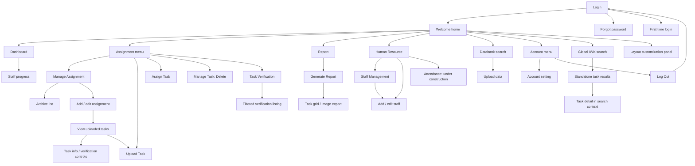
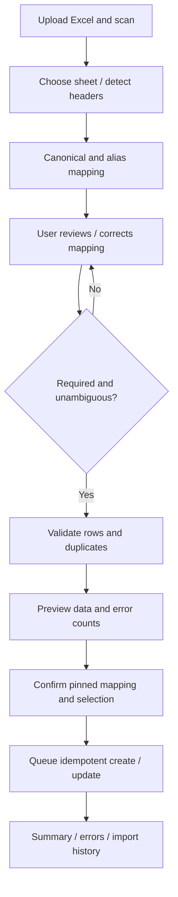
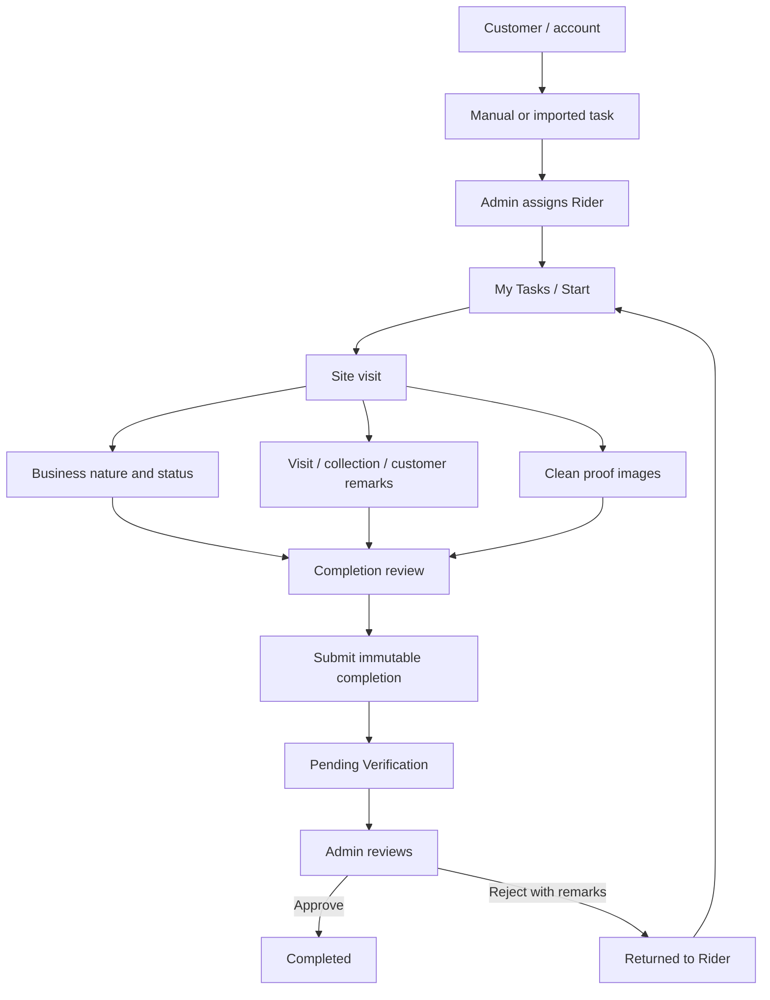
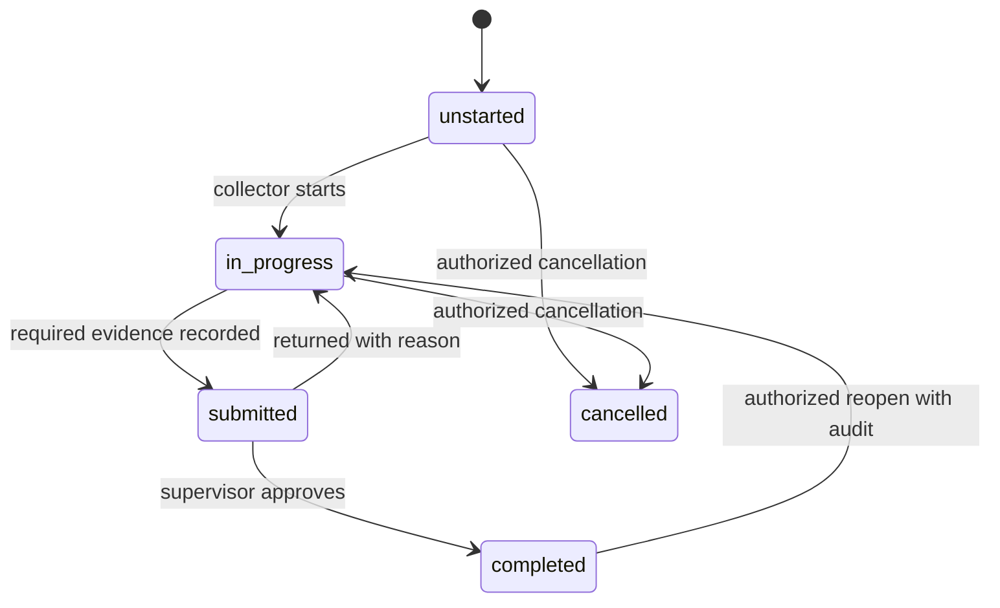
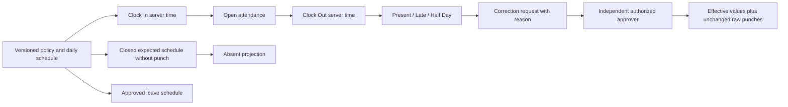
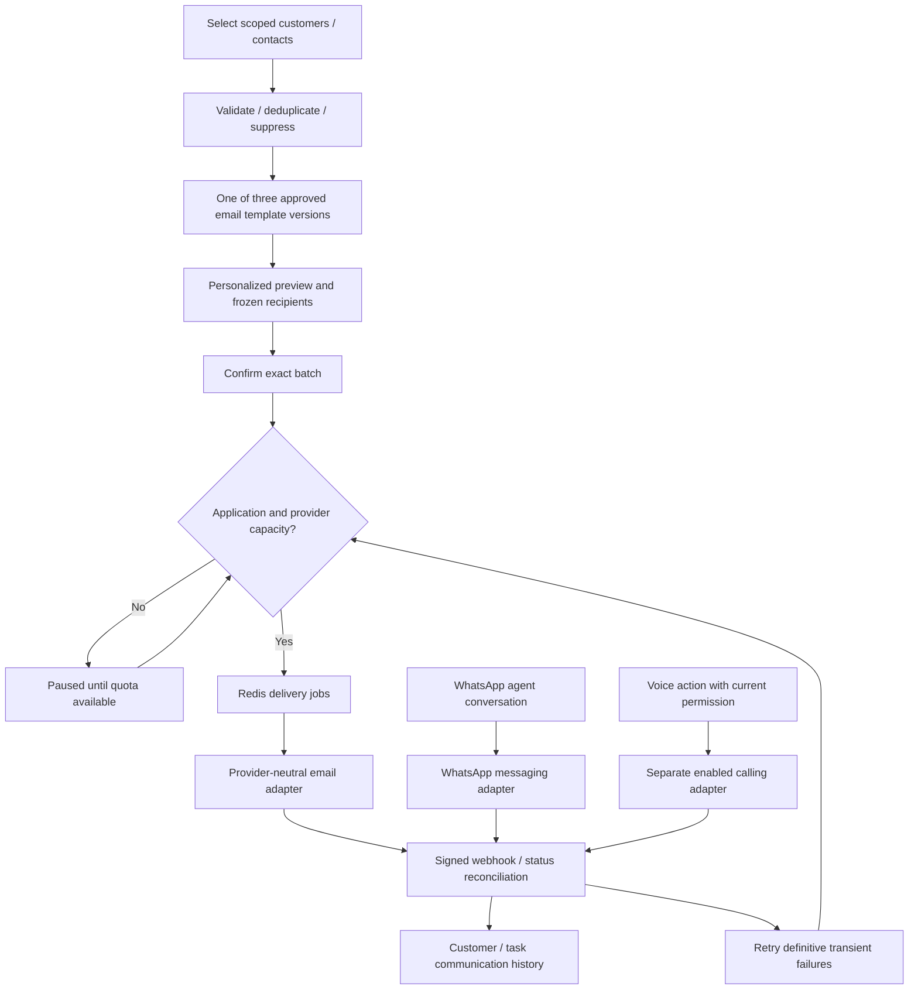

# DCMS — Functional and Workflow Blueprint

**Confirmed scope update — 16 October 2026.** The user's confirmed DCMS requirements take precedence over the earlier DRMS parity baseline. **C** means confirmed DCMS capability; **P** denotes an implementation choice within that scope; **O/U** continue to describe only observed/unverified DRMS behaviour. Missing DRMS evidence does not defer Customer Management, automated column mapping, Rider workflows, attendance, Call Centre, email or WhatsApp. Provider selection, template wording and business policy values remain configuration/implementation decisions, not omitted features. See the Feature Coverage Matrix in Plan.md.

Terminology: **Customer** is the UI/business term for the existing party record in **debtors** (Eloquent **Debtor**); **Rider** is collection staff in **staff**, linked one-to-one to **users**. **Client** remains the commissioning company. Retain these existing physical names and models: do not add parallel customers/customer_contacts/customer_addresses/rider_profiles/task_assignments/attachments/task_verifications tables for the same facts.

InteXcode (IXC) · 16 October 2026 · Baseline for implementation with discovery gates.

## Reading this blueprint

Evidence IDs E01–E24 and outstanding gaps G01–G08 are defined in [Plan.md](Plan.md). **O** means observed, **P** means proposed, **U** means unverified. Confirmed DCMS behaviours below are marked C; physical implementation choices remain P. Existing O/U statements describe the reference only, not whether confirmed features will be built. A visible Save/Update/Delete control proves availability, not successful server enforcement. No live business records were changed during review.

## Navigation observed in DRMS

This describes accessible navigation, not proven permission equivalence across roles. Notification/global search/header widgets are shared surfaces, not confirmed standalone business modules.

## Shared module contract (P)

All list screens use scoped server pagination, explicit sort allowlists, persisted filter state, authorized exports and friendly empty/loading/error messages. Every mutation validates on the server, authorizes the specific record and action, executes in a transaction when relational state changes, increments a concurrency version, writes an audit event and returns a clear result. Uploads remain quarantined until validated/scanned. IDs in URLs never grant access. Monetary fields use exact decimals and currency; dates preserve nulls and display in the user's configured zone. Bulk actions show an explicit preview and cannot operate on an implicit full result set.

## M01 — Access and account lifecycle

| Requirement | Blueprint |
|---|---|
| Purpose / description | Secure staff access; separate staff identity, login account and debtor identity. O: login/recovery/activation/settings/logout. |
| Roles / entry point | All invited users; `/`, account menu. Other-role permissions U. |
| Submodules / screens | UI01 login, UI02 recovery, UI03 activation, UI04 home, UI05 settings, UI06 logout outcome. |
| Functions / actions / buttons | O: Log In, Remember me, Request Change Password, Register, Update settings, photo browse, Log Out. P: privileged MFA and session management. |
| Forms / fields | Login email/password/remember; recovery email; activation registered email/user name/password/retype/terms; settings read-only staff no/names plus old/new/retype passwords and avatar. |
| Tables / search / filters | No business table observed; P: own active sessions table for privileged session control. |
| Validation / statuses | O: required input browser validation on empty login; activation inputs have required attributes. P: valid email, generic login/recovery errors, strong confirmed password, throttling, token expiry, invited/active/disabled/locked account states. Actual policy U. |
| Business rules / workflow | O: successful login → home; logout → login. P: invitation tied to active staff/email; single-use activation and recovery; prevent privilege acquisition through registration. |
| Dependencies / related modules | M10 staff, M12 permissions/audit/notification; email delivery infrastructure P. |
| Input → processing → output | Credentials/token → validate, authenticate, rotate session → scoped home or neutral error. Settings → validate current password → update credential and revoke sessions per policy. No credential writes tested. |

### Confirmed Admin and Rider access

**C:** Admin Login (UI01) and Rider Login (UI46) share users, Laravel guard and password recovery, with role/permission-aware redirects to UI07 and UI47. Login/logout and every endpoint enforce current account/staff status. Admin capabilities are permission bundles, never hardcoded role-name bypasses. Rider owns current allocation/own attendance and can read a masked history of their own submissions. Field-level policy suppresses unnecessary identifiers/contact details. UI38 manages future roles (Super Admin, Call Centre Agent, Supervisor, Operations Manager, Finance User) without new identity tables. See Plan.md#plan-access for permissions and client scopes.

## M02 — Dashboard and staff progress

| Requirement | Blueprint |
|---|---|
| Purpose / description | Assignment-level completion and daily workload overview (E05–06). |
| Roles / entry | Authorized staff/management P; Dashboard menu. |
| Submodules / screens | UI07 dashboard, UI08 staff progress. |
| Functions / user actions | O: inspect batch/date, four metric cards, staff/overall summaries, View All Staff; widget collapse/settings/remove icons. P: explicit batch selector and drill-down filters. |
| Forms / fields / tables | O: assignment name/date, total task, goal completion count/percent, today's task/completion, overall complete/outstanding and today's complete/outstanding; staff list container. Actual staff columns U. |
| Search / filters / buttons | P: assignment, collector, date; metric links open filtered tasks. Global header Search O but result behaviour U. |
| Validation / statuses | P: authorized active/archive batch selection; zero denominator = 0% with tooltip, no divide-by-zero; disclose time zone and as-of timestamp. |
| Business rules / workflow | P: completion KPI based on verified completion; separate submitted count. Confirm DRMS numerator/denominator definition G03; displayed progress indicator must match number. |
| Dependencies / related | M03, M05, M06, M07, M09. |
| Input → processing → output | Batch/date/scope → indexed aggregate or bounded cache → cards, progress and scoped staff/task drill-down. |

### Confirmed operational dashboards

**C Admin UI07:** total customers, active/assigned/completed tasks, pending verification, active Riders, attendance Present/Late/Absent/Leave/Half Day, visit/collection outcome statistics and recent activities. Filters: client/batch/date/Rider/category; every card links to the same scoped list. Completed means approved review; visit statistics count completed visit activities, never assumed cash. Show count basis and as-of/timezone. **C Rider UI47:** own today's/pending/assigned/in-progress/returned/submitted/completed tasks, due follow-ups, today clock status and large Start Task/Clock In/Clock Out actions. Empty/error/loading states are explicit; zero denominators render 0%.

## M03 — Assignment batch management

| Requirement | Blueprint |
|---|---|
| Purpose / description | Named client recovery work packages; distinct from collector allocation (E07–10). |
| Roles / entry | Administrative/manager P; Assignment → Manage Assignment. |
| Submodules / screens | UI09 active list, UI10 archive, UI11 create, UI12 edit, UI13 uploaded tasks. |
| Functions / actions | O: list/add/edit/archive status, View Task, Upload Task; Copy/CSV/PDF/Print/column visibility; search/sort/page. No standalone assignment Delete observed. |
| Forms / fields | O: Select Type, Name, Assignment Date, Due Date, Description, DCA Code, DCA Name, LA Name, State, Status. Types: Vacant, Domestic DR, Domestic CTOS, Domestic LOD, Domestic LOD CTOS, COM DR, COM LOD. State options listed in Database.md. |
| Tables / filters | O: #/ID/Name/Date/Type/Upload/Assign/Complete/Payment Update/Image Dir/Status, many responsive-hidden. Task list columns action/IWK ID/SAN/Payment Update/Owner 1/Address/Task Completed/Action By; both plain and responsive table variants observed. P state/client filters. |
| Buttons / validation | O: Save/Update/Back/View Task. P: required type/name/client/start/due; end ≥ start; known state; normalized trimmed DCA metadata; uniqueness by client+external batch reference where supplied. |
| Statuses / business rules | O: Active, Archive. P: archive read-only after work disposition checks; reopening permission/reason; do not cascade delete history. Existing archive enforcement U. |
| Workflow | Create metadata → staged task intake → task list → allocation/execution → review/report → archive. O navigation; full lifecycle P. |
| Dependencies / related | M04 imports, M05 allocation, M06 tasks, M09 report. |
| Input → processing → output | Metadata → authorize/validate and persist → versioned assignment, task count and audit event. |

## M04 — Excel Import and Automated Column Mapping

**C — Excel import and automated column mapping.** Reuses existing intake/staging rather than a second importer.

| Requirement | Functional contract |
|---|---|
| Purpose / roles / entry | Admin or authorized importer; customer/debt/assignment-batch/task/payment-update/databank data. Entry Upload Excel or context batch/customer screen. |
| Screens / submodules | UI14 upload; UI57 column mapping; UI15 preview/progress/result; UI58 import history/detail; UI39 approved field/alias/template/profile configuration. |
| Upload / header detection | Validate workbook format/content/size; choose sheet and header row; preserve original source names/order and file. Proposed initial accepted .xlsx/.xls via validated parser; reject macros/executables/password-protected unreadable files with useful error. Limits are config, not inferred from DRMS. |
| Mapping / aliases | Normalize case, whitespace, punctuation/BOM; match canonical fields, then unique active aliases in module/client scope. Confidence/method shown. Unmatched/ambiguous columns require explicit target or Ignore. No automatic fuzzy mapping of identities/money/Rider assignment. |
| Review form / actions | Source column/header/sample (masked), proposed canonical field, rule/match basis, target type/required indicator, approved transform; Review/Correct/Ignore/Save reusable profile/Continue. Duplicate targets block unless an explicit approved combine transform exists. Required targets must be mapped. |
| Data validation | Run only after mapping accepted: required/type/date/currency/contact/identifier rules, duplicate source keys, deterministic existing-record match and permitted update policy. Preserve leading zeros; Rider maps unique staff reference and authorized allocation. Header-like rows, malformed values and ambiguous customer matches are rejected. |
| Preview / confirm | Row number, create/update/skip/error, affected record, old/new safe values, counts. Confirmation freezes template/profile/field versions, mapping digest, selection and actor. No silent remapping if aliases change later. |
| Processing / statuses | uploaded → scanning → mapping → validating → ready → processing → completed/failed/cancelled. Required mapping invalidates preview if edited. Per-row staged/accepted/rejected/duplicate/processed/failed states retain granular reasons. |
| Summary / history | All input rows reconciled; successful committed count, rejected count, excluded duplicates, processing failure count and outstanding accepted rows. Failed count = rejected validation + terminal processing failures, shown separately as well as total. Downloadable redacted row-error report, prior job/mapping/profile history and audit. |
| Reuse / dependencies | import_fields + column_aliases + versioned import_mapping_profiles + per-import import_column_mappings; existing import_templates/batches/rows, S3, queues, audit/outbox. Mapping edits do not automatically publish global aliases. |
| Input → processing → output | Workbook/type/client → detect/map/review/validate/preview/confirm → scoped records, immutable source provenance, progress/reconciliation/error artifact and notification. |

Alias examples: Customer Name/Cust Name/Nama Pelanggan → customer_name; IC No → identification_no; Mobile/Phone No → phone_number; Outstanding → outstanding_amount; Collector → assigned_rider. Canonical keys map to the existing normalized model fields documented in Database.md; no parallel customer table is created.

## M05 — Allocation and bulk task management

| Requirement | Blueprint |
|---|---|
| Purpose / description | Allocate range-selected work and manage unwanted task rows (E12–13). |
| Roles / entry | Administrative/supervisor P; Assign Task or Manage Task. |
| Submodules / screens | UI16 allocation, UI17 bulk management; P UI18 preview and results. |
| Forms / fields | O allocation: assignment, type/date, staff, operation, From/To IWK ID. Operations New, Replace, Re-assign (Task uncompleted), Un-assign. O management: assignment/type/date, Delete, From/To. |
| Tables / search / filters | O assignment/staff searchable selectors; no affected-record preview observed. P scoped candidate grid with existing collector/state and exclusion reasons. |
| Buttons / actions | O TASK PROCESSING. P Preview, Apply, Cancel, Download result, explicit selected-count confirmation. |
| Validation / statuses | P known active assignment/collector, numeric source ID range if template defines numeric IWK IDs, from ≤ to, limit batch size, reject stale previews. Allocation current/released; bulk operation queued/running/completed/failed. |
| Business rules | Proposed semantics: New only unassigned; Replace replaces current collector; Re-assign only incomplete tasks; Un-assign closes allocation. Actual difference New vs Replace U. One current collector enforced by DB. Delete becomes recoverable cancellation with reason; permanently purge only under retention policy. |
| Workflow | Select batch/operation/range/staff → preview → reauthorize and lock rows → close/open allocations or cancel → per-row result/audit. |
| Dependencies / related | M03 assignment, M06 task state, M10 staff availability, M07 verified work restrictions. |
| Input → processing → output | Range and requested operation → resolve scoped tasks; lock and apply atomic changes → allocation history, counts, rejected rows, audit/outbox events. |

### Confirmed task creation, assignment and monitoring

**C:** UI56 creates/edits a task from selected customer/account, active batch/type, priority, planned visit and due date. Manually created tasks use public_id and origin=manual; no fabricated IWK source key. UI16/UI18 accept one task, explicit multi-selection or verified IWK range; New/Replace/Reassign/Unassign semantics retain allocation history. Imported assigned_rider requires the same permission and preview rules. Deactivated Riders cannot receive new tasks; pending reviews cannot be reassigned without an explicit transfer/reopen policy and audit. Cancel is recoverable and requires reason; no erasure of evidence/history.

UI55 Task Monitoring filters all/unassigned/assigned/in-progress/visited/pending completion/pending verification/completed/rejected-returned/overdue/cancelled by Rider, customer, category, date, priority and batch. Display customer, account, current Rider, due/visit time, work/review badges, latest outcome and task history. Single/selected assignment rechecks versions and scope; all task creation, edits, reallocation and status events are persisted in task_status_histories and audit_logs. M06 defines status dimensions; monitoring does not write arbitrary statuses.

## M06 — Account, task execution, property and evidence

| Requirement | Blueprint |
|---|---|
| Purpose / description | Inspect and execute an assignment task tied to client account/property/parties. Observed admin task detail combines imported fields and review controls (E14). Six type samples reviewed; COM DR has no matching active table result. Collector edit forms remain G01/G06. |
| Roles / entry | Assigned collector and scoped reviewer P; task eye action, previous/next, verification/report links where available. |
| Submodules / screens | UI13 listing, UI19 task detail, UI20 Vacant variant, UI21 Domestic/COM variants, UI42 verification-context detail, UI43 global search results, UI44 search-context detail; P UI22 activity/follow-up, UI23 evidence upload/viewer, UI24 party/account detail. |
| Main functions / user actions | O read task info, photos/no-photo state, staff assignment, select Completed/Uncompleted/Payment Update, Update task, previous/next icons. P record visit/call/TPS outcomes, correct contacts with provenance, reminders and submit for review. |
| Forms / fields | O task control form: staff selector, action/status selector; Domestic CTOS Uncomplete remark shown with `*`, hidden when Completed/Payment Update selected. Imported field inventory below. Most imported fields rendered as text rather than editable inputs in this account. |
| Tables / search / filters | Task list IWK ID/SAN; report inventory; P assigned task list filters assignment/status/due date/property/collector and scoped account search. |
| Buttons / validation | O Assign task/Update task. P transition-specific required evidence/outcome, nonnegative counters, valid contacts/dates, upload content limits; no server enforcement claimed from asterisk alone. |
| Statuses / business rules | O Uncomplete and Complete badges, three action options; completed Vacant sample showed updater/time and categorized photo figures. P work status unstarted/in_progress/submitted/completed/cancelled, separate review pending/approved/returned and payment marker; protect optimistic version. CTOS information never automatically changes an external credit record. |
| Workflow | P select allocated task → review source snapshot → record activity/contact/property changes → attach categorized evidence → set reminder/submit → supervisor review → completion or correction. |
| Dependencies / related | M03–05, M07–09, M10, M11; private storage. |
| Input → processing → output | Source account/property/party details and collector observations → append history, validate transition, preserve import values → current task state, activity trail, reminders, evidence and report projection. |

### Observed task field dictionary

Names below are source labels, not assertions about DRMS storage. Preserve them in import adapters; normalized DCMS mapping appears in Database.md.

| Group | Actual labels / fields |
|---|---|
| Context | Client Company, Task type, Task Update By, Task Remarks, Remarks admin, Last update, assignment and IWK ID |
| Source / routing | exclude, iwkSpecialInstruction, dcaFileType, dcaName, dcaCode, state, costState, uo, laName, bilNo, san, rangeDue |
| Customer / owners | custTelNo, custMobileNo, custFaxNo, custEmail, owner1, owner2, Owner1NRIC, Owner2NRIC |
| Property | propAddr1–5, building, buildingId, roadname, taman, postcode, suburb |
| Billing | mailName1Bill, mailName2Bill, mailAdd1Bill–4, LODTemplate |
| Financial snapshot | LODOverdueAmount, CajPerkhidmatanPembentungan, Caj3pctgUntukPembatalanNamadDalamCTOS, CajUntukSuratTuntutan, JumlahCajYangPerluDibayar, balanceAmountAtDate, balanceAmountAsCopyBill, diffBetweenbalanceAsCopyBillAndbalanceAtDate |
| Visits / reminders | visitDate, agentsName, upDateReminder, numberOfVisitation, NumberOfFollowUp |
| Verified occupier / owner / tenant | occupier, correctOwnerName, ownerName, ownerTelNo, ownerMobileNo, ownerFaxNo, ownerEmail, tenantName, tenantTelNo, tenantMobileNo, tenantFaxNo, tenantEmail, occupierNationality |
| Property/business outcome | propertyUsage, propertyType, nameOfShopCompany, natureOfBusiness, drCode, blackArea, reasonCustomer, BusinessClosedDown |
| LOD / CTOS / evidence | CustomerLODAcknowledgement, LODAcknowledgementRemark, ProofOfVisitation, ctosOrNonctos; photo section |
| Additional report columns | Third Party Search, Source of TPS, TPS Outcome Contact Number, Remarks TPS, Remarks, Staff Id; URL Street (Sign Board), URL Permise 1, URL Permise 2, URL Meter |
| Vacant-specific | san, propAddr, currentClass, occupied, vacant, othersA, othersADesc, commercial, domestic, othersB, othersBDesc, MeterConnectedInd, meterNumber |

Sample `diffBetween...` held a Y marker, so treat this as a difference flag pending template confirmation, not a decimal difference. Fee labels do not establish a currently applicable fee formula. Counter and agent-name fields do not prove a normalized event history exists in DRMS.

### Confirmed mobile Rider work (C)

Entry: UI47 Rider Home → UI48 My Tasks → UI49 task detail/customer tab. Today's tasks use planned visit date (fallback due date), while pending/assigned/in-progress/returned/submitted/completed are explicit filters with query preservation. Reveal only the customer's task-relevant name, address and permitted contact; hide full identification numbers by default. Completed/previous submission history remains read-only.

UI22's mobile visit form records visit date/time, availability, site status, address/location text, contact result, person contacted and outcome. UI50 business section records predefined business type/nature/status with Other requiring explanation. UI22 also provides separate visit/collection/customer/follow-up remarks and due follow-up. These extend collection_activities/property_inspections/follow_ups rather than duplicating site_visits/remarks tables. Call outcomes and actual cash receipts remain distinct.

UI23 supports camera/gallery, multiple images, preview/remove-before-submit, type/size/dimension/count validation, per-image upload/scan state, retry and private S3 metadata/task/uploader/time. Defaults 10 MiB/image and 10 clean images/submission, JPEG/PNG/WebP; override by approved task-type policy. Unsupported browser camera access falls back to file/gallery. EXIF location is not required. Upload failure never completes a task.

UI51 completion review validates required visit, outcome, configured remarks, business nature where applicable and clean proof categories/count. Missing fields link to the exact editor. Confirm creates an immutable task_submissions version with submitter/time and frozen remarks/business/visit/proof references; moves work_status to submitted and review_status to pending. UI52 acknowledges Pending Verification with submission reference; duplicate tap/retry returns same submission. Return exposes Admin reason, enables a new draft and retains previous versions. Only M07 approval sets completed.

| Display / filter | Canonical rule |
|---|---|
| Unassigned / Assigned | work_status=unstarted; no/current task_allocation. |
| In Progress | work_status=in_progress, current review not returned. Start recorded atomically. |
| Visited / Pending Completion | Progress filters within in_progress: completed visit recorded; completion checklist still incomplete or draft awaiting submit. Not extra writable states. |
| Pending Verification | work_status=submitted and review_status=pending. |
| Rejected / Returned to Rider | work_status=in_progress and review_status=returned; start correction clears current review projection to none but leaves decision history. |
| Completed | work_status=completed and review_status=approved. |
| Reassigned | Allocation-history event/badge; does not erase work/review history. |
| Cancelled / Overdue | cancelled is terminal work_status with reason; overdue is derived due_at < now and nonterminal. |

## M07 — Task verification

| Requirement | Blueprint |
|---|---|
| Purpose / description | Supervisor review of collection work; observed search, empty and populated result, and verification-context detail E15. |
| Roles / entry | Supervisor/manager P; Assignment → Task Verification. |
| Submodules / screens | UI25 verification criteria, UI26 results/review, UI42 detail. Actual decision persistence U. |
| Forms / fields / tables | O assignment, staff, From/To IWK default 1/1000, type/date summary, View Task; result Update and No Record, plus 143-record populated result with search/export/page and eye detail. Full headers #, IWK ID, SAN/sewacc, Payment Update, Address, Street, Permise1, Permise2, Meter, Complete Date, Action By, unlabeled decision column. Each row has Completed/Uncompleted/Payment Update. P independent review decision/reason instead of mixing payment marker. |
| Search / filters / buttons | O listed criteria. Assignment-only attempt did not leave search; adding staff yielded result. Populated list includes Update, Copy/CSV/PDF/Print/Column visibility and pagination. P explicit required fields/errors, selected rows, Approve/Return. Whether bulk Update applies beyond displayed page is U. |
| Validation / statuses | P only submitted task at matching version; reviewer authorized and different from submitter; return reason required; pending/approved/returned/superseded decision states. Actual DRMS states U. |
| Business rules / workflow | P submitted → review evidence → approve/completed or return/in_progress; immutable decision, later correction supersedes rather than overwrites. Bulk decision validates each row; do not silently succeed partially. |
| Dependencies / related | M05 allocation, M06 task/evidence, M09 progress/report, M12 audit. |
| Input → processing → output | Scoped filters and review decision → compare task version and evidence → decision record, task transition and notification. |

This is the confirmed DCMS lifecycle expressed with existing internal work codes; DRMS's three-option selector remains reference evidence only. Rejection/return and assignment are separate dimensions described in M06.

### Confirmed completion review contract

**C:** Admin (or future reviewer permission) sees UI26 queue and UI42 detail: customer/account, Rider, submission version/time, visit date/time/availability/person/outcome, business type/nature/status, all remark categories, clean proof images, supporting source/task information and completion checklist. UI51 submission is mandatory; draft/partial work cannot be approved. Approve/Verify stores approved + remarks and completes task. Reject requires verification remarks and stores decision=returned (UI Rejected / Returned to Rider); notifies current Rider for correction. Reviewer cannot be submitter. Optional approve remarks, required reject remarks; no hidden Payment Update side effect.

task_submissions retains submitted_by, submitted_at and task version; task_reviews references exactly that submission, reviewed_by (existing reviewer_id), reviewed_at, decision and reason. History shows each submitted/approved/returned cycle, and immutable proof manifest prevents later uploads changing reviewed evidence. Bulk review confirms explicit selection and validates each version; stale or denied rows are reported, never silently approved. UI55/UI07 count submitted pending review separately from verified completed.

## M08 — Financial snapshots and payment updates

| Requirement | Blueprint |
|---|---|
| Purpose / description | Preserve imported balance/fee information and payment-update state; E11/E14/E16. No observed payment ledger, method selector, receipts or gateway. |
| Roles / entry | Administrative/finance permission P; import kind Payment Update; task control and report Payment Update filter O. |
| Submodules / screens | UI14 import, UI19 task control, UI27 report; P UI28 financial update review/exceptions. |
| Forms / fields / tables | O snapshot fields above, Payment Update action, report yes/no; actual update workbook columns U. P source reference/date/currency, account match, before/after amounts and approval reason. |
| Actions / filters | O Upload/Update task and Yes/No report filter. P preview matched/unmatched/duplicate rows and approve/reject. |
| Validation / statuses | P reject ambiguous account match, invalid money/date or duplicate source update; pending/approved/rejected update state separate from task work status. |
| Business rules | Balance snapshot is not a receipt or proof of payment. Do not calculate collected cash by subtracting snapshots without client accounting rules. Imported fee totals preserved; reconciliation flags discrepancies instead of assuming a 3% formula applies. |
| Workflow | Source update → staged matching → exception review → approved immutable snapshot → current projection → filtered report. Proposed approval G04. |
| Dependencies / related | M04, M06 account/task, M09, M12 audit. |
| Input → processing → output | Update workbook/marker → validate source/idempotency/account and review → balance snapshot, task payment marker, reconciliation and audit. |

## M09 — Reporting and export

| Requirement | Blueprint |
|---|---|
| Purpose / description | Assignment task dataset, progress and photo export E05/E06/E16. |
| Roles / entry | Authorized administrative/supervisor/management P; Report → Generate Report. |
| Submodules / screens | UI27 report criteria/results, UI29 image bundle; dashboard/progress links. |
| Forms / fields | O assignment, IWK From/To default 1–1000, staff, Assign Date, status Task Complete/Task Outstanding, payment Yes/No. Image categories Street (Sign Board), Permise 1, Permise 2, Meter. |
| Tables / search / filters | O 88-column report includes field inventory M06 plus payment marker/staff/photo URLs; search, sorting, pagination and responsive expansion. P named presets with explicit output columns and PII permissions. |
| Buttons / actions | O View Task, Copy/CSV/PDF/Print/Column visibility, Export Images. Actual file generation U. P asynchronous export jobs, progress and expiring download. |
| Validation / statuses | P valid range, optional null date, authorized scope, safe export size/type, category required for image export; queued/running/completed/failed/expired exports. |
| Business rules / workflow | Freeze report criteria and snapshot time; derive totals from same snapshot as exported rows; redact/mask by export permission; spreadsheet-formula injection escaping; record every export and download. |
| Dependencies / related | M03–08, M10 staff, S3 and queues. |
| Input → processing → output | Filters/columns/category → scoped snapshot and streaming generation → report file/image bundle, metadata and audit. |

### Confirmed basic report catalogue

**C UI27:** choose Customer, Task, Rider Assignment, Rider Performance, Completed Task, Verification, Attendance, Collection/Visit, Communication or Import report. Each family supports date range, search and applicable client/category/customer/Rider/status/batch/channel/template/import-kind filters; CSV/PDF actions with approved column sets and queue progress/artifact UI41. Customer reports use customer/category records; Rider performance uses completed visits and approved tasks (not submitted counts); attendance uses schedule-aware statuses and adjustments; communication reports distinguish accepted/delivered/failed/unknown; imports reconcile row/mapping results. UI29 image exports remain supported. Field-level restrictions, snapshot consistency, formula escaping, audit and signed downloads remain unchanged. Do not label outstanding-balance movement as money collected.

## M10 — Rider / Staff Management and Attendance

| Requirement | Blueprint |
|---|---|
| Purpose / description | Staff directory and employment status; attendance visible but under construction E17–19. |
| Roles / entry | Authorized HR/admin P; Human Resource menu. |
| Submodules / screens | UI30 Rider/staff list, UI31 create, UI32 edit, UI54 Rider profile, UI33 Admin attendance, UI53 Rider attendance/history, UI59 policy/schedule/correction. |
| Forms / fields | O Staff No (IWK Staff ID), Email, Active Status, First Name, Last Name, Gender, Position, Appointment Date, Phone No, Home Phone No, Address. Position values in Plan.md. |
| Tables / search / buttons | O #/Staff ID/Staff No/Name/Appointment Date/Position/Status; search/sort/pagination, exports, Add/Save/Update/back. |
| Validation / statuses | O Active/Unactive and Select/Male/Female. P unique staff no and account email, valid email/date, bounded names/contact values; availability check before allocation. Keep display code separate from permission role. |
| Business rules / workflow | Create staff → invite account P; edit/disable → review outstanding allocations → reassign under authorization. Do not erase staff referenced by history. DRMS attendance fields remain U; confirmed DCMS attendance is specified below. Payroll is outside scope. |
| Dependencies / related | M01 accounts, M05 allocation, M09 reports, M12 permissions/audit. |
| Input → processing → output | Staff metadata → validated identity/status update → directory entry, controlled invitation and audit. Attendance uses the confirmed policy/schedule/clock/correction contract below; G08 now concerns policy values, not feature inclusion. |

### Rider management (C)

UI30/31/32 become Rider list/create/edit filters over existing staff; UI54 Rider profile adds contact/employment/status, assigned/completed/returned tasks, attendance/history, activity timeline and scoped performance. Rider eligibility staff.is_rider and active state are independent from Spatie permissions; activation/invitation does not grant Admin. Deactivation requires outstanding task disposition and prevents sign-in/new assignments according to account policy. Additional office staff continue to use the same records/forms.

### Attendance management (C)

| Contract | Behaviour |
|---|---|
| Entry / roles / screens | UI53 Rider today/history; UI33 Admin attendance dashboard/list; UI59 schedule/policy/correction dialog. |
| Rider actions / fields | Clock In, Clock Out, today's server timestamps/status, own date-filtered history and optional remarks. Show business timezone and open shift. |
| Rules / statuses | One current open interval per Rider, idempotent request keys, clock-out after clock-in. Pin policy/schedule per service date; overnight clock-out stays linked to start-date schedule. Present/Late/Half Day calculated from scheduled start/grace/worked minutes; Absent only expected closed schedule without a punch; Leave from authorized schedule, not guessed. Rules configurable and versioned; thresholds/workdays must be configured before activation. |
| Admin actions | Search/filter Rider/date/status, totals, scoped CSV/PDF; configure schedule/workdays/leave exceptions. Correct request includes reason, original and proposed times/status and a separate authorized approver; reject self-approval. No overwriting raw punches. |
| Input → processing → output | Server clock event → scope/duplicate/open-shift validation → immutable raw times + effective approved adjustments → own/admin attendance and report projections, audit/notifications. |
| Tables / dependencies | attendance_policies, attendance_schedules, attendances, attendance_adjustments; existing staff/users/audit/export jobs. No GPS/biometrics required. Missing schedule shows Unscheduled / Needs review, not Absent. |

## M11 — Call Centre and Databank

| Requirement | Blueprint |
|---|---|
| Purpose / description | Search independently imported data for call-centre work E20. Match schema and successful results U. |
| Roles / entry | Call Centre plus explicitly authorized staff P; Databank. |
| Submodules / screens | UI34 search/results, UI35 upload; P record detail only after G05. |
| Forms / fields / tables | O one unlabeled search input, Search and Upload Data; upload file chooser with Excel template instruction. No-match table displayed literal `{"status":"No Record"}`. Successful result columns U. |
| Search / filters / buttons | O free-text search; exact/partial/identifier semantics U. P bounded search, client/data-source scope, explicit allowed keys and masked results. |
| Validation / statuses | P require minimum safe query length, rate limiting, provenance, scan/template checks and row errors. Do not persist unknown source fields into public searchable columns. |
| Business rules / workflow | P intake staged like M04; search only entitled source datasets; no bulk scrape/export by default; selected contact evidence records provenance in M06. No external contact initiated. |
| Dependencies / related | M04 common import infrastructure, M06/TPS activities, M12 audit. |
| Input → processing → output | Search term or source workbook → scoped query/staged normalization → masked matches/no-results or intake reconciliation. Schema must be finalized from positive samples. |

### Confirmed Call Centre operations

**C UI60:** authorized Admin/Call Centre Agent searches Customer/account/task/category/Rider, views necessary debt/task/contact context, records an outgoing telephone call, call time/person/outcome/remarks and follow-up, and sees prior calls plus email/WhatsApp/visit history. Outcomes: Answered, No Answer, Busy, Invalid Number, Call Back Requested, Promise to Pay, Disputed, Other; Other requires detail, Call Back Requested requires follow-up date. Promise to Pay captures notes/optional stated date or amount in context and follow-up; it is not a posted payment or full repayment-plan engine. Contact edits require customers.update_contacts and retain provenance/version.

Call logs reuse collection_activities(type=call), linked to customer, optional task, performed_by and optional communication/voice record. Task-less calls are valid. Follow-ups reuse follow_ups with required customer and optional task. No new duplicate call_logs/whatsapp_messages tables. Actual telephony automation is optional beyond recording manual calls; WhatsApp voice is the separate confirmed integration M14. UI34/35 remain the legacy databank submodule; unknown DRMS databank schema does not block the customer-based Call Centre.

## M12 — Shared tools, roles, reference settings, notifications and audit

| Requirement | Blueprint |
|---|---|
| Purpose / description | Operational governance. O account settings is M01; notification bell and header tools surfaced without business content. Dedicated role/settings/audit screens not found. |
| Roles / entry | All users for own notifications; privileged administrators/auditors for configuration P. |
| Submodules / screens | UI36 shared tools, UI43 global results, UI44 search-context task detail, UI45 layout customization O; P UI37 notification centre, UI38 roles/permissions, UI39 reference/template settings, UI40 audit, UI41 job monitor. |
| Forms / fields / tables | O global IWK search/results columns in E24; customization has 13 layout/text/dark-mode checkboxes and color variant groups. P notification title/message/type/record/time/read; role name/action permissions/scope; versioned reference code/label/active/order; audit actor/action/record/old/new/IP/agent/time; job state/counters/errors. |
| Search / filters / buttons | P read/unread/type, role search, audit date/actor/module/action/record, job state; Mark read, Save role, Publish template, Retry job. Actual DRMS behaviour U. |
| Validation / statuses | P prevent self-escalation/last-admin removal, version configuration, immutable audit, scoped retry and notification ownership checks. |
| Business rules / workflow | Proposed sensitive changes require reason and appropriate approval; notifications use post-commit events; retries preserve idempotency; audit redacts secret fields. |
| Dependencies / related | Cross-cutting M01–11; cache invalidation, queues and private S3. |
| Input → processing → output | Authorized config change/event → validated persistence/audit/outbox → revised permission/reference version, user notice or operational event. |

### Confirmed operational administration

Admin/Rider permission bundles, customer categories/reference codes, canonical import fields/aliases/profiles, attendance policies/schedules/correction authority and communication template/provider/capability/quota configuration use granular permissions, versioning and audit. UI70 integration settings stores only provider/sender capability and secret reference, never secret contents. Approved production DCMS domain, TLS, APP_URL/session scope and signed webhook routes follow Plan.md#plan-deployment; the reference DRMS domain is unchanged. Existing audit/notification/job tools serve every confirmed module, with own-recipient notices for task assignment/return/approval, import completion, attendance correction and communication job action needed. No automatic customer messaging is triggered merely by a task status change unless a later explicitly configured business rule authorizes it.

## M13 — Customer Management and categories

**C.** Customer is the existing debtor/party identity, not the commissioning client or a new duplicate table.

| Requirement | Functional contract |
|---|---|
| Purpose / roles / entry | Admin manages customer master and categories; Rider views only task-relevant subset. Entry Customers in Admin sidebar; UI24 existing account/party detail becomes consolidated Customer Details. |
| Screens / submodules | UI62 Customer List; UI24 details/history; UI63 create/edit customer; UI61 category list/editor/assignment. |
| Functions / actions | View/search/filter/create/update/activate-deactivate, categorize, view related accounts/tasks/visits/collection remarks and communications. Edit contacts/address with provenance; no physical delete of referenced customers. |
| Forms / fields | Customer reference, individual/company, name, optional identifier, client, contact(s), address(es), active state, category selection; identifier masked/permission-gated. Categories code/name/description/active; assignments effective/revoked times and actor. |
| Tables / search / filters | Customer reference/name/type/category/status/client; scoped reference/name-token/identifier/contact search, category/type/status filters and stable pagination. Related task/visit/collection/communication tabs preserve filters. |
| Validation / business rules | Unique reference within client; valid required name/type; safe optional identifiers; contact format/type; no fuzzy party merges. Inactive category cannot be newly assigned but historical memberships remain visible. Category changes do not change debt, task status or existing source snapshots. Multiple active categories allowed; duplicate active membership prohibited. |
| Workflow / statuses | Create or import → resolve duplicate warnings → persist customer and contacts/categories → create/view related task → trace visits/calls/messages. Customer active/inactive; category active/inactive. |
| Dependencies / input-processing-output | M04 imports, M05/M06 tasks, M11 calls, M14 communication; existing debtors/contacts/addresses/account_parties plus customer_categories/customer_category_assignments. Input metadata → scoped validation/audited transaction → master record and combined read-only history. |

## M14 — Communication Management

**C.** Admin/authorized agents use customer/task context; channel permissions are independent from Rider task privileges. No live sending is performed by this documentation task.

| Requirement | Functional contract |
|---|---|
| Purpose / entry / screens | Customer communication with audit/history. UI64 history, UI65 template selection/editor/approval, UI66 recipients, UI67 personalized preview, UI68 batch result, UI69 WhatsApp conversation, UI70 provider-qualified calling and integration status. Customer/task/Call Centre link to same records. |
| Three email / letter options | Exactly three logical email slots with immutable approved versions, configurable subject/body. Seed drafts until wording approved. Select approved version; auto-fill customer_name and optionally account_number/outstanding_amount/due_date/company_name. Allowlisted placeholders only, escaped values; missing required value blocks affected recipient. Preview letter/PDF from same template is a document artifact, not an email delivery. |
| Recipient selection / validation | Scoped customer/category/account/task filters or explicit selected contacts; validate email, current preference/suppression and name/task context; deduplicate canonical addresses within batch by explicit one-customer context. Shared address with conflicting personalization requires review; do not merge balances. Show selected/eligible/duplicate/invalid/suppressed counts and reasons. |
| Preview / confirmation | Preview recipient-specific subject/body and source amount/date/currency, template version and frozen context; review representative and exception rows, view any selected recipient. Confirm exact recipient snapshot/digest; edits invalidate preview. Individual send uses same preview path; no BCC fan-out leaking personal content. |
| Bulk queue / limit | Configurable initial ~1,000 email recipients/day (KL calendar day), plus actual provider rolling quota/rate. Atomic reservations enforce both across workers. At limit, pause remaining queue with resume time. Raising to ~5,000/day requires quota/tier/rate configuration, not redesigned application. Providers remain adapters. |
| Delivery / retries / history | Persist customer/template/recipient/subject/sent_by/sent_at/status/task, rendered snapshot, attempt and receipt history. accepted ≠ delivered. Temporary definitive failures retry with capped backoff; permanent/opt-out invalidation suppresses; ambiguous accepted timeout becomes unknown and reconciles before resend. Resume/retry/cancel privileges audited. |
| WhatsApp messaging / conversation | Separate channel adapter plus generic conversations/communications. Link customer/contact and optional task, inbound/outbound bodies/media, staff owner, timestamp and delivery state; provider-approved template/window rules and preferences checked at dispatch. Three email slots are not WhatsApp template approval. Verify/authenticate/dedupe webhooks, support two-way agent chat and preserve history. |
| WhatsApp voice | Separate VoiceCallingAdapter + call_permissions/voice_sessions and common communication envelope. Verify selected service's sender enablement, supported countries/accounts, explicit permission for business-initiated calls, restrictions/expiry, agent browser/SIP route and events before activating Call. Show disabled reason and retain backlog if service lacks calling; do not claim all messaging APIs can call. No recording/transcription assumed. |
| Inputs / states / outputs | Approved template + frozen scope/recipient/context → reviewed preview → outbox/queue → adapter → signed receipts → history. Batch draft/previewed/queued/sending/paused/completed/completed_with_errors/cancelled. Message draft/queued/accepted/delivered/read/failed/unknown/cancelled/suppressed/received; letter generated and manual call recorded are channel-specific non-email states. Inbound does not require an email template. |
| Dependencies / storage | M13 customers, M06 tasks, M11 call outcomes, M12 roles/audit/notifications, Redis/outbox/S3. Generic communications, communication_batches/attempts/events/preferences, conversations, integration_accounts/events, templates, quota reservations and voice tables; no duplicate email_deliveries/whatsapp_messages facts. |

## Implementation acceptance checklist

Every module must have an approved role matrix, agreed field dictionary, tested state transitions, accessible validation/empty/error states, scoped exports and audit evidence. DRMS parity claims still require G01–G08; confirmed DCMS features proceed under the C contracts and explicit policy/provider activation checks. Prototype.md defines interface structure; Database.md defines proposed storage. Any new evidence that changes import keys, finance rules, task variants or verification must update all four documents together.

### Context and search consistency requirements

O: global header IWK search navigates to a separate result table; a synthetic nonnumeric query returned two source-ID-0 rows. Internal coercion is an inference, not a verified root cause. P: validate identifier syntax, preserve literal query, require permitted scope and return explicit no-match state. Search rows link to task detail without the full search breadcrumb; DCMS should preserve the query/list state.

O: an uploaded Vacant detail showed occupancy/meter fields, while a verification-context Vacant detail showed the broad recovery dictionary. P: use one type-aware task renderer with contextual review controls. A dummy-looking source row showed header-like strings in amount/contact fields and malformed dates; treat this as a data-quality finding with unknown origin, and reject header rows, shifted columns and malformed numeric/date values during DCMS intake.
