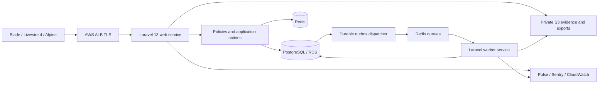

# DCMS — Project and Technical Development Plan

**Confirmed scope update — 16 October 2026.** The user's confirmed DCMS requirements take precedence over the earlier DRMS parity baseline. **C** means confirmed DCMS capability; **P** denotes an implementation choice within that scope; **O/U** continue to describe only observed/unverified DRMS behaviour. Missing DRMS evidence does not defer Customer Management, automated column mapping, Rider workflows, attendance, Call Centre, email or WhatsApp. Provider selection, template wording and business policy values remain configuration/implementation decisions, not omitted features. See the Feature Coverage Matrix in Plan.md.

Terminology: **Customer** is the UI/business term for the existing party record in **debtors** (Eloquent **Debtor**); **Rider** is collection staff in **staff**, linked one-to-one to **users**. **Client** remains the commissioning company. Retain these existing physical names and models: do not add parallel customers/customer_contacts/customer_addresses/rider_profiles/task_assignments/attachments/task_verifications tables for the same facts.

Product: Debt Collector Management System (DCMS) · Developer: InteXcode (IXC)  
Reference: [DRMS — Senja Bina](https://drms.senjabina.my/) · Review date: 16 October 2026 (Asia/Kuala_Lumpur)

## 1. Document status and evidence boundary

This is an implementation planning baseline derived from an authenticated, non-destructive browser review. It is **not a claim that every DRMS role, write operation, or business rule has been verified**. All top-level navigation visible to the supplied account was visited. Representative task details were reviewed for COM LOD, Domestic DR, Domestic CTOS, Domestic LOD, Domestic LOD CTOS, and Vacant. COM DR was selectable but no active assignment matched a table search for that type. No source code, database, import templates, API contract, or other-role credentials were supplied.

Use these labels throughout the four documents:

- **O — Observed:** rendered page, field, option, or read-only interaction directly reviewed.
- **P — Proposed:** implementation design; **C — Confirmed:** mandatory DCMS scope supplied by the user, including features beyond DRMS.
- **U — Unverified:** unavailable, empty, role-dependent, or requiring a live write to establish behaviour.

The four requested artifacts are [Plan.md](Plan.md), [Module.md](Module.md), [Prototype.md](Prototype.md), and [Database.md](Database.md). Module and interface IDs provide traceability. No supplied password or real debtor/staff sample data is included. Routes containing `{id}` below are route patterns, not instructions to enumerate records.

## 2. Project overview, background, and objectives

DRMS organizes recovery work around named assignment batches. Tasks are imported from Excel, allocated to staff using IWK ID ranges, inspected or marked for completion/payment update, verified, and reported. It also provides staff administration and a call-centre databank. Its task fields combine account, property, owner/tenant, visit, contact, LOD, CTOS, financial snapshot, and report information.

DCMS will preserve those business capabilities as an independent InteXcode product. Its objectives are reliable assignment and collection execution, traceable verification, accurate client reporting, controlled handling of personal data, and a clear account history across multiple batches. It will use its own terminology, information architecture, database, and interface design.

Success measures proposed for acceptance: every imported row accounted for; allocation history retained; no unauthorized cross-assignment access; report totals reconcile to their snapshot; all sensitive writes and exports auditable; failed jobs recoverable without duplicate data. Business owners must set operational targets during Phase 0.

## 3. Reference coverage register

| Evidence | Route / surface | Observation and limit |
|---|---|---|
| E01 | `/` | Email/password, remember me, login, recovery, first-time login; successful sign-in to `/home`; empty submit displayed browser “Please fill out this field.” |
| E02 | `/authentication/forgotpassword` | Email and Request Change Password; delivery/token behaviour not exercised. |
| E03 | `/authentication/register` | Registered email, user name, password/retype, mandatory terms checkbox, PDPA link; activation not submitted. |
| E04 | `/home`, shared navigation | Welcome page; Dashboard; Assignment; Report; Human Resource; Databank; account settings/logout; global Search and notification icon. |
| E05 | `/dashboard` | Batch header/date; total tasks, goal completion, today totals/completion, staff and overall progress; View All Staff. Sample had 40 tasks. Displayed progress semantics need confirmation. |
| E06 | `/dashboard/progress/{assignment}` | List of staff container; reviewed sample rendered no staff rows. |
| E07 | `/assignment` | Active assignments, add, archive link, table search/sort/pagination/export/column visibility; 97 entries at review. Full header inventory: #, ID, Name, Date, Type, Upload, Assign, Complete, Payment Update, Image Dir, Status. |
| E08 | `/assignment/archive` | Active-list return link, add, “No record”; exposed PHP notice. |
| E09 | `/assignment/management[/{id}]` | Create/edit fields, seven assignment types, Active/Archive, View Task on edit. Save/update not submitted. |
| E10 | `/assignment/upload/{assignment}` | Task table, IWK ID, SAN/sewacc, eye detail action, upload link; samples included 40, 18, and 2,966 tasks. Full columns also Payment Update, Owner 1, Address, Task Completed, Action By. Both responsive DataTable and plain table renderings observed. |
| E11 | `/import`, `/import/index/{assignment}` | Assignment/type/date, upload type Assignment or Payment Update, Excel template instruction, file chooser/upload. Contextual page verified assignment preselection and populated type/date. Template not exposed as a download. |
| E12 | `/assignment/assign_task` | Assignment/type/date, staff, New/Replace/Re-assign (Task uncompleted)/Un-assign, From/To IWK ID, processing button. |
| E13 | `/assignment/manage` | Batch/type/date, manage type Delete, From/To IWK ID, processing button. No deletion performed. |
| E14 | `/task/update/{task}/view_upload` | Six type details sampled. Assignment, status selector Completed/Uncompleted/Payment Update, assign staff when unassigned, task info, previous/next icons. Domestic CTOS showed required-looking Uncomplete remark; other statuses hid it. Completed Vacant sample showed Complete badge, updater/date and street/premise2/meter photo figures. No save. |
| E15 | `/verification`, `/verification/listing/{assignment}/staffId-{staff}/iwkid-{from}-{to}`, `/verification/details/{task}/staffId-{staff}/iwkid-{from}-{to}` | Assignment/staff and IWK range 1–1000. Both No Record and populated 143-record result reviewed. Full columns #, IWK ID, SAN/sewacc, Payment Update, Address, Street, Permise1, Permise2, Meter, Complete Date, Action By, final unlabeled status column. Per-row Completed/Uncompleted/Payment Update dropdowns and bulk Update observed. Detail eye opens review context with same task controls. Persistence/approval semantics U. |
| E16 | `/report` and submitted result | Batch/range/staff/assign date/status/payment filters; report grid, 88 column labels, Export Images and four image categories. Blank date became 1970-01-01 after submission. No files exported. |
| E17 | `/management` | Staff grid, search/sort/pagination/export; 182 entries at review; columns staff ID/no/name/appointment/position/status. |
| E18 | `/management/staff[/{id}]` | Staff create/edit; seven position values; active/unactive; staff/email/name/gender/date/phones/address. |
| E19 | `/info` | Attendance under construction, PHP notice visible. Attendance fields/process unavailable. |
| E20 | `/databank`, `/databank/upload` | Search, Excel upload screen; synthetic no-match search and sampled SAN returned literal JSON-like No Record in table. Successful match schema U. |
| E21 | `/authentication/setting/{user}` | Separate settings page, staff identifiers, photo browse icon, old/new/retype password, Update. Not submitted. |
| E22 | account menu logout | Logout returned to login. Session invalidation/server-cookie details not inspected. |
| E23 | notification dropdown / header tools | Notification icon expanded without visible content. Tiles opens Customize AdminLTE panel: 13 layout/text/dark-mode checkboxes and navbar/accent/sidebar/brand variants; no preferences changed. Fullscreen/widget controls observed; deeper behaviour U. |
| E24 | `/search/result/{query}`, `/search/info/{task}/{iwk}` | Header search leads to standalone result table: IWK ID, SAN, Assignment Name, Type, Assignment Date, Owner Namee, Address, Complete Date, Staff Id, Task Id. Synthetic nonnumeric query returned two IWK ID 0 rows, rather than no matches; likely coercion, internal cause U. Row buttons lead to task detail. One dummy-looking record displayed column-label strings as values and invalid-looking dates. |

### Type and context findings

Six task types were inspected through uploaded-task detail; COM DR remains U beyond its selectable option. Task source groups generally match the M06 dictionary, while uploaded Vacant detail uses a short occupancy/meter dictionary. The verification-context page for a completed Vacant task rendered the broad recovery field dictionary instead. Treat this as a context inconsistency to validate with the owner; do not copy it into DCMS. The source contained dummy-looking/misaligned values, so UI examples alone cannot establish reliable import column order or money/date types.

Counts are transient observations, not seeded DCMS requirements. Table headers included responsive hidden columns; DOM inspection read rendered table markup to inventory them. List exports, uploads, allocation, status writes, account creation, password changes, and deletion were not executed on live data.

### Required discovery follow-up

| Gap | Evidence needed | Implementation impact |
|---|---|---|
| G01 | Staff, call-centre, supervisor and system-admin demonstrations in a sandbox | Confirm role navigation, task editing, photo capture and access boundaries. Position labels do not prove permissions. |
| G02 | All seven type templates and valid/invalid synthetic imports | Confirm required columns, types, duplicate keys, date formats, payment update semantics and error policy. |
| G03 | Disposable verification tasks and owner explanation of observed row selectors | Establish persistence, submitted/verified/rejected semantics, whether updates affect all pages or only displayed rows, and required remarks. Populated read-only listing has been inspected. |
| G04 | Payment update specification, source files, accounting policy | Determine balance overwrite vs delta; no ledger/receipt UI was discovered. |
| G05 | Positive databank example and template | Establish search keys, result columns, edit capability, provenance and retention. |
| G06 | All type-specific collector forms, documents, attachments and photos | Confirm field options, required evidence, upload limits and generated document capability. |
| G07 | Invalid save, duplicate, concurrent edit and delete/restore examples | Confirm actual server validation and destructive semantics safely. |
| G08 | Reference attendance/audit/settings demonstrations if useful | Attendance is now confirmed DCMS scope. Configure schedules, grace/half-day rules and correction authority; DRMS construction status is historical evidence only. |

These are reference-discovery follow-ups. They do not block implementing the confirmed DCMS workflow below. Legacy import field semantics and financial source interpretation still require fixtures; attendance rules, email content, quotas and provider capability settings must be finalized before their production activation.

## 4. Target users and authorization strategy

**C:** Minimum application roles are **Admin** and **Rider**. Admin manages dashboard, customers/categories, Riders, imports/mapping, task creation/allocation/monitoring/review, attendance, Call Centre, communications, reports and administration subject to permission grants. Rider accesses assigned work, necessary customer details, visits/business nature/remarks/proof, completion submission and own attendance through a mobile interface. Both use Laravel session authentication with different entry/landing routes, not separate identity databases.

Spatie roles bundle granular permissions; Laravel policies enforce current client scope, assignment ownership and field-level access on every request/Livewire action, export and download. Example permissions: customers.view/create/update/categorize, riders.manage, imports.map/confirm, tasks.create/assign/reassign/cancel, tasks.monitor, tasks.submit, tasks.verify, attendance.clock/view_own/view_all/correct/approve_correction/export, calls.record, communications.compose/send/bulk_send, templates.approve, whatsapp.message/call, reports.export, roles.manage and audit.view. A role label never bypasses these policies. Additional Super Admin, Call Centre Agent, Supervisor, Operations Manager and Finance User roles can be composed without new code paths.

The baseline uses time-bound user_client_scopes plus action permissions; Riders additionally require current allocation for active work. Their own historical submissions/attendance remain accessible with masked customer detail after reassignment. Employment position and Rider eligibility remain staff attributes, separate from permissions. Preserve DRMS position codes 01 Staff, 02 Administrative, 03 Supervisor, 04 Manager, 05 Director, 99 System Admin and 06 Call Center as reference data; do not seed them as mandatory DCMS roles. Admin must not verify their own submission; correction approval and template approval use separate grants. Scope/role changes invalidate caches and are audited. Team/branch hierarchy and SaaS tenancy remain future organizational decisions.

## 5. Functional scope and modules

| Module | Baseline scope | Evidence |
|---|---|---|
| M01 Access and account | Login, recovery, activation, settings, photo, logout | E01–04, E21–22 |
| M02 Dashboard | Assignment and staff progress with drill-down | E05–06 |
| M03 Assignment batches | Active/archive lists, create/edit, type and date metadata | E07–09 |
| M04 Excel import and automated mapping | Customer/debt/batch/task/payment/databank intake, aliases, mapping review, preview, confirmed import, progress/history/errors | E10–11; C |
| M05 Task allocation and management | Individual/selected/range allocation, reassignment, manual task creation, monitoring and recoverable cancellation | E12–13; C |
| M06 Rider task execution and evidence | My Tasks, visits/business nature/remarks, mobile camera/gallery proof, completion checklist and pending verification | E14, E16; C |
| M07 Completed task verification | Admin review, approve or reject/return with remarks, immutable submission and decision history | E15; C |
| M08 Payment updates | Imported financial snapshots and payment marker; optional ledger extension | E11, E14, E16 |
| M09 Basic reporting | Customers, tasks, assignments, Rider performance, completion/review, attendance, visits/collections, communications and imports; scoped CSV/PDF | E05–06, E16; C |
| M10 Rider management and attendance | Staff profile and performance, activate/deactivate, own clock-in/out/history, Admin attendance corrections/reports | E17–19; C |
| M11 Call Centre and databank | Customer/account/task search, outgoing call/outcome/remarks, contact updates, follow-ups and communication timeline; legacy databank retained | E20; C |
| M12 Administration and audit | Shared global search/customization; notification centre, roles/reference settings/audit proposed | E21, E23–24; remainder P |
| M13 Customer Management | Customer list/detail/create/edit, categories, scoped search and task/visit/collection/communication history | C |
| M14 Communication Management | Three email/letter template options, single/bulk email, WhatsApp messaging/history and separate provider-qualified voice integration | C |

The confirmed scope includes recording Promise to Pay as a call outcome and follow-up, not a financial receipt or a separate payment-plan engine. Payment gateway, receipts/ledger, legal-case approval, automated dialler, commission/payroll and external CTOS integration remain outside the confirmed additions. DRMS absence does not exclude confirmed email, WhatsApp or attendance.

### Customer, Rider and task contracts (C)

Customer categories are active/inactive configurable records with time-bound assignments. Customer detail consolidates relevant accounts, tasks, visits, collection remarks, contact changes and communications. Search covers client-scoped customer reference, approved name tokens, identifier/contact exact matches and category/status. Creating a customer need not create a debt. Manual/imported tasks explicitly select a customer and account, batch/type, priority, planned visit and due time; unknown/ambiguous import matches are exceptions. Reuse existing debtors/contacts/addresses and staff identities. Admin Rider detail combines assigned/completed tasks, attendance, activity and performance without duplicating personnel profiles.

Task Monitoring provides all/unassigned/assigned/in-progress/visited/pending-completion/pending-verification/completed/returned/overdue/cancelled views, filters by Rider/customer/category/batch/date/priority and history. Keep the existing work_status codes unstarted/in_progress/submitted/completed/cancelled; display Unassigned/Assigned from current allocation, Pending Verification from submitted, and Rejected / Returned from the current review projection. Reassigned is an allocation-history event; Visited and Pending Completion are progress filters based on recorded visits and checklist. Overdue is a derived time condition. These are not competing writable status columns. Only Admin approval produces Completed. Rejection returns the task to the current Rider with required remarks and a new resubmission version; completion never implies payment received.

Attendance is mandatory: server-timestamped clock-in/out, today/history for Rider, Admin dashboard/filter/export/correction. Configure work calendar, schedules, timezone, grace and half-day thresholds before production. Present/Late/Half Day derive from actual duration and the pinned policy; Absent derives only from an expected completed schedule with no attendance, and Leave from an authorized leave calendar entry. No assumed weekend/holiday absence. Corrections retain original punches, reason, before/after values and authorized approval. No GPS, biometrics or continuous tracking is required by this scope.

### Admin KPIs (C)

Show total customers (active/all filter), active tasks (nonterminal), assigned tasks (current allocation), completed tasks (approved only), pending verification, active Riders, attendance by status, visit counts/outcomes, recent audited activities and due follow-ups. Denominators, date range, timezone and snapshot time are visible. Collection statistics mean visits/outcomes and approved balance snapshots; cash collected is not fabricated from snapshot differences. Drill-downs use exactly the card's scope and filters. Rider home shows own today/pending/returned/submitted/completed work and attendance state.

## 6. System architecture

Use a modular Laravel monolith initially: Livewire request handlers delegate business transactions to application actions; policies and Form Requests or Livewire validation guard inputs; domain services handle allocation, import mapping, state transitions and reporting. PostgreSQL is the source of truth. Events dispatch jobs only after transaction commit. An outbox records critical durable processing requests so Redis loss cannot lose committed business work.

### Technology use and compatibility

| Technology | Concrete use |
|---|---|
| Laravel 13 / PHP | Session authentication, policies, validation, Eloquent, jobs, scheduler, storage abstraction and business actions. Pin PHP 8.4 as the proposed runtime and verify all dependencies in the initial spike. Laravel 13 requires PHP 8.3 minimum per official release notes. |
| Livewire 4 / Blade | Server-driven list, detail, form and review screens with reusable Blade inputs; pagination and query-string filters. Authorize each Livewire action. |
| Tailwind CSS / Alpine.js | Responsive layout, status styles, focus states, light client interactions; use Livewire's bundled Alpine integration, avoiding a duplicate Alpine runtime. |
| PostgreSQL | Relational account/task history, constraints, decimal snapshots, JSONB for preserved source extensions; actual PostgreSQL used in tests. |
| Docker / Laravel Sail | Reproducible local PHP, PostgreSQL, Redis and mail test services with synthetic fixtures. Sail is local tooling; production uses separately built images. |
| AWS / S3 | ECS Fargate web/worker/scheduler, ECR images, RDS PostgreSQL, managed Redis-compatible service validated with Laravel, ALB, private S3 objects, KMS and Secrets Manager. Final sizing/region decided with IXC. |
| GitHub / GitLab | GitHub canonical source and PR review; GitLab CI receives authenticated integration/mirror events and builds the exact reviewed GitHub SHA. No independent source edits in the mirror. |
| Redis | Short-lived cache, rate limits, permission cache and queues; separate queue and cache instances/policies in production to prevent cache eviction losing queued work. |
| Pest / PHPUnit | Pest for readable domain/feature tests using PHPUnit underneath; package compatibility and selected integration tests may use PHPUnit directly. Avoid duplicate tests of the same behaviour. |
| Playwright | Browser scenarios for login, import preview, allocation, role boundaries, task/verification cycles, exports and responsive accessibility. Synthetic accounts only. |
| Laravel Authentication | Session guards, CSRF, secure cookies, password broker, invitation/activation policy and throttling; MFA proposed for privileged roles. |
| Spatie Laravel Permission | Roles and permission storage integrated with Laravel gates; policies retain record-level scope. Confirm package major with Composer; official compatibility table lists Laravel 12/13 support in v7–v8. |
| Pulse / Sentry / CloudWatch | Pulse for application/queue trends, Sentry for sanitized exceptions/releases, CloudWatch for infrastructure logs/metrics/alarms. Restrict monitoring access and redact PII. |

Version references checked 16 October 2026: [Laravel releases](https://laravel.com/docs/13.x/releases), [Livewire installation](https://livewire.laravel.com/docs/4.x/installation), [Livewire security](https://livewire.laravel.com/docs/4.x/security), [Spatie prerequisites](https://spatie.be/docs/laravel-permission/v8/prerequisites). These support compatibility/security decisions; all architecture choices here are IXC proposals. Commit Composer/npm lockfiles and image digests after the compatibility spike; do not use floating production versions.

### Integration boundaries (C scope; P adapters)

Add provider-neutral EmailDeliveryAdapter, WhatsAppMessagingAdapter and VoiceCallingAdapter interfaces. The application owns customer/task context, approved template rendering, recipient selection, history and delivery state; adapters own provider authentication and response translation. A signed webhook endpoint verifies source authenticity, stores an idempotent integration event, acknowledges promptly and processes it asynchronously. Durable communication attempts and receipts handle duplicates/out-of-order callbacks. Never treat provider acceptance as delivery or automatically resend an ambiguous timeout through another provider.

Voice is a distinct integration: WhatsApp sender enablement, country/number eligibility, inbound/outbound support, customer call permissions, browser/SIP routing, webhook events and service restrictions must pass a documented provider capability test. A provider lacking WhatsApp voice does not remove it from scope: select an enabled service/adapter; show an unavailable reason until enabled. Do not substitute an ordinary telephone call and label it WhatsApp. Call recording/transcription is not part of the initial requirement.

## 7. Data, authentication, files, cache and queues

Database design is detailed in Database.md. Separate reusable service accounts, parties and properties from assignment-specific task snapshots. Preserve every imported source field and its template version, without silently conflating account balance snapshots with money received. Use transactions for allocation changes, decisions, reconciliation and audit entries. Query/index by client, assignment, collector, status and date. Do not infer DRMS table design from its UI.

Use administrator-created staff plus expiring account invitations rather than unrestricted registration. Regenerate session on login, invalidate it on logout, throttle recovery and return a neutral response. Never store plaintext passwords. Credential-change UI requires old-password validation and confirmation, with tokens/sessions revoked according to policy. User email need not equal imported debtor email. Imported identifiers never become credentials.

Private S3 buckets hold evidence, source files, generated exports and avatar objects in separate prefixes. Store object metadata and checksums in PostgreSQL. Validate MIME/content/size, quarantine and scan uploads, strip unneeded EXIF, authorize each signed download and expire its URL. Keep image category and task provenance. Do not persist public or expiring URLs as authoritative file identifiers.

Use cache only for reproducible summaries. Imports, image bundles and large reports run asynchronously with persisted job state, idempotency keys, retry limits, dead-letter/failed-job handling, progress and completion notices. Recheck permission at execution and download. Bound memory with streaming/chunked processing. Never delete a source file before reconciliation and retention requirements are met.

### Automated Excel Column Mapping (C)

Intake sequence: upload/scan → choose sheet/header row → detect headers → normalize whitespace/case/punctuation/BOM → compare active module/client aliases and canonical fields → propose mappings → human review/manual correction → validate transformed rows → preview → confirm → queued commit → reconciliation/history/error download. Match by column identity/ordinal, not original order. Canonical exact matches and unique configured aliases can be auto-selected; ambiguous, missing required or duplicate-target mappings block confirmation. Suggested fuzzy matches are never silently accepted for identities, money or assignment.

Use import_fields, column_aliases, versioned import_mapping_profiles and per-job import_column_mappings alongside existing import_templates/import_batches/import_rows. Example aliases Customer Name/Cust Name/Nama Pelanggan → customer_name; IC No → identification_no; Mobile/Phone No → phone_number; Outstanding → outstanding_amount; Collector → assigned_rider. The latter resolves a unique staff reference and allocation permission, not an arbitrary display name. Approved transforms handle locale/date/decimal formats; preserve leading-zero identifiers and the original workbook. Saving a profile creates a reviewed reusable configuration; a manual mapping does not globally publish an alias. Freeze field/template/profile versions and mapping digest for reproducible retries.

Import kinds include customer, debt_account, assignment_batch, assignment (task), payment_update and databank. Required fields/matching/update policy differ by kind and target client. Row states and counters distinguish rejected/duplicate/failed processing from committed success; each row is accounted for once. History retains mapping decisions, preview/confirm actor, successful/failed counts and downloadable redacted errors. Header rows masquerading as data, invalid dates/amounts and ambiguous Rider/customer matches are blocked. Existing staging, audit and idempotency design is retained.

### Email, templates, WhatsApp and queues (C)

Initially provide exactly three logical approved email/letter options, each with immutable versions. Seed three draft slots; the content/subject must be configured and approved before sending. Allow only customer_name, account_number, outstanding_amount, due_date and company_name placeholders (extend through an explicit approved registry). Render escaped literal data, never executable Blade/user code. A missing required value blocks that recipient. Display the financial amount's source/date/currency. A letter uses the same selected template and a private PDF artifact; it is not recorded as an email delivery.

Email flow: scoped customer/contact selection → deduplicate/validate/suppress → personalized preview with frozen template/recipient/value versions → confirm exact eligible recipients → outbox → Redis email queue → provider attempts → receipts/history. Separate batch, recipient communication, attempt and event records avoid duplicated email-delivery tables. Queue counters show eligible/invalid/suppressed/queued/accepted/delivered/failed/unknown, with safe retries and per-row reasons. Authorization and contact eligibility are rechecked at dispatch. No customer addresses are exposed in shared To/CC headers.

Initial application limit is configurable at approximately **1,000 email recipient deliveries/day**, using Asia/Kuala_Lumpur calendar days by default. Also enforce each provider/account's actual rolling quota and per-second rate. Reserve capacity atomically across workers, preserve reservations for ambiguous sends, release definitive pre-acceptance failures and reconcile receipts. Paused jobs resume when capacity becomes available; do not drop recipients. Increasing to approximately **5,000/day** changes configured caps, service quota/tier and worker/rate limits after verification, not the schema or business workflow. Provider is not selected: evaluate transactional/bulk services behind Laravel's mail/adapter layer, with bounce/complaint handling, suppression, domain authentication and account quotas.

WhatsApp messaging uses a customer-scoped conversation and the same communications/attempts/events history. Link a message to an optional task and contact; ingest inbound/outbound events; handle permitted conversation windows, provider-approved message templates and contact opt-in/suppression according to the selected service's rules. The three email templates are not automatically approved WhatsApp templates. Keep WhatsApp chat, conversation history and VoiceCallingAdapter separate. No outbound messages or calls are authorized by this documentation update.

Use dedicated Redis queues for imports, exports, email, WhatsApp messages, webhook processing and media scans with fair worker capacity, retry/backoff/dead-letter handling and persisted outbox recovery. Real-time call media runs on the voice service/WebRTC connection; queues handle setup events/history, not live audio. S3 stores multi-image proof and generated letters/exports privately. Proposed upload defaults: JPEG/PNG/WebP, 10 MiB per image, 10 images per task submission; configurable per task type. Server validates actual content/decoded dimensions, scans, strips unnecessary EXIF, and only clean images satisfy the completion checklist. Camera/gallery input supports mobile browsers; network/upload failures retain a retryable draft, never claim server success.

Current provider references checked 16 October 2026: [Twilio WhatsApp Business Calling](https://www.twilio.com/docs/voice/whatsapp-business-calling) documents sender/calling enablement; [Infobip business-initiated calling](https://www.infobip.com/docs/whatsapp/whatsapp-business-calling/business-initiated-calling) documents explicit customer call permission. These are evaluation examples, not selected vendors. [Amazon SES quotas](https://docs.aws.amazon.com/ses/latest/dg/manage-sending-quotas.html) distinguishes a rolling sending quota from sending rate; the application's 1,000/day setting is not an assumed provider entitlement. Reverify the chosen provider's current rules before implementation/activation.

## 8. Source control, CI/CD and deployment

GitHub: protected main branch, `codex/` or team feature branches, PR templates, CODEOWNERS for finance/security, required review and immutable release tags. GitLab CI must verify event source and SHA, not trust arbitrary webhook variables. Use a GitHub App with least privilege, or a documented pull mirror; validate the chosen integration in Phase 1.

Pipeline: resolve reviewed SHA → install locked dependencies → formatting/static analysis → PostgreSQL Pest/PHPUnit tests → build frontend → Playwright with synthetic fixtures → dependency/container scanning → build and sign immutable image → push ECR → staging deploy → backward-compatible migrations as one controlled job → smoke tests → production release approval → rollout → health checks. Store secrets in protected CI variables/Secrets Manager and use short-lived AWS OIDC credentials. Production approval is a release control, not an action requested in this planning task.

Use infrastructure as code; isolated AWS accounts/environments, private database/cache networking, least-privilege task IAM, TLS, S3 public-access blocks and encrypted storage. Scheduler runs once (or distributed locking), workers deploy separately, and queue workers restart gracefully on release. Use expand/backfill/contract migrations. Roll back application images only when compatible with deployed schema; forward-fix data migrations. Practice backup restore before launch.

### Domain and communication deployment (C)

The DCMS production domain is **not yet supplied**. drms.senjabina.my remains the reference system and must not be repointed. Configure the approved DCMS domain in DNS, ACM TLS/ALB, APP_URL, trusted hosts/proxies, secure session/cookie scope and webhook callback URLs; use staging separately. Verify the sending domain and configure provider-approved SPF/DKIM/DMARC and callback signatures before email launch. Secrets Manager stores provider secrets; database records contain secret references only. Run queue workers/scheduler and public HTTPS webhook endpoints with bounded request size, signature verification, replay/idempotency checks and alarms. Sandbox/test recipient restrictions remain enforced in nonproduction. No domain purchase, DNS change, service signup or deployment is performed by this update.

## 9. Testing and acceptance strategy

- Domain tests: overlapping IWK ranges, one current collector, reassignment history, valid transitions, archival restrictions, financial snapshot reconciliation and duplicate import idempotency.
- Feature tests: scoped queries and direct-object access, role changes, CSRF/session lifecycle, validation, signed evidence access, atomic audit/outbox writes and export permissions.
- Integration tests: actual PostgreSQL constraints/partial indexes, Redis retry behaviour, S3 adapter/quarantine lifecycle, real workbook fixtures and interrupted import recovery.
- Browser tests: batch → preview import → commit → allocate → collector update → evidence → submit → supervisor return/approve → report; accessible validation, empty/error/loading states and mobile collector workflow.
- Acceptance gates: all seven approved templates, positive databank fixtures, populated verification, sandbox role matrix, restored database, retry without duplication and report snapshot reconciliation. Do not claim completion based only on the read-only review.

### Confirmed-scope acceptance additions (C)

Test Admin/Rider route and record isolation; category history/search; manual/imported tasks and selected/bulk reallocation races; mobile 320–430px completion cycle with camera/gallery, dropped upload and returned resubmission; immutable submitted proof/remarks and independent Admin approval. Attendance tests cover double clock-in/out, overnight schedule, absent vs day-off/leave, grace/half-day boundaries, authorized adjustments and timezones. Mapping fixtures cover reordered/multilingual/duplicate headers, ambiguous aliases, explicit ignore, leading zeros, date/decimal locales, version reuse and replay with identical results.

Email integration tests use fakes/sandbox callbacks: three slots, unknown placeholders, recipient dedupe, personalized preview, 1,000-cap concurrency, rollover, 5,000-cap configuration, provider lower quota, pause/resume, suppression, transient/permanent failure, ambiguous timeout and duplicate/out-of-order receipts. WhatsApp tests cover incoming/outgoing task linkage, signature validation, permitted template/window handling and unavailable voice capability; capability-qualified calling tests verify permission expiry and correct service enablement. CSV/PDF tests cover each report family, date ranges, scoped/field-level data and queue artifacts. No test sends to real customers.

## 10. Security, monitoring and operational readiness

Threats include cross-client access, exposed identifiers, mass assignment, unauthorized exports, forged evidence, double processing, concurrent allocation and leaked exception details. Use allowlisted fields, scoped authorization, parameter binding, HTML escaping, upload quarantine, audit redaction, transaction locks and idempotency. Disable public debug output. Mask identity/contact values unless permission and purpose require full access. Keep source uploads and exports out of logs and error trackers.

Define data classification, retention, lawful processing and client contracts with the business/privacy owners; this document does not assert a statutory retention period. Set proposed RPO ≤15 minutes and RTO ≤4 hours as targets pending budget/restore tests. Monitor web error/latency, database connections/storage, queue age/failure, import reconciliation failures, export failures and unusual export volume. Assign on-call ownership and runbooks for failed imports, lost queue connections, S3 scan failures, identity recovery and restore.

Communication-specific controls: allowlisted placeholders with safe rendering, recipient privacy, channel-purpose preferences/suppression and verified callback signatures; sensitive rendered bodies/recipients encrypted and omitted from logs. Audit template approval, mapping/profile changes, imports, customer/category edits, task state/allocation/reviews, attendance punches/corrections, call outcomes, previews/confirmed sends/retries and provider configuration. Monitor quota reservations, queue age, accepted-vs-delivered outcomes, bounces/complaints, webhook failures, absent clock-outs and review backlog. Rider endpoints disclose only necessary customer fields and authorized task proof. No background geolocation is required.

## 11. Development phases and roadmap

The enlarged confirmed scope replaces the original estimate. Durations are indicative for a small cross-functional team; parallel workstreams depend on team capacity. Detailed content, attendance policies and provider onboarding are early dependencies, not optional future modules.

| Phase | Indicative duration | Deliverable / exit gate |
|---|---|---|
| 0 Contracts and provider feasibility | 1–2 weeks | Confirm field/matching rules, attendance policy/calendar, three template content owners, DCMS domain, email quota/tier and WhatsApp messaging/calling capability matrix. |
| 1 Foundation and identity | 2 weeks | Existing stack/Sail/CI/AWS staging, Admin/Rider permissions/scopes, customer/staff foundations, audit/outbox and provider interfaces. |
| 2 Customers, categories and mapping intake | 3 weeks | Customer CRUD/history/categories, canonical field/alias registry, reusable profiles, mapping review, preview/import errors/progress/history. |
| 3 Task operations and mobile Rider | 3–4 weeks | Manual/imported tasks, individual/selected/range allocation/reassignment, monitoring, visit/business/remarks, multi-proof upload and completion checklist. |
| 4 Review and attendance | 2–3 weeks | Versioned submissions/approve/reject-return, Rider attendance/history, Admin schedule/filter/correction/export and KPIs. |
| 5 Call Centre and communications | 3–4 weeks | Call/outcome/follow-up timeline, three approved templates/letters, queued single/bulk email, quotas/receipts/history and WhatsApp chat/inbound events. |
| 6 Calling, reports and integration readiness | 2–3 weeks | Provider-qualified WhatsApp voice, all report families/CSV/PDF, domain/sending authentication and end-to-end sandbox acceptance. Voice enablement must have explicit supported service, not silently disappear. |
| 7 Pilot, hardening and launch | 2–3 weeks | Security/load/mobile/accessibility tests, reconciliation/restore drills, training, approved cutover and hypercare. |

Indicative total: 18–24 weeks sequentially, subject to staffing and external provider approvals. Use feature flags for incomplete integration activation while retaining the confirmed delivery backlog. The existing Laravel modular folder structure remains appropriate; extend Actions/Livewire/Services with Customers, Attendance, Communications, ImportMapping and ProviderAdapters rather than a second application.

## 12. Existing behaviour and recommended improvements

| Existing DRMS behaviour (O unless noted) | Recommended DCMS improvement (P) |
|---|---|
| IWK range bulk operations and a Delete option | Preview affected count and exclusions, authorization, reason, dry run, recoverable cancellation and audit. |
| Task status selector mixes completion and Payment Update | Separate work lifecycle, review lifecycle and payment-update marker. |
| Account/property/contact data appears repeated within tasks | Normalize reusable entities while retaining immutable per-batch source snapshots. Actual DRMS schema is U. |
| Raw field names and wide responsive report tables | Grouped sections, clear labels, saved report presets and explicit hidden-column selection. |
| Blank report date became epoch date | Preserve null dates; validate formats and show active filter chips. |
| PHP notices reveal implementation details | Generic error page/correlation ID; private exception tracking. |
| Empty verification/staff containers and literal JSON no-record databank | Helpful empty states, clear required filters and accessible messages. |
| Attendance menu leads to construction page | Feature flag until a functional, approved module exists. |
| Template supplied by administrator, no visible download | Versioned templates, downloadable examples and per-row validation feedback. |
| No audit or permission editor surfaced | Explicit audit and permission design; do not claim absence in DRMS. |
| Nonnumeric global IWK search returned ID 0 rows; dummy-like source values and malformed dates surfaced | Strict identifier validation, namespaced search, rejection of header-as-data rows and versioned import mapping; never silently coerce invalid IDs/dates. |
| Vacant detail field groups differed between upload and verification contexts | Reuse one type-aware field renderer and preserve review context without changing the source dictionary. |

## 13. Risks and future enhancements

Main risks: incomplete other-role discovery, unknown template rules, conflating snapshots with cash, ambiguous IWK ID uniqueness, duplicate party matching, migration quality, cross-platform CI complexity, sensitive exports, and large image bundles. Mitigate with Phase 0 evidence, namespaced identifiers, deterministic matching, reconciliation totals and controlled export jobs.

Future candidates outside these confirmed additions: documented cash ledger/receipts, full promise-to-pay repayment schedules, offline synchronization, client portal, route optimization, external credit integrations, commissions/payroll and SaaS tenancy. Email, WhatsApp (including provider-qualified voice), customer categories, automated mapping and attendance are confirmed scope, not future candidates.

## 14. Feature Coverage Matrix

“Complete” below means the documentation covers architecture, behaviour, screens and persistence for the confirmed feature; it does **not** mean the application/integration has been implemented or externally enabled. Existing coverage was reused; missing contracts were added and incomplete ones enhanced. All four files carry the same C terminology/status rules. Provider capability, domain, wording and policy parameter dependencies remain visible rather than falsely marked operational.

| Feature | Plan.md | Module.md | Prototype.md | Database.md | Status |
|---|---|---|---|---|---|
| Admin Login / Logout / RBAC | [✓](#plan-access) | [✓](Module.md#m01) | [✓ UI01/UI38](Prototype.md#ui01) | [✓ users, roles, permissions, user_client_scopes](Database.md#table-users) | Complete |
| Rider Login / Logout / RBAC | [✓](#plan-access) | [✓](Module.md#m01) | [✓ UI46](Prototype.md#ui46) | [✓ users, staff, permission pivots](Database.md#table-users) | Complete |
| Admin Dashboard / operational KPIs | [✓](#plan-tasks) | [✓](Module.md#m02) | [✓ UI07](Prototype.md#ui07) | [✓ tasks, task_reviews, staff, attendance_schedules, debtors](Database.md#table-tasks) | Complete |
| Customer Management / history | [✓](#plan-customer) | [✓](Module.md#m13) | [✓ UI62/UI24/UI63](Prototype.md#ui62) | [✓ debtors, contacts, addresses, tasks, collection_activities, communications](Database.md#table-debtors) | Complete |
| Customer Categories | [✓](#plan-customer) | [✓](Module.md#m13) | [✓ UI61](Prototype.md#ui61) | [✓ customer_categories, customer_category_assignments](Database.md#table-customer_categories) | Complete |
| Rider Management / performance | [✓](#plan-customer) | [✓](Module.md#m10) | [✓ UI30/UI31/UI32/UI54](Prototype.md#ui30) | [✓ staff, users, task_allocations, attendances](Database.md#table-staff) | Complete |
| Excel upload / validation / preview / confirmation | [✓](#plan-import) | [✓](Module.md#m04) | [✓ UI14/UI57/UI15](Prototype.md#ui14) | [✓ import_batches, import_rows, documents](Database.md#table-import_batches) | Complete |
| Automated Excel Column Mapping / aliases / review / profiles | [✓](#plan-import) | [✓](Module.md#m04) | [✓ UI57/UI39](Prototype.md#ui57) | [✓ import_fields, column_aliases, import_mapping_profiles, import_column_mappings](Database.md#table-import_fields) | Complete |
| Import progress / summary / errors / history / audit | [✓](#plan-import) | [✓](Module.md#m04) | [✓ UI15/UI58/UI41](Prototype.md#ui15) | [✓ import_batches, import_rows, audit_logs](Database.md#table-import_batches) | Complete |
| Manual and imported task creation / editing | [✓](#plan-tasks) | [✓](Module.md#m05) | [✓ UI56/UI19](Prototype.md#ui56) | [✓ tasks, debt_accounts, debtors](Database.md#table-tasks) | Complete |
| Individual / multiple / imported assignment and reassignment | [✓](#plan-tasks) | [✓](Module.md#m05) | [✓ UI16/UI18](Prototype.md#ui16) | [✓ task_allocations, bulk_operations, bulk_operation_items](Database.md#table-task_allocations) | Complete |
| Task Monitoring / priority / due / cancellation / history | [✓](#plan-tasks) | [✓](Module.md#m05) | [✓ UI55](Prototype.md#ui55) | [✓ tasks, task_status_histories, task_allocations](Database.md#table-tasks) | Complete |
| Task Completion / Pending Verification / Approve / Reject / Return | [✓](#plan-tasks) | [✓](Module.md#m07) | [✓ UI51/UI52/UI26/UI42](Prototype.md#ui51) | [✓ task_submissions, task_submission_documents, task_reviews](Database.md#table-task_submissions) | Complete |
| Rider Home / My Tasks / necessary Customer Details | [✓](#plan-tasks) | [✓](Module.md#m06) | [✓ UI47/UI48/UI49](Prototype.md#ui47) | [✓ tasks, task_allocations, debtors, contacts](Database.md#table-tasks) | Complete |
| Rider Site Visits / availability / person / outcome | [✓](#plan-tasks) | [✓](Module.md#m06) | [✓ UI22](Prototype.md#ui22) | [✓ collection_activities, property_inspections](Database.md#table-collection_activities) | Complete |
| Business Type / Nature / Status / Other | [✓](#plan-tasks) | [✓](Module.md#m06) | [✓ UI50](Prototype.md#ui50) | [✓ property_inspections, reference_values](Database.md#table-property_inspections) | Complete |
| Visit / collection / customer / follow-up remarks | [✓](#plan-tasks) | [✓](Module.md#m06) | [✓ UI22](Prototype.md#ui22) | [✓ collection_activities, follow_ups](Database.md#table-collection_activities) | Complete |
| Mobile multi-proof images / validation / S3 | [✓](#plan-communication) | [✓](Module.md#m06) | [✓ UI23/UI51](Prototype.md#ui23) | [✓ documents, task_submission_documents](Database.md#table-documents) | Complete |
| Rider Clock In / Clock Out / Today / History | [✓](#plan-attendance) | [✓](Module.md#m10) | [✓ UI53](Prototype.md#ui53) | [✓ attendances, attendance_schedules, attendance_policies](Database.md#table-attendances) | Complete; policy values configurable |
| Admin Attendance / statuses / correction / export | [✓](#plan-attendance) | [✓](Module.md#m10) | [✓ UI33/UI59](Prototype.md#ui33) | [✓ attendances, attendance_adjustments, attendance_schedules](Database.md#table-attendances) | Complete; policy values configurable |
| Call Centre / outcomes / contact changes / follow-ups | [✓](#plan-communication) | [✓](Module.md#m11) | [✓ UI60/UI64](Prototype.md#ui60) | [✓ collection_activities, contacts, follow_ups, communications](Database.md#table-collection_activities) | Complete |
| Three approved Email / Letter Options / placeholders | [✓](#plan-communication) | [✓](Module.md#m14) | [✓ UI65/UI67](Prototype.md#ui65) | [✓ communication_templates, communications, documents](Database.md#table-communication_templates) | Complete; wording/approval pending activation |
| Communication History / sender / recipient / delivery | [✓](#plan-communication) | [✓](Module.md#m14) | [✓ UI64](Prototype.md#ui64) | [✓ communications, communication_attempts, communication_events](Database.md#table-communications) | Complete |
| Bulk Email / recipients / personalization / preview | [✓](#plan-communication) | [✓](Module.md#m14) | [✓ UI66/UI67/UI68](Prototype.md#ui66) | [✓ communication_batches, communications](Database.md#table-communication_batches) | Complete |
| Configurable ~1000/day to ~5000/day / Redis / safe retries | [✓](#plan-communication) | [✓](Module.md#m14) | [✓ UI68/UI70](Prototype.md#ui68) | [✓ communication_quota_reservations, communication_attempts, integration_accounts, system_settings](Database.md#table-communication_quota_reservations) | Complete; provider/tier unselected |
| WhatsApp API / messaging / chat / task linkage / history | [✓](#plan-communication) | [✓](Module.md#m14) | [✓ UI69](Prototype.md#ui69) | [✓ conversations, communications, integration_events](Database.md#table-conversations) | Complete; provider activation required |
| WhatsApp voice / separate calling integration | [✓](#plan-communication) | [✓](Module.md#m14) | [✓ UI70](Prototype.md#ui70) | [✓ call_permissions, voice_sessions, integration_accounts](Database.md#table-call_permissions) | Complete design; provider capability verification required |
| All ten Basic Report families / filters / dates / search | [✓](#plan-tasks) | [✓](Module.md#m09) | [✓ UI27](Prototype.md#ui27) | [✓ export_jobs, reporting projections of domain tables](Database.md#table-export_jobs) | Complete |
| Scoped CSV / PDF / background exports | [✓](#plan-communication) | [✓](Module.md#m09) | [✓ UI27/UI41](Prototype.md#ui27) | [✓ export_jobs, documents, audit_logs](Database.md#table-export_jobs) | Complete |
| Responsive Admin and mobile Rider UI | [✓](#plan-tasks) | [✓](Module.md#m06) | [✓ UI07/UI47/UI48/UI49/UI53](Prototype.md#ui07) | [✓ Existing scoped domain data; no extra layout tables](Database.md) | Complete |
| Authentication / permissions / administration | [✓](#plan-access) | [✓](Module.md#m12) | [✓ UI01/UI38/UI39/UI70](Prototype.md#ui01) | [✓ users, roles, permissions, integration_accounts, system_settings](Database.md#table-users) | Complete |
| Audit Trail / Notifications / durable processing | [✓](#plan-communication) | [✓](Module.md#m12) | [✓ UI37/UI40/UI41](Prototype.md#ui37) | [✓ audit_logs, notifications, outbox_events, processed_events](Database.md#table-audit_logs) | Complete |
| PostgreSQL / private file storage / security | [✓](#plan-communication) | [✓](Module.md#m12) | [✓ UI23/UI40](Prototype.md#ui23) | [✓ documents, domain constraints, encrypted PII](Database.md#table-documents) | Complete |
| Domain / Deployment Configuration | [✓](#plan-deployment) | [✓](Module.md#m12) | [✓ UI70](Prototype.md#ui70) | [✓ system_settings nonsecret config; Secrets Manager references](Database.md) | Complete design; domain/provider values pending |

### Review disposition and retained material

Unchanged where sufficient: DRMS evidence register/source field dictionary, seven type values, PostgreSQL/stack fundamentals, private S3 metadata strategy, Spatie pivots, allocation history, financial snapshot safeguards, audit redaction, source control/CI baseline and scoped export principles. Enhanced: Admin/Rider access, dashboards, imports/mapping, tasks/review/mobile evidence, staff/attendance, Call Centre, report families, queue/provider/domain/test/roadmap contracts. Added only absent concepts: category membership, canonical mapping registry/profile/job decisions, immutable completion/proof snapshots, attendance schedules/punches/adjustments and channel-neutral communication/provider/voice data.

No duplicate customers/rider_profiles/site_visits/call_logs/attachments/task_assignments/task_verifications/email_deliveries/whatsapp_messages tables or duplicate modules were created. The illustrative alternative names in the request are mapped to the existing core or a single new canonical structure. Latest scope: 14 module families and 70 interface entries/states; historical O entries retain evidence context and C sections define the target behaviour.
